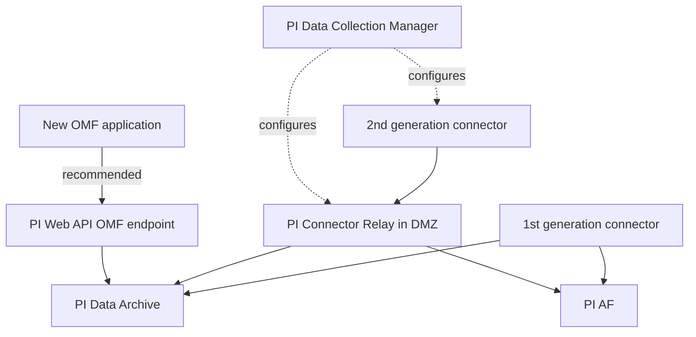

## Plain English

PI Connectors came in two generations:

- **1st generation**: the connector sends data straight to the PI Data Archive (creating points
  automatically) and sends the source's structure to AF.
- **2nd generation**: the connector sends to a **PI Connector Relay**, which forwards data to the
  PI Data Archive and AF. You configure the whole chain in **PI Data Collection Manager (DCM)**, a
  central web tool.

Think of the Relay as a post office between many connectors and the PI Server, and DCM as the
office manager that registers every connector, relay and destination.

> [!WARNING]
> There is currently no failover support for 2nd-generation PI Connectors or the PI Connector Relay.

## Deep Dive

**Why a relay?** OSIsoft's 2017 decks pitched the Relay as enabling "Secure & Flexible
Architectures": it can send data across networks to multiple destinations, and it uses certificates
for authentication and encryption. In IIoT designs the Relay sat in the DMZ between edge devices
and the enterprise PI Server. Traditional connections used X.509 certificates; remote devices or OMF
apps used SAS tokens.

**DCM.** Data Collection Manager offered a "Unified Admin Experience". Relay and DCM betas were
planned for the second half of 2017 with release in Q4 2017. AVEVA's 2023 roadmap still describes
connector administration as "Reliable configuration with ICU and DCM", and lists the Relay under
"Continued Support and Investment".

**Timestamps.** PI Connectors and the Relay send events with UTC timestamps.

**Security.** To run Connectors, the Relay or DCM under a gMSA, add the gMSA to the **PI Connector
Administrators** or **PI Trusted Installers** group.

**The Relay and OMF.** For a while the Relay was also an ingress point for OMF applications; a beta of
"PI Server ingress through PI Connector Relay" was targeted for Q4 2017. Apps were configured with a
**Producer Token** and a **Relay Ingress URL** taken from DCM. Since then:

- A third-party OMF client states that OSIsoft discontinued the Relay as an OMF endpoint and that
  PI Web API replaced it.
- AVEVA's own OMF samples list the Relay as "not tested" and recommend the PI Web API OMF endpoint
  for PI.

## Worked Example

A site runs a 2nd-generation connector on an edge server and a Relay in the DMZ.

1. In DCM, the admin registers the Relay and adds the PI Data Archive and AF server as destinations.
2. She registers the connector and points it at the Relay.
3. The connector sends data; the Relay forwards it to the Data Archive (points) and AF (structure).
4. The security team asks for redundancy. She explains that neither the connector nor the Relay has
   failover, so the design relies on fast restart and monitoring instead, or she plans another path
   (for example an AVEVA Adapter, where OPC UA and MQTT adapters support failover).
5. A developer asks for the OMF endpoint URL. She points him to PI Web API's OMF endpoint rather
   than the Relay.

## Diagram

## Common Mistakes

- **Assuming the Relay has failover.** It does not, and neither do 2nd-generation connectors.
- **Building new OMF apps against the Relay.** Use the PI Web API OMF endpoint.
- **Mixing timestamp expectations.** Connectors and the Relay send UTC; check time zones in the source, not the relay.
- **Forgetting group membership for a gMSA.** Without PI Connector Administrators or PI Trusted Installers membership, the service account cannot manage the connector.

## Real-World Scenario

OSIsoft's 2017 IIoT session showed a layered design: devices and small connectors at the edge, a PI
Connector Relay in the DMZ, and the enterprise PI Server behind it. Traditional connectors used X.509
certificates, while remote devices used SAS tokens. The same pattern lives on, but the ingestion
point for new OMF applications has moved to PI Web API, which is what AVEVA's current OMF samples
target.
