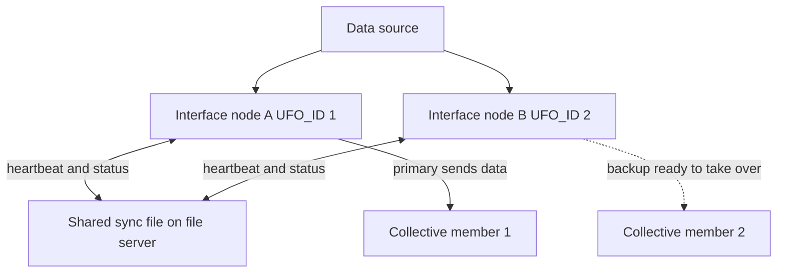

## Plain English

If the one computer running an interface fails, data stops. **Interface failover** runs two copies
of the same interface on two nodes. One is **primary** and sends data to PI. The other is
**backup** and is ready to take over. The two watch each other's heartbeat and status, and when the
primary fails, the backup becomes primary.

UniInt offers two ways to keep the pair in step:

- **Phase 1** synchronises *through the data source itself*. The source must talk to two
  interfaces at once, and the interface must support outputs (it writes control values to the DCS).
- **Phase 2** synchronises *through a shared file* on a network share. It supports three levels:
  **hot, warm and cold**.

AVEVA's architecture decks sum the levels up as: **Hot = no data loss, Warm = maybe data loss,
Cold = some data lost.**

## Deep Dive

**Phase 2 parameters.** Both nodes run the same interface with these extra switches:

| Parameter | Rule | Default |
|---|---|---|
| `/UFO_ID=#` | Required. Positive, non-zero, different on each node | Node 1 = 1, Node 2 = 2 |
| `/UFO_OtherID=#` | Required. Equals the partner's /UFO_ID | none |
| `/UFO_Sync=` | Required for Phase 2. Path (and optional file name) of the shared file | none |
| `/UFO_Type=` | Required. HOT, WARM or COLD | COLD |
| `/UFO_Interval=#` | Optional heartbeat interval in ms; must be identical on both nodes | 1000 (range 50 to 20000) |

**The shared file.** The `/UFO_Sync` path must end with `/` or `\`. Without the trailing slash the
last part of the path is taken as the file name. Quote paths that contain spaces. The default file
name is `executablename_pointsource_interfaceID.dat`. The first interface to start creates it, so
both service accounts need read, write and create rights on the share. OSIsoft recommends hosting
the file on a dedicated server with no other data-collection role.

**Host settings.** Without a collective, `/Host` must be the same on both nodes. With a collective,
point each node at a different member.

**Control points.** The shared file holds:

- **ActiveID**: which failover ID is primary. Changing it by hand (for example 1 to 2) forces a failover.
- **Heartbeat 1 and 2**: values 0 to 31.
- **Device Status 1 and 2**: 0 is good, 99 is off. The node with the lower value tries to be primary.

You can expose these as PI tags with case-sensitive ExDesc prefixes `[UFO2_ACTIVEID]`,
`[UFO2_HEARTBEAT:#]` and `[UFO2_STATE:#]`, where # is the owning node's failover ID.

**UFO_State values:** 0 Off, 1 Backup No Data Source, 2 Backup No PI Connection, 3 Backup,
4 Transition (a brief state that prevents "thrashing"), 5 Primary.

**Other rules.** `/stopstat` is disabled in a failover pair so both nodes do not write shutdown
digital states. If an interface does not support the requested failover type, it shuts down and
logs an error to pipc.log.

**Product support.** PI Interface for OPC DA supports Phase 1 from 2.3.2.0 and Phase 2 from
2.3.10.0 (Microsoft Cluster failover is "not recommended"). PI to PI supports Phase 2 hot, warm or
cold. PI Connectors behave differently: there is currently no failover for 2nd-generation PI
Connectors or the PI Connector Relay. AVEVA Adapter failover is available with the OPC UA and MQTT
adapters.

## Worked Example

Two nodes run the PI Interface for OPC DA against a PI collective with members PIDA1 and PIDA2.
The share is `\\fileserver\UFO\` (an illustrative name).

- Node A: `/UFO_ID=1 /UFO_OtherID=2 /UFO_Type=HOT /UFO_Sync=\\fileserver\UFO\ /UFO_Interval=1000 /Host=PIDA1`
- Node B: `/UFO_ID=2 /UFO_OtherID=1 /UFO_Type=HOT /UFO_Sync=\\fileserver\UFO\ /UFO_Interval=1000 /Host=PIDA2`

Check the pairing rules: the IDs differ and each points at the other; the interval matches; the
sync path ends with a backslash; each node targets a different collective member.

To test, an admin sets ActiveID from 1 to 2. Node B's UFO_State moves through 4 (Transition) to
5 (Primary) and Node A drops to 3 (Backup).

## Diagram

## Common Mistakes

- **No trailing slash on `/UFO_Sync`,** so the folder name becomes the file name.
- **Different `/UFO_Interval` values** on the two nodes.
- **Service accounts without rights** on the shared folder.
- **Assuming connectors fail over like interfaces.** There is no failover for 2nd-generation PI Connectors or the Relay.
- **Copying the sync file when moving it.** Not needed: an interface that cannot find the file creates a new one, and PI to PI history recovery covers any gap.
- **Expecting warm or cold to be lossless.** Only Phase 2 hot gives no data loss for a single point of failure.

## Real-World Scenario

A PI Square discussion about moving PI to PI failover files to a new server concluded that there
is no need to copy the old file: the interface creates a new one, and PI to PI history recovery
fills any gap. AVEVA's feedback portal also records a case where batch interfaces running in
failover could over-recover history from a stale STARTUP.dat file; AVEVA planned a fix in the
batch framework for a January 2025 release. Both show that failover is about the whole data path,
not just two services.
