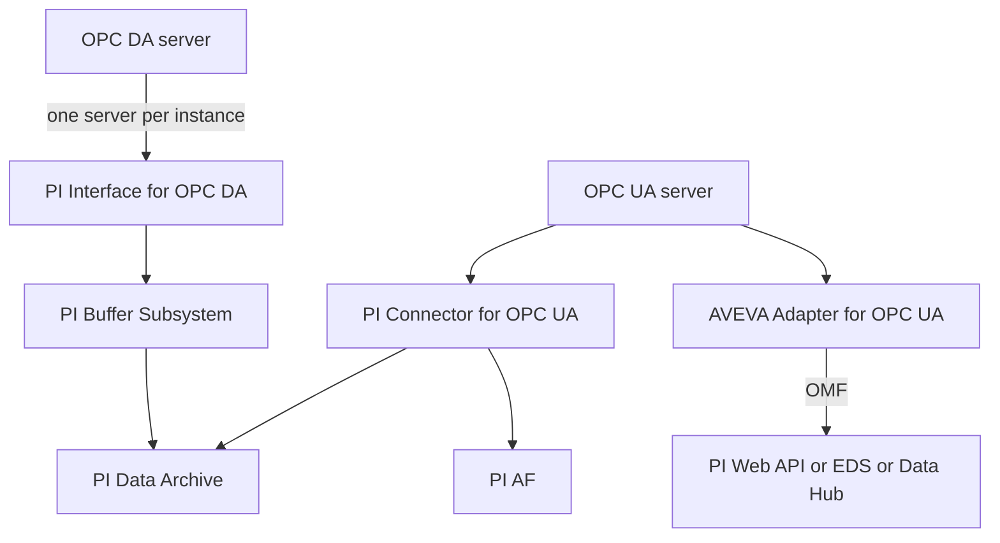

## Plain English

**OPC** is the industry standard way for software to read data from control systems. The older
standard is **OPC DA** (Data Access); the newer one is **OPC UA** (Unified Architecture). The PI
System has three main ways to collect OPC data:

| Product | Generation | Talks to |
|---|---|---|
| PI Interface for OPC DA | UniInt interface | One OPC DA server per instance |
| PI Connector for OPC UA | PI Connector | OPC UA servers; can auto-create PI points and AF elements |
| AVEVA Adapter for OPC UA | AVEVA Adapter | OPC UA servers; sends to OMF endpoints such as PI Web API, Edge Data Store or Data Hub |

All three were installed side by side in AVEVA's architecture course lab. AVEVA's 2023 roadmap
lists the OPC UA connector under "Continued Support and Investment", and the OPC UA adapter is one of
the adapters that supports failover.

## Deep Dive

**PI Interface for OPC DA.** It transfers data between OPC servers and the PI System. Each instance
connects to a single OPC server. It can run on the PI home node or a separate interface node; an
interface node is preferred because it supports buffering. It is certified by the OPC Foundation
and supports UniInt Phase 1 failover (from 2.3.2.0), Phase 2 (from 2.3.10.0) and server-level
failover.

**OPC-specific startup parameters:**

- `/SERVER=<node>::<name>`: the machine and OPC server name.
- `/OPCSTOPSTAT=IntfShut`: write a value to points on shutdown. The UniInt "Write Status to Tags on
  Shutdown" setting is ignored for OPC DA; set it in the OPCInt plug-in instead.
- `/TS`: the timestamp source.

**OPC DA point attributes:**

| Attribute | Meaning |
|---|---|
| PointSource | Typically `O`, matching /PS |
| Location1 | Interface ID (must match /ID) |
| Location2 | Special handling of data types (usually 0) |
| Location3 | 0 polled or event, 1 advise, 2 output, 3 and 4 watchdog points for failover |
| Location4 | Scan class |
| Location5 | Optional advise deadband |
| InstrumentTag | The OPC ItemID, for example `CIU-A.Import.AIL_point.OUT` |

If advise points are in the first scan class, the interface creates OPC groups automatically.

**Tools installed or used with OPC DA:**

- **PI ICU** with the OPCInt plug-in for parameters.
- **PIOPCTool**, installed with the interface, to install and check the OPC connection.
- **PI_OPCClient**, a test OPC client.
- **OPC Tag Configurator**, which creates PI points from OPC server tags.
- **PI OPC DA Interface APS Connector**, for PI AutoPointSync.

**PI Connector for OPC UA.** The 2016 connector could auto-discover endpoints and auto-create PI
points and AF elements. Version 1.3.x.x was certified by the OPC Foundation, added "Tag Only" mode
and engineering units, and improved disconnect handling.

**AVEVA Adapter for OPC UA.** A lightweight adapter that collects data and metadata and sends it by
OMF to PI Web API, Edge Data Store or AVEVA Data Hub. See the adapters lesson for configuration.

## Worked Example

An engineer adds a flow reading from an OPC DA server on node `OPCSRV1`:

1. The instance runs with `/PS=O /ID=1 /SERVER=OPCSRV1::<progid>` and two scan classes.
2. She uses PIOPCTool to browse the server and confirm the ItemID `CIU-A.Import.AIL_point.OUT`.
3. She creates the point with PointSource `O`, Location1 `1`, Location3 `1` (advise), Location4
   for its scan class, and InstrumentTag set to the ItemID.
4. Because this is an advise point, she keeps it out of the scan class used by polled points.
5. For a large batch of points she uses the OPC Tag Configurator instead of building each by hand.

## Diagram

## Common Mistakes

- **Expecting one OPC DA instance to read several OPC servers.** Each instance reads from one server; add instances for more servers.
- **Polled and advise points in the same scan class.**
- **Setting shutdown status in the UniInt tab.** For OPC DA, it is ignored; use /OPCSTOPSTAT in the OPCInt plug-in.
- **Running the interface on the PI home node** when an interface node with buffering is available.
- **Using Microsoft Cluster for failover.** It is "not recommended"; use UniInt failover instead.

## Real-World Scenario

AVEVA's architecture course builds a realistic layout. Machine one runs the PI Interface for OPC DA,
the PI Connector for OPC UA and the AVEVA Adapter for OPC UA. Machine two runs a failover partner
for the OPC DA interface, plus the PI Connector Relay and PI Data Collection Manager. Students see
that the older OPC DA path needs UniInt failover and buffering on each node, while the OPC UA
connector path runs through the Relay, which has no failover. That trade-off is a common design
discussion when sites move from OPC DA to OPC UA.
