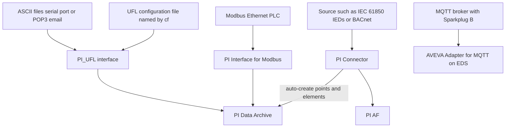

## Plain English

Not every data source speaks OPC. The PI System has three families of collectors:

- **PI Interfaces**, the long-standing UniInt programs (Modbus, UFL, RDBMS, PI to PI and hundreds more).
- **PI Connectors**, a newer family that also builds the asset structure for you.
- **AVEVA Adapters**, lightweight collectors that send OMF to modern endpoints.

Some sources have **exclusive** interface connectivity to the PI Data Archive: AVEVA's 2023 roadmap
names OPC DA, OPC HDA, UFL, RDBMS and PI-To-PI. Others, such as MQTT, are newer and served by
adapters.

## Deep Dive

**PI Interface for Modbus Ethernet PLC.** Manual 4.0.7.x describes it as "designed to read data from
a PLC on a periodic or event basis", with outputs sent on an event basis. It supports Phase 2
failover, and Location1 must match `/id`. (Its other location codes are interface-specific; check
the manual.)

**PI_UFL, the Universal File and Stream Loader.** It "reads data from various ASCII stream data
sources" and replaces the old PI Batch File interface. Its data-source plug-ins are:

- ASCII files (`asciifiles.dll`)
- serial port (RS-232)
- POP3 e-mail

UFL is driven by a **configuration (INI) file** named by the mandatory `/cf=full_path` parameter.
The file has sections `[INTERFACE]`, `[PLUG-IN]`, `[SETTING]`, `[FIELD]` and `[MSG]`. The
`[INTERFACE]`, `[PLUG-IN]` and `[SETTING]` sections must not come after `[FIELD]`.

UFL point attributes: Location4 is the scan class, Location5 says whether exception reporting is
used, InstrumentTag is the tag-name alias and Convers is a multiplier.

**PI Connector for UFL.** It reads files and REST input, supports secure REST endpoints and
user-defined templates and event frames. Version 1.2 (2017) added native JSON parsing, a ForEach
construct and multi-parameter REST client calls.

**What connectors do.** PI Connectors can auto-discover the data source, build a reference model,
auto-create AF elements and linked PI points, store events in event frames, and update when the
source changes. Points they create use the Base point class.

**The connector catalogue.** In 2017, available PI Connectors included BACnet, CygNet (upstream oil
and gas), DC Systems RTscada, EtherNet/IP, HART-IP, IEC 60870-5-104, IPMI, NOV WITSML, OPC UA, Ping,
PI System Health, Siemens SIMATIC PCS 7, UFL and Wonderware Historian. IEC 61850, for substation
IEDs (and IEC 61400-25 for wind), was in development, as were MQTT Sparkplug and MTConnect.

**Adapters and MQTT.** AVEVA Adapters in 2023 cover Azure Event Hubs, BACnet, DNP3, Modbus TCP, MQTT,
OPC UA, RDBMS and Structured Data Files. The AVEVA Adapter for MQTT consumes **Sparkplug B** payloads
(component type `MQTTSparkplugB`) and runs with Edge Data Store on Linux.

## Worked Example

A lab drops CSV-like result files into a folder. The admin sets up PI_UFL:

```
PLUG-IN = asciifiles.dll
IFM = "C:\PIPC\Interfaces\PI_UFL\Data\*.txt"
MSGINERROR = c:\pipc\interfaces\PI_UFL\logs\errors.out
OUTPUT = c:\pipc\interfaces\ufl\logs\pi_ufl.out
LOCALE = de-de
```

1. `PLUG-IN` picks the ASCII-file plug-in and `IFM` is the input file mask.
2. Lines that cannot be parsed go to `MSGINERROR`; the interface log goes to `OUTPUT`.
3. `LOCALE = de-de` tells UFL to parse German number and date formats.
4. The `[FIELD]` and `[MSG]` sections, placed after the settings, describe how to split each line
   into a tag, a timestamp and a value.
5. The interface is started with `/cf=` pointing at this file.

## Diagram



## Common Mistakes

- **Putting `[SETTING]` after `[FIELD]` in a UFL file.** The manual warns against it explicitly.
- **Guessing location codes.** They differ per interface; Modbus and RDBMS codes must come from their manuals.
- **Choosing a connector for a source with interface-only connectivity** (OPC HDA, UFL, RDBMS, PI to PI) to the Data Archive.
- **Forgetting that connectors build structure.** Connector points use the Base point class and AF elements appear automatically; plan your AF hierarchy before switching it on.

## Real-World Scenario

The Dutch grid operator Stedin presented its IEC 61850 deployment at the 2017 user conference. The
PI Connector for IEC 61850 collected both asset information and real-time measurements from the
substation station bus, allowed "flexible adding/removal of IEDs and reports", and was architected
with a PI data relay. At the far edge, OSIsoft also showed a Modbus PI Connector running on a Cisco
829 industrial router, collecting data right where it was produced.
