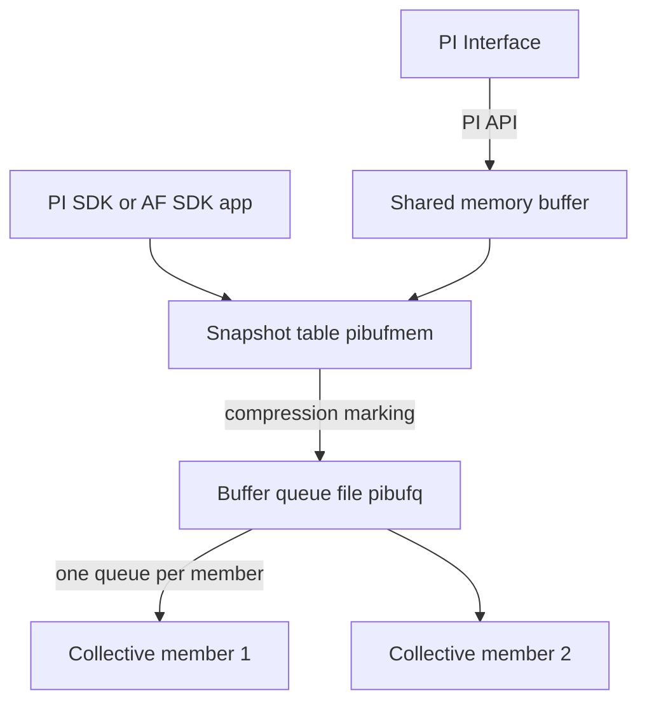

## Plain English

Networks fail and servers get patched. If an interface sent data straight to the PI Data Archive,
every outage would leave a gap. **Buffering** fixes this: data is first written to a queue on the
collection node, and the queue is emptied to the server whenever it can be reached. The training
material calls the queue file "the tank".

OSIsoft offers two buffering programs:

- **PI Buffer Subsystem (PIBufss)**, installed with every PI Interface and running as a Windows
  service. It can buffer data from any application writing to a Data Archive, OSIsoft or custom.
- **API Buffer Server (bufserv)**, an older service that only buffers PI API data but runs on
  non-Windows platforms.

Use PIBufss unless you have a specific reason not to.

## Deep Dive

**What makes PIBufss different.** PIBufss buffers data from both PI API interfaces and PI SDK / AF
SDK applications. It was introduced with PI Server Platform Release 1 (3.4.375.x) mainly to improve
high availability. It also runs **compression** on the collection node before sending, which
reduces load on the PI Server. Events are marked "Snapshot Only" or "To Be Archived".

**The data path inside the buffer:**

1. shared memory buffer
2. snapshot table
3. compression marking ("Snapshot Only" or "To Be Archived")
4. memory-mapped buffer queue file
5. PI Data Archive

PI SDK and AF SDK applications write directly into the snapshot table and skip the shared-memory step.

**The files:**

| File | Holds |
|---|---|
| `APIBUF_<Data Archive name>.dat` | Overflow when the shared-memory buffer is full |
| `pibufmem_<GUID>.dat` | The snapshot table: latest value of every buffered point |
| `pibufq_<GUID>.dat` | The buffer queue ("tank"); 32 MB by default, with more files added as each fills until the disk is full |

AVEVA strongly recommends putting the queue on a drive separate from the OS (the course uses
`E:\OSIsoft\Buffering`).

**Start order and set-up.** PIBufss must start before every interface on the machine. When PI ICU
asks, answer yes and it adds PIBufss to the interface's service dependencies. Buffering is enabled
per interface on the ICU General tab. From PIBufss 4.3 the **Buffering Manager** GUI is in PI ICU
under Tools > Buffering; a healthy system shows "total events sent" increasing.

**Commands:**

| Command | Shows or does |
|---|---|
| `pibufss -cfg` | Overall buffering status |
| `pibufss -qs` | Buffer queue statistics (Ctrl+C to stop); a healthy queue has reads and writes |
| `pibufss -bc stop` / `pibufss -bc start` | Stop and restart sending, for example to simulate an outage |

**n-way buffering.** With a PI collective, PIBufss keeps a **separate queue for each member**. If one
member is down, data keeps flowing to the others while that member's queue grows. `pibufss -qs` asks
which member's queue to show.

**Accounts.** The default service account is LocalSystem in the 2017 R2 workbook and
`NT Service\pibufss` in the newer one. Create a dedicated PI Identity, "PI Buffer", mapped to the
buffering service account. The Buffering Manager accepts a gMSA from PIBufss 4.9.0.37; older versions
need the gMSA added to the PI Buffering Administrators group.

**bufserv.** Use the API Buffer Server only if the receiving PI Server is older than 3.4.375, or the
interface runs on a non-Windows platform. Its command-line utility is `pibufutil`.

## Worked Example

The administration course runs this lab to prove buffering works:

1. Run `pibufss -cfg`. The state should be connected and events should be being sent.
2. Run `pibufss -bc stop`. This simulates a network outage: PIBufss stops sending.
3. Run `pibufss -qs` and watch the writes to the queue file grow while reads stay flat.
4. Run `pibufss -bc start`. Sending resumes and the queue drains to the Data Archive.
5. Open a trend of a buffered point: there is no gap for the "outage".

## Diagram

## Common Mistakes

- **The interface does not depend on PIBufss,** so it starts first and sends directly to the Data Archive, bypassing the buffer.
- **The queue on the OS drive,** where a long outage can fill the system disk.
- **Different host formats.** Using a hostname in the interface's `/host` but an IP address in the buffering configuration.
- **Using bufserv against a modern server** when PIBufss is available.
- **Forgetting other writers.** Best practice is to buffer PI ACE and PI Notifications too, not just interfaces.

## Real-World Scenario

PI Square lists "BufServ not buffering" and "Error 11403 when starting PIbufss" among common
buffering problems. An illustrative case: after a firewall change, a site sees `pibufss -qs` showing
writes but no reads, and the queue files growing. Because the queue was on a separate data drive
sized for days of data, nothing was lost. When the firewall rule was fixed, the queue drained and
the trends filled in. In a collective, only the unreachable member's queue would grow while the
other members stayed current.
