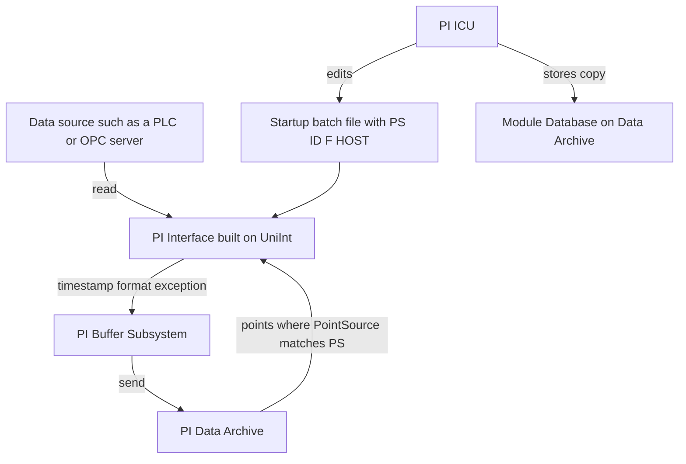

## Plain English

A **PI Interface** is a small program that sits between a data source (a control system, PLC or
OPC server) and the PI Data Archive. It reads values, stamps them with a time (or checks the
time the source gave), formats them, and sends them to PI. AVEVA states there are over 450 PI
interfaces.

Collection always follows the same five steps: **read, timestamp, format, apply exception, send.**

Most interfaces share a common core called **UniInt**, short for *Universal Interface*. UniInt was
first developed in 1992. It is reusable code that handles the parts every interface needs: a
consistent install, similar parameters, orderly start and stop, messaging, bad-data and
comms-failure indication, automatic pickup of PI point changes, and failover.

Each interface instance is just three things:

1. the interface **executable**,
2. a **startup batch file** (`.bat`) that holds its parameters, and
3. a **Windows service** that runs that instance.

Two data sources means two batch files and two services.

## Deep Dive

**Startup parameters.** The batch file is named after the service with `.bat` added. The most
common parameters are:

| Parameter | Meaning |
|---|---|
| `/PS` | Point source: which interface owns a point |
| `/ID` | Interface ID: which instance (an integer) |
| `/F` | Scan class: how often to read (at least one is required) |
| `/HOST` | The name of the PI server |

**How points find their interface.** Each PI point carries attributes that must match the
instance:

- **PointSource** must match `/PS`.
- **Location1** is typically the instance number (`/ID`).
- **Location4** is typically the scan class number (which `/f` the point uses).
- **Scan** must be ON for interface points.

Location meanings differ between interfaces, so always consult the interface manual.

**Scan classes.** `/f=00:01:00,00:00:05` (one minute, five-second offset) is the same as
`/f=60,5`. With an offset, scans run at reference time + n x frequency + offset. Adding `,L`
selects wall-clock scheduling, so `/f=24:00:00,00:08:00,L` stays at 08:00 local time across
daylight-saving changes.

**Read methods.** *Polled* points are read as a group per scan class. *Advise* points listen for
new events. *Output* points read a separate PI point and write its value to the source. Do not
mix advise and polled points in the same scan class. Interfaces that can write come in Read Write
and Read Only editions; Read Only disables writes for security.

**PI ICU.** The PI Interface Configuration Utility is a GUI for editing the batch file. It reads
the Module Database (MDB) on the Data Archive and writes to both the batch file and the MDB, which
allows recovery. It only configures interfaces on the same computer. Each save comments out the
old command line and writes the new one below it. ICU also groups log management, buffering,
IORATES and performance points, service options and runtime options.

**Time and security.** Interfaces send UTC timestamps. An interface whose clock is more than 30
minutes off the server will not run, and real-time values more than 10 minutes in the future are
discarded. Interfaces use the older PI API and connect with PI Trust or Windows Integrated
Security (through the PI API for WIS). Trusts should follow a "2+" convention (IP address plus
executable name) and should not map to piadmin.

**Health and logs.** Interfaces on UniInt 4.5.0.x or later write to the PI Message Log (read it
continuously with `pigetmsg -f`); those earlier than 2.5.0.x write to `PIPC\dat\pipc.log`. Create
UniInt health points in ICU (UniInt > Health Points): Heartbeat, Device Status, IO Rate and Scan
Class Scans Skipped. If a heartbeat stops updating, the interface has stopped collecting.

**Disconnected startup** lets an interface start from a local copy of its point list when the
Data Archive is unreachable, and is recommended for production. The first start must connect to
build the cache files, and outputs are not supported while disconnected.

## Worked Example

An engineer installs a second OPC DA instance. ICU writes a batch file containing switches such as
`/PS=O /ID=2 /f=00:00:01 /f=00:01:00`.

1. Points for this instance get PointSource `O` and Location1 `2`.
2. Fast flow points get the Location4 scan class number of the one-second `/f`; slow tank levels get
   the number of the one-minute `/f`.
3. She starts the interface interactively from ICU (Ctrl+T) to test, then starts the Windows
   service, because the service account may lack permissions the interactive account has.
4. She creates the Heartbeat and IO Rate health points and watches them update.
5. A colleague later edits the `.bat` in Notepad. Next time ICU opens, it reports a mismatch with
   the MDB and asks which version to keep.

## Diagram

## Common Mistakes

- **Mixing advise and polled points in one scan class.** Keep them in separate `/f` groups.
- **Testing only with an interactive start.** Always test the service start too.
- **Hand-editing the batch file** and then being surprised by ICU's out-of-sync prompt.
- **Clock skew.** More than 30 minutes stops the interface; future timestamps over 10 minutes are discarded.
- **Interface starting before the buffer.** Make the service depend on PI Buffer Subsystem, or data may bypass the buffer.
- **Different host formats.** Use the same hostname (or IP) in the interface and in the buffering configuration.
- **Using PI ICU to create a gMSA service.** ICU cannot. Create the service under the default NT Service account, then switch to the gMSA in Services Manager.

## Real-World Scenario

In AVEVA's PI System administration course, students are told that a health point that stops
updating means "the interface has stopped collecting data". A typical night-shift call is that a
trend has gone flat. The admin checks the Heartbeat health point first: if it is frozen, the
interface or its service is down; if it is moving but IO Rate is zero, the interface is running
but the source is not delivering. The PI Interface Status Utility (PI ISU) can alert on stale data
so the problem is found before users notice.
