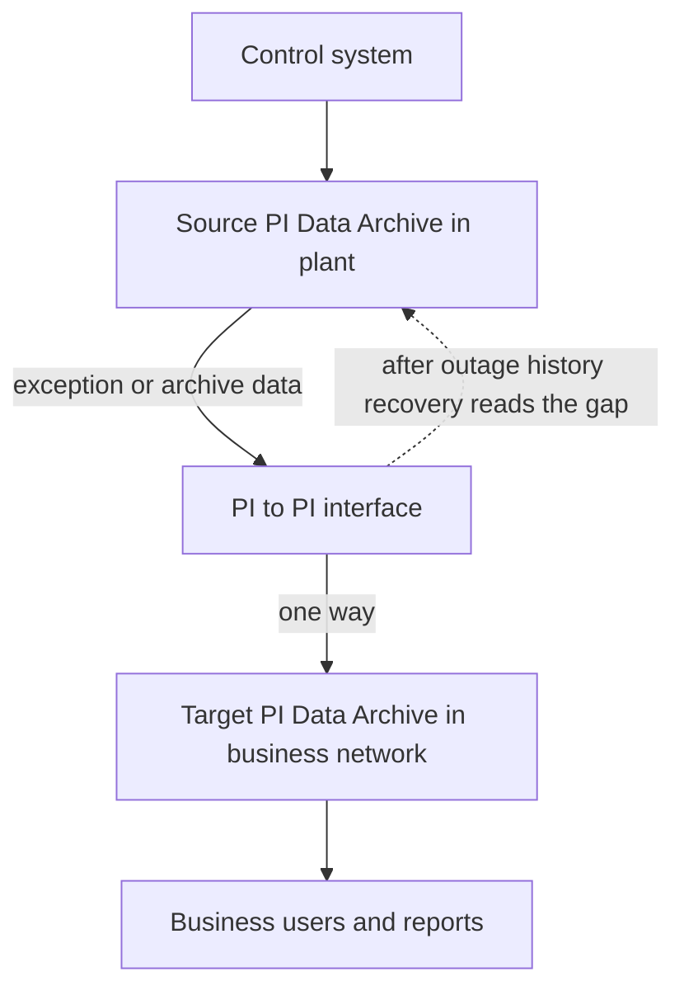

## Plain English

**PI to PI** is an interface that "copies PI point data from one PI Data Archive to another". It
works **one way**: from a *source* server to a *target* server. Its source is just another PI
server, read the way any client would read it.

Common reasons to use it:

- **Plant to corporate.** Each plant has its own Data Archive; PI to PI feeds a corporate one.
- **Security and load.** Users query the copy, not the server next to the control system.
- **Backups, test copies and aggregation.**

AVEVA's NERC CIP reference diagrams, for example, show a business-domain PI Server fed by PI to PI
from a PI Server in the protected domain.

## Deep Dive

**Two kinds of source data.** PI to PI can read:

- **Exception data**: values that have only passed exception testing on the source. Reading it is
  faster (it comes from memory), but it is not compressed.
- **Archive data**: values that have also been through compression and been stored.

**History recovery.** When PI to PI starts, and again after a lost connection is restored, it
"recover[s] archive data for time periods when the interface was not running". It reads the source
archive for the outage window and writes it to the target. This is why PI to PI can survive outages
without a permanent gap.

**Point attributes** (from the manual's table of contents):

| Attribute | Purpose |
|---|---|
| Location1 | Interface instance |
| Location2 | Timestamp adjustment |
| Location3 | Interface status events |
| Location4 | Scan class |
| Location5 | Write mode |
| InstrumentTag | Source point name |
| UserInt1 | Source point ID |

**Failover.** PI to PI supports source Data Archive-level failover and UniInt Phase 2
interface-level failover (cold, warm or hot).

**Placement.** It can run on a separate node from both the source and the target.

**Limits.** PI to PI "is not a true data replication tool". It does not copy annotations or batch
data. If you need every server to hold identical data, use a PI collective instead.

**Future direction.** AVEVA's 2023 roadmap puts Batch, PItoPI, OPC DA and OPC A&E interfaces on a
"PI System Connector" migration path. The PI System Connector (2016) already supported secure
cross-domain transfer, archive replication and backfilling.

> [!VERIFY]
> The exact PI to PI startup switches for the source host and history-recovery window were not
> readable in the research sources. Check the PI to PI interface manual before configuring them.

## Worked Example

A refinery copies 2,000 tags from its plant Data Archive (`PLANT01`) to the corporate server
(`CORP01`).

1. PI to PI runs on a node in the business network. It reads from PLANT01 and writes to CORP01.
2. Each target point has InstrumentTag set to the source point's name (UserInt1 can hold the source
   point ID).
3. Location4 picks the scan class; Location1 matches the instance.
4. A firewall change cuts the link for three hours. When the link returns, history recovery reads
   archive data for those three hours from PLANT01 and fills the gap on CORP01.
5. Operators add annotations on PLANT01 trends. They do not appear on CORP01, because PI to PI does
   not copy annotations.

## Diagram

## Common Mistakes

- **Calling PI to PI replication.** It is one-way copying, and annotations and batch data are not copied.
- **Expecting two-way sync.** Writes to the target never flow back to the source.
- **Forgetting that exception data is uncompressed.** It is faster to read but can store more events on the target.
- **Panicking after an outage.** History recovery fills the gap when the connection is restored; check it ran before backfilling by hand.

## Real-World Scenario

A PI Square discussion about moving PI to PI failover files to a new file server concluded that the
old sync file does not need to be copied: an interface that cannot find it creates a new one, and
PI to PI's history recovery covers any gap created during the move. The same feature is what lets
plant-to-corporate copies survive network maintenance windows without manual backfills.
