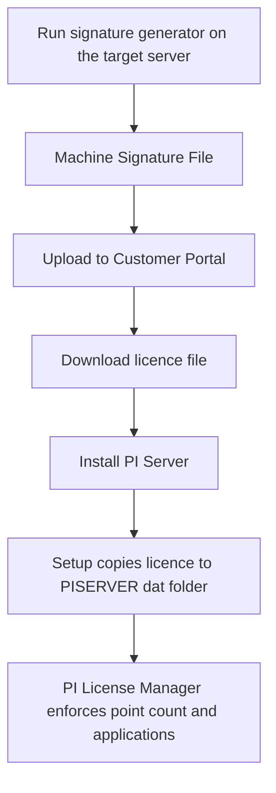

## Plain English

A PI Data Archive will not run without a **licence file**. You create that file *before* you install,
in AVEVA's Customer Portal, using a **Machine Signature File** made on the server itself. The licence
is tied to that machine.

The licence says which applications may connect and sets limits such as the **point count**. The
**PI License Manager** subsystem keeps track of it while the server runs.

How you pay has changed. Traditional PI licensing was tag-based. AVEVA now sells the PI System mainly
by **subscription**, through **AVEVA Flex**: you buy **Flex credits** and spend them on the products
you use, on premises or in the cloud.

## Deep Dive

**Licence steps (architecture course).**

1. Run the install kit's machine-signature generator on the target server or VM.
2. Upload the Machine Signature File to the Customer Portal.
3. Download the licence file.
4. Install the PI Server. Setup copies the licence to `%PISERVER%\dat`.

A signature generated on another machine will not work.

**AVEVA Flex.** Flex is a subscription program that gives "flexible access to any amount and any mix
of AVEVA software". You subscribe, buy Flex credits for an AVEVA Connect account, and consume software
against "AVEVA Flex Product Rate Plans". Credits burn down at daily, monthly or annual rates, measured
by metrics such as monthly active users, daily active users, concurrent users, terabytes, data streams
and diagrams. An AVEVA World 2023 deck said "AVEVA PI Server 2023 requires you to be on AVEVA Flex".
In October 2022 AVEVA offered a trade-in credit for PI customers moving from a perpetual licence to a
subscription. Edge Data Store and AVEVA Data Hub are also sold through Flex.

**The PI System Software Schedule (v1.5, June 2026).**

| Rule | What it says |
|---|---|
| Data collection | Licensed by node and data streams; tags count as data streams; streams are not transferable between products |
| Aggregate Tag tiers | A committed minimum tag tier spread across all PI Servers; overage paid daily; no reductions during the term |
| Capacity (Non-Reporting) tiers | Aggregate tag count must not exceed the tier; only fixed-capacity PI Server tag licences |
| PI Test Server | Matches production tag count up to one million tags; 90-day data retrieval limit; not for production |
| HA PI Servers | Form a collective with the primary and cannot be split into independent servers |
| PI to PI | Each connection is one-way, so two licences for two-way transfer |
| Named user | One person and their login; reassign no sooner than 90 days after the last reassignment |
| Backup copies | Not for testing, training, hot standby or caching |

In the Aggregate Tag model, each PI Server needs the **PI to CONNECT Agent** installed and configured,
because it reports tag usage.

## Worked Example

A new production Data Archive, PISRV01, is being built:

1. The admin logs on to PISRV01 itself and runs the signature generator from the install kit. Running
   it on a laptop would produce an unusable licence.
2. The file goes to the Customer Portal and a licence file comes back.
3. Setup copies it to `%PISERVER%\dat`.

The site also wants a test server and two-way PI to PI with head office. Per the schedule, the test
server has a 90-day data retrieval limit and may hold up to the production tag count (to one million
tags). Two-way PI to PI needs two licences.

> [!VERIFY]
> A third-party reseller (Flow Software, 2025) estimates about 20 Flex credits per day for a PI Server
> and 1 per day for a PI Vision user, and reports that the City of Lakeland bought a 3-year Flex
> subscription worth USD 325,710. These are not official AVEVA figures.

## Diagram

## Common Mistakes

- **Generating the machine signature on another computer.** The licence is bound to the machine that
  produced the file.
- **Installing first, licensing later.** The licence file must exist before the Data Archive is
  installed.
- **Using a backup copy as a hot standby.** The schedule forbids it; HA needs licensed collective
  members.
- **Assuming PI to PI is two-way on one licence.** Each connection is one-way.

## Real-World Scenario

A utility moving from perpetual licences to Flex can use AVEVA's 2022 trade-in credit to offset future
charges. If it chooses the Aggregate Tag model, it commits to a tag tier shared across all its PI
Servers, installs the PI to CONNECT Agent on each to report usage, and plans for overage at the daily
rate rather than reductions mid-term.
