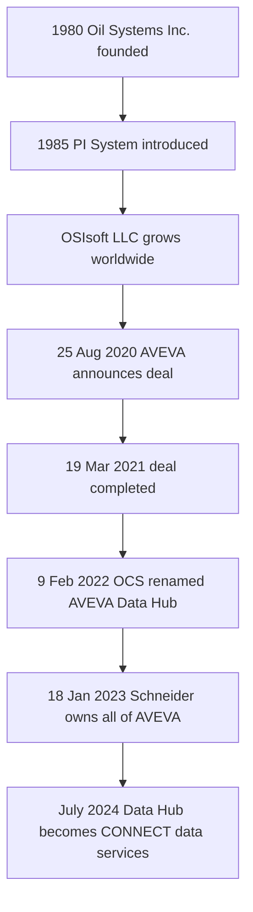

## Plain English

The PI System was made by a company called **OSIsoft**. Dr. J. Patrick (Pat) Kennedy founded it in
1980 as **Oil Systems Inc.** It was later renamed OSIsoft LLC and was based in San Leandro,
California. The PI System itself appeared in 1985 and became the most widely used historian in the
process industries.

In 2020 the software company **AVEVA** agreed to buy OSIsoft. The deal closed in March 2021. Since
then the products carry AVEVA names, such as **AVEVA PI Server** and **AVEVA PI Vision**. In January
2023 AVEVA itself became fully owned by **Schneider Electric**.

So when you read "OSIsoft PI", "AVEVA PI" or "PI System", people mean the same product family.

## Deep Dive

**The founder.** Before OSIsoft, Kennedy was a research engineer at Shell Development Company and an
applications consultant at Taylor Instrument Company. He holds a B.S. and a Ph.D. in Chemical
Engineering from the University of Kansas.

**Growth.** In January 2011 Technology Crossover Ventures and Kleiner Perkins Caufield & Byers made a
USD 135 million minority investment. By 2016 OSIsoft had more than 1,300 employees.

**The AVEVA deal.**

| Item | Detail |
|---|---|
| Announced | 25 August 2020 |
| Headline value | USD 5 billion (USD 4.4 billion cash plus USD 0.6 billion in AVEVA shares) |
| OSIsoft revenue, 12 months to 30 June 2020 | USD 488.5 million |
| Completed | 19 March 2021, final consideration GBP 3,831.4 million |
| Kennedy's new role | Chairman Emeritus |

At announcement the PI System ran at about 14,000 sites in 127 countries.

**Who owns whom.** Schneider Electric merged most of its industrial software into AVEVA in 2018 and
held about 60% of AVEVA when AVEVA bought OSIsoft. On 18 January 2023 AVEVA announced that it was now
wholly owned by Schneider Electric.

**Product renames.**

| Old name | Newer name |
|---|---|
| PI Coresight | PI Vision |
| OSIsoft Cloud Services (OCS) | AVEVA Data Hub (from 9 Feb 2022) |
| AVEVA Data Hub | CONNECT data services (announced July 2024) |
| PI Server, PI Vision, PI DataLink | AVEVA PI Server, AVEVA PI Vision, AVEVA PI DataLink |

Older OSIsoft product names you may still meet include PI ProcessBook, PI WebParts and PI Cloud
Connect.

## Worked Example

A colleague hands you an old design document that mentions "OSIsoft Cloud Services" and "PI
Coresight". You can translate it:

1. OSIsoft Cloud Services became AVEVA Data Hub on 9 February 2022.
2. AVEVA Data Hub is becoming CONNECT data services (AVEVA blog, July 2024).
3. PI Coresight is the predecessor of PI Vision.

A short timeline helps keep the order straight: 1980 founding, 1985 PI System, 25 Aug 2020 deal
announced, 19 Mar 2021 deal completed, 19 Oct 2021 AVEVA Data Hub announced, 9 Feb 2022 OCS renamed,
18 Jan 2023 Schneider owns 100% of AVEVA, July 2024 CONNECT data services.

## Diagram

## Common Mistakes

- **"Schneider Electric bought OSIsoft."** AVEVA bought OSIsoft while Schneider was AVEVA's majority
  shareholder. Schneider bought the rest of AVEVA later, in January 2023.
- **Quoting USD 5 billion as the final price.** That was the headline value at announcement. The
  final consideration reported at completion was GBP 3,831.4 million.
- **Thinking OCS, AVEVA Data Hub and CONNECT data services are three products.** They are successive
  names for the same cloud service line.

## Real-World Scenario

You are writing a migration plan for a site that still runs PI ProcessBook displays and talks about
"OCS". Using current names (AVEVA PI Vision, CONNECT data services) in the plan avoids confusion with
AVEVA's current documentation, while a short "formerly known as" note keeps long-serving engineers on
board.

> [!VERIFY]
> AVEVA's 2024 blog says AVEVA Data Hub "is becoming" CONNECT data services. Check current AVEVA
> material for whether the rename is complete.
