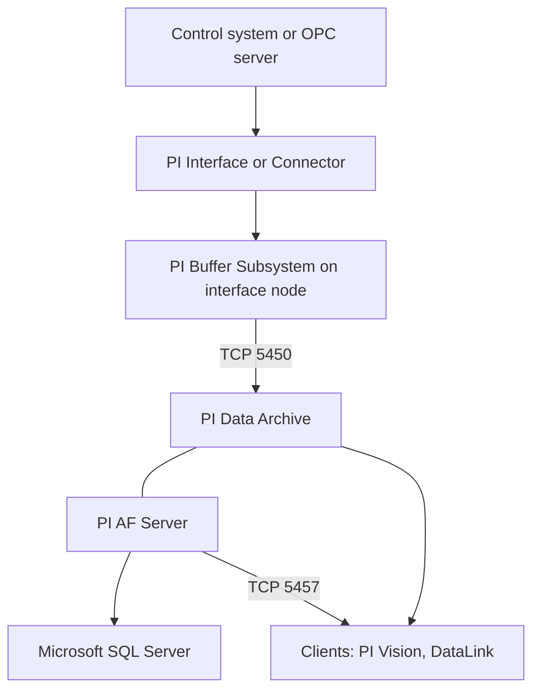

## Plain English

A minimal PI System has three parts:

1. A **collector** (a PI Interface or PI Connector) that reads data from the control system.
2. A **PI Server**, which is the **PI Data Archive** (time series) plus **PI Asset Framework (AF)**
   (asset context).
3. A **visualisation tool**, such as PI Vision.

On each interface computer a Windows service called the **PI Buffer Subsystem** (pibufss) sits
between the interface and the server. If the network or the server goes down, it holds the data like
a reservoir and sends it on later.

## Deep Dive

**PI AF and SQL Server.** PI AF stores its database in Microsoft SQL Server, which must exist when AF
is installed. SQL Server Express is fine for small to medium systems, but on the same node it is
limited to one physical CPU and 1 GB of RAM. AVEVA recommends SQL Server on a separate computer from
the PI Server, and AF on a separate computer from the Data Archive when AF serves several PI Servers
or uses high availability. Since the PI Server 2018 unified installer, AF is no longer a required
prerequisite for installing the Data Archive.

**Operating systems.** The current architecture workbook lists Windows Server 2022 (recommended),
2019 and 2016 for production; Windows 10 only for test systems.

**PI Buffer Subsystem files.**

| File | Role |
|---|---|
| `pibufmem_<GUID>.dat` | Buffer snapshot table |
| `pibufq_<GUID>.dat` | Buffer queue (32 MB each by default; more are created as each fills) |
| `APIBUF_<Data Archive name>.dat` | Shared-memory overflow |

Buffering Manager is available from PI Buffer Subsystem 4.3, and accepts a gMSA from 4.9.0.37. The
old API Buffer Server (bufserv) is only for servers older than 3.4.375 with non-Windows interfaces.

**Interfaces, connectors and adapters.**

| | Exception settings | PointSource | Failover |
|---|---|---|---|
| PI Interface | Applies them | Uses it | Interface failover (redundant copies) |
| PI Connector | Ignores them | Ignores it | None for 2nd-generation connectors or Connector Relay |
| AVEVA Adapter | Can filter by its own deadband, ignores the tag's settings | not covered here | not covered here |

Interface failover can be **hot** (no data loss), **warm** (minimal or possible loss) or **cold**
(some loss). **Disconnected startup** builds a local tag cache so an interface can start without a
server connection; AVEVA recommends it for production interfaces. The **PI ICU** (Interface
Configuration Utility) is the GUI for setting up interface batch files and services.

**Ports.**

| Port | Service |
|---|---|
| TCP 5450 | PI Data Archive client connections |
| TCP 5457 | AF SDK to AF Server (and Data Archive outbound for MDB-to-AF sync) |
| TCP 5459 | PI SQL for AF |
| TCP 5463 | PI Analysis Service |
| TCP 5468 | PI Notifications Service |

**Scale.** A 2017 OSIsoft deck gave over 20 million tags, under 30 s startup per million tags, over
1 million events/s into the snapshot, over 500,000 events/s into the archive and over 10 million
events/s out.

## Worked Example

The OSIsoft administration course lab looks like this:

| Computer | Role |
|---|---|
| PISRV01 | PI Data Archive and PI AF |
| PIINT01 | PI Interface for OPC DA (version 2.6.3.5) with PI Buffer Subsystem |
| PIINT02 | Second interface node |

Data path: OPC server, then PIINT01 interface (exception), then pibufss, then TCP 5450 to PISRV01.
If PISRV01 is rebooted for patching, pibufss on PIINT01 queues the data in its `pibufq` files and
forwards it when PISRV01 returns.

## Diagram

## Common Mistakes

- **Expecting connectors to honour ExcDev or ExcMax.** "Exception settings actually do not apply at
  all for connectors."
- **Putting a network load balancer in front of the Data Archive.** Use collective connection
  preferences instead.
- **Running AF on SQL Express in production on the same node.** One CPU and 1 GB of RAM is a hard
  ceiling.
- **Assuming connectors fail over like interfaces.** There is no failover for 2nd-generation PI
  Connectors or PI Connector Relay.

## Real-World Scenario

In a 2012 Dell benchmark, nine interface nodes fed a two-node PI Server 2012 collective. It archived
more than 500K events/s and served up to 20M events/s for historical reads. Storage was split: C:
(RAID1) for binaries and .dat files, E: (RAID0) for recent archives and event queues, and a 20 TB SAN
for older archives (reported by Dell and OSIsoft, 2012). The lesson: separate fast storage for hot
data from bulk storage for history.
