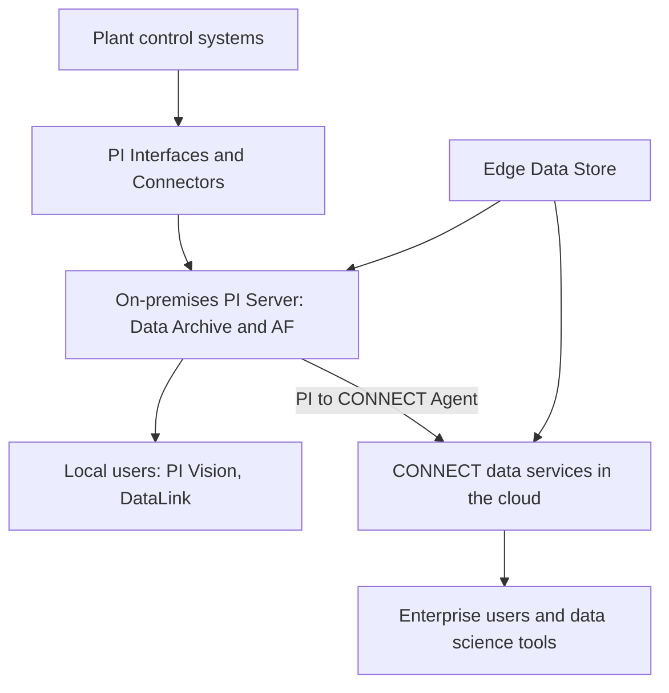

## Plain English

The **PI Server** is software you install on your own Windows servers. AVEVA calls it "the
on-premises home for operational data". You license it, run it and patch it.

**CONNECT** is AVEVA's cloud "industrial intelligence platform". Its data layer is **CONNECT data
services**, the service that used to be called **AVEVA Data Hub** (and before that OSIsoft Cloud
Services). It runs in a browser, there is nothing to install, and AVEVA looks after updates and
infrastructure.

You do not have to choose one. Most designs keep the PI Server at the site and send selected data,
with its asset context from PI AF, up to CONNECT for sharing and analysis.

## Deep Dive

**What CONNECT data services does.** It is cloud-native and handles aggregation, storage,
enrichment, access, analysis and secure sharing of real-time industrial data. AVEVA Data Hub was
designed to handle operations data that arrives late or out of order, and it integrates natively
with PI System products, including PI Server and Edge Data Store.

**Use cases.** OSIsoft Cloud Services highlighted remote monitoring, enterprise-wide data science and
cross-enterprise data sharing. CONNECT data services also integrates with Databricks via Delta
Sharing.

**Context comes from AF.** PI AF provides the contextualisation that CONNECT builds on before data is
shared.

**Hybrid PI Server.** PI Server 2023 was the first "hybrid" release, integrating with AVEVA Data Hub,
and added OpenID Connect (OIDC) claims-based authentication.

**At the edge.** Edge Data Store transfers data to the PI Server and to the cloud service.

**Getting PI data to CONNECT.** AVEVA's service description says the **PI to CONNECT Agent** reports
tag usage for the Aggregate Tag licence model and can optionally send process data to CONNECT data
services.

| | PI Server (on premises) | CONNECT data services (cloud) |
|---|---|---|
| Who installs it | The customer, on Windows servers | Nobody; it is SaaS in a browser |
| Who manages updates and infrastructure | The customer | AVEVA |
| Tenancy | Your own servers | Multitenant SaaS |
| How it is bought | Licence or Flex subscription | Through AVEVA Flex credits |

## Worked Example

A water company has PI Servers at six treatment works. Head office wants a single view and its data
scientists want Databricks access.

1. Each works keeps its PI Server and AF, so operators never depend on the internet for local data.
2. AF models give each pump and tank its context.
3. Selected streams and their context go to CONNECT data services.
4. Data scientists use the cloud copy, for example through the Databricks integration, while plant
   displays still read the local PI Server.

## Diagram

## Common Mistakes

- **Thinking CONNECT replaces the PI Server.** AVEVA still positions PI Server as the on-premises
  home for operational data, and lists CONNECT alongside it as a core component.
- **Treating OCS, AVEVA Data Hub and CONNECT data services as different products.** They are
  successive names.
- **Forgetting context.** Sending raw tags without AF context makes cloud data hard to use; AF
  provides the contextualisation CONNECT builds on.

## Real-World Scenario

AVEVA announced AVEVA Data Hub at PI World on 19 October 2021 as its first SaaS offering combining
key PI System features, available through AVEVA Flex. A company already on PI Server 2023 can treat
it as a hybrid system: the plant keeps running on local servers while enterprise teams work with the
cloud copy.
