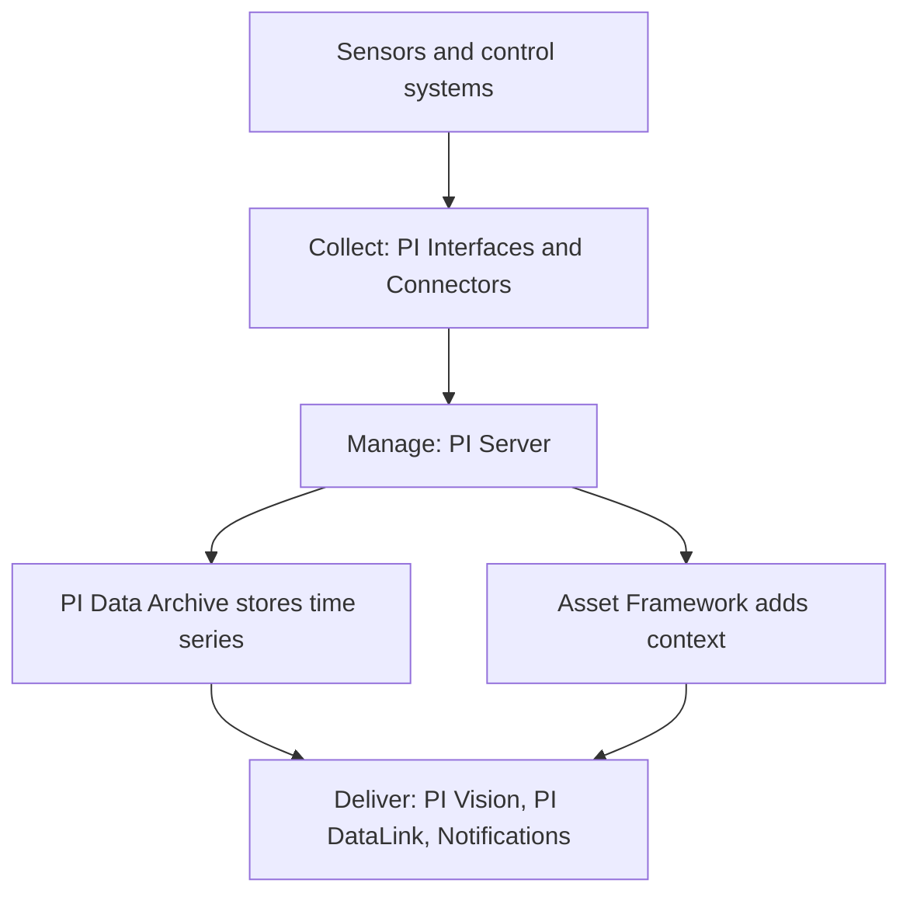

## Plain English

A plant has thousands of sensors: temperatures, pressures, flows, valve positions. Each one produces
a reading again and again. A **historian** is a database built to keep all those time-stamped
readings and hand them back quickly when someone asks "what happened at 03:10 last Tuesday?".

In the PI System the historian is the **PI Data Archive**. OSIsoft called it a proprietary database
optimised for time-series data, often simply "the Historian". PI Vision training calls it "the
heart of the PI System".

The PI System as a whole is "just software". It runs on ordinary servers and computers on a network.
It collects, stores, organises, calculates on and delivers sensor data, and was built mainly for
industrial use.

## Deep Dive

**Three layers.** OSIsoft's PI 101 material describes the PI System in three layers:

| Layer | What it does | Examples |
|---|---|---|
| Collect | Read data from control systems and devices | PI Interfaces, PI Connectors |
| Manage / Enhance | Store, organise and calculate | PI Server (Data Archive and Asset Framework) |
| Deliver | Show data to people and other systems | PI Vision, PI DataLink, PI ProcessBook, Notifications |

**The interface is a translator.** A PI Interface reads a value from the source system, gives it a
timestamp, formats it, applies exception filtering and sends it to the Data Archive. OSIsoft compares
an interface to "a translator" between the control system's language and PI.

**Keeping data for a long time.** The PI Server "stores the values forever" and keeps data online for
decades, so engineers can compare today with years ago.

**Many sources.** In 2010 OSIsoft said the PI System connects to more than 450 different systems; in
2017 it cited hundreds of data sources.

**Today's offering.** AVEVA lists the core of its PI Data Infrastructure as AVEVA PI Server, AVEVA
Edge Data Store, CONNECT and connectivity products (PI Interfaces, PI Connectors, AVEVA Adapters).
Tools such as AVEVA PI Vision, PI DataLink, PI Integrator for Business Analytics, RtReports and PI
Manual Logger are optional add-ons.

## Worked Example

Follow one tank level reading:

1. The level transmitter on Tank 2 reports 4.31 m to the control system.
2. A PI Interface reads 4.31, stamps it with the time, checks whether it changed enough to be worth
   sending (exception), and sends it.
3. The PI Data Archive stores it alongside years of earlier readings for that tag.
4. An engineer opens a PI Vision trend for the last week, or pulls the values into Excel with PI
   DataLink.

Each step matches a layer: collect (interface), manage (Data Archive), deliver (Vision, DataLink).

## Diagram

## Common Mistakes

- **Thinking the PI System is a box or appliance.** It is Windows software you install on servers.
- **Treating the historian like a normal relational table.** Time-indexed storage handles uneven
  spacing, different start times and out-of-range values far better than a table index.
- **Mixing up the PI Server and the PI Data Archive.** The PI Server is the Data Archive plus Asset
  Framework.

## Real-World Scenario

AVEVA's product page claims that more than 1,000 power utilities and 9 of the top 10 mining companies
use PI, and that 75% of the world's crude oil, natural gas and liquids are produced with PI
(reported by AVEVA). Whatever the industry, the pattern is the same: interfaces collect, the Data
Archive keeps the history, and visualisation tools turn it into decisions.
