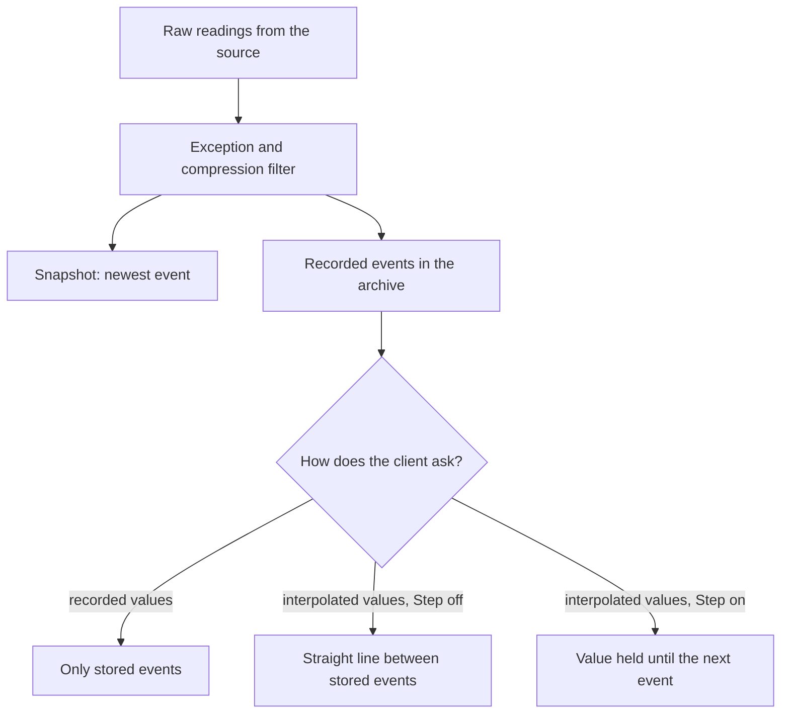

## Plain English

Every reading stored in PI is an **event**: a **timestamp**, a **value** and a **status** (for
example "GOOD"). A stream of events for one measurement lives in a **PI Point**, also called a
**PI Tag**.

The newest event for a point is its **snapshot**. Older events that were kept are its **recorded**
(or compressed) values. Because PI does not keep every raw reading, a client that asks for "the value
at 10:00" may get an **interpolated** value calculated between two recorded events.

PI stores all timestamps in **UTC**. Every stored day therefore has exactly 24 hours, and your client
converts to local time, including daylight saving, when it shows the data.

## Deep Dive

**What an event can carry.** Besides timestamp, value and quality, OSIsoft lists substitution and
change flags and optional annotations.

**Three ways to read data.**

| Request | What you get |
|---|---|
| Recorded / compressed values | Only the events actually stored in the archive |
| Interpolated / sampled values | Values calculated at chosen times between stored events |
| Archived value with "previous" retrieval | The stored value at or before the time |

In the AF SDK, `PIPoint.RecordedValues(...)` returns recorded values and
`PIPoint.InterpolatedValues(...)` returns interpolated values. In PI DataLink, the Sampled and Timed
Data functions interpolate.

**Stepped or not.** The point attribute **Step** decides how values between stored events are worked
out. With Step off, PI draws a straight line (linear interpolation). With Step on, the value is held
until the next stored event, like a staircase. Use Step on for set points, counts and states.

**Time expressions.** PI accepts short time strings:

| Expression | Meaning |
|---|---|
| `*` | now |
| `t` | today (midnight) |
| `y` | yesterday (midnight) |
| `*-1d` | one day ago |
| `t+3h` | 03:00 today |
| `*+1h` | one hour from now (future data) |

The training gives one offset per expression.

**Historical versus future data.** Measured data streams in, in time order, steadily and densely.
Forecast (future) data may arrive out of order, sporadically and less densely.

**Time zones.** Because raw data is in UTC seconds, changing a server's time zone does not change
stored data. After daylight-saving rule changes you still need operating-system patches and an updated
`localhost.tz`; `pidiag -tz` checks it.

## Worked Example

A solar farm's MW tag sits at 0 overnight. Compression keeps a 0 at 23:00 and CompMax is the
default 28,800 s (8 hours), so the next stored value is 3.2 MW at 07:00, eight hours later.

- A **sampled** DataLink report at 01:00, 03:00 and 05:00 interpolates between 0 and 3.2 and shows a
  false ramp: roughly 0.8, 1.6 and 2.4 MW at night.
- Fixes suggested on PI Square: read **compressed** data instead, set **CompMax to 3600** so a zero
  is stored every hour, or use an AF analysis threshold.

Another example: a pump idle for a year starts at 10 l/s. An OPC UA connector stores only changes, so
an interpolated trend shows a slow year-long ramp rather than a step.

## Diagram

## Common Mistakes

- **"Unexpected linear interpolations."** Using interpolated or sampled retrieval on a non-stepped tag
  with sparse stored data draws ramps that never happened.
- **Assuming local time is stored.** Timestamps are stored in UTC; conversion happens in the client.
- **Expecting every raw reading to be there.** Only recorded events are stored; anything else is
  calculated.

## Real-World Scenario

A reliability engineer compares two pumps in Excel and sees one ramp up slowly over hours while the
DCS shows it started instantly. Switching the DataLink function from Sampled Data to compressed data
shows the real step. The team then sets Step on for its run-status tags so trends show a staircase.
