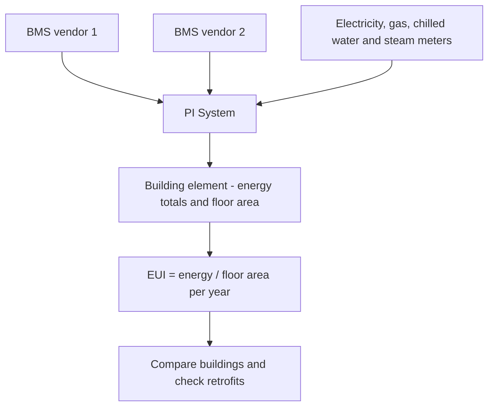

## Plain English

A university campus or a large site can have hundreds of buildings, each with its own heating, cooling
and lighting controls. These are run by a **building management system (BMS)**, sometimes called a
building automation system (BAS). Different buildings often have different BMS vendors.

The PI System pulls all of these into one place. Then energy managers can compare buildings fairly,
spot waste and check whether a retrofit worked. The fair-comparison number is **EUI** (energy-use
intensity): energy used per unit of floor area per year. A big building uses more energy than a small
one; EUI shows which one is actually efficient.

OSIsoft grouped facilities with data centres: its 2018 PI World Water/Energy/Facilities track included
data-centre colocation portfolios.

> [!TIP]
> See the [Smart Buildings hub](#/industries/buildings) for typical tags, templates and KPIs.

## Deep Dive

**Campus scale.** UC Davis (1,000 buildings) uses PI System, PI Vision and AVEVA System Platform. Its
projects include chilled water system optimisation, HVAC scheduling, and switching district steam to
low-temperature hot water.

**Electrical distribution.** The University of Maryland, College Park centralised electrical
distribution data on PI System with partner Data Systems Analysts, Inc. Before that, data was spread
across disparate, isolated systems, which limited outage response.

**Buildings inside a factory site.** Pfizer Groton runs a second PI server set for utilities and building
automation (8 to 12 systems/historians). A PI Vision floor-plan dashboard overlays environmental and
process data by room. AVEVA reports "50% reduction in BMS reporting".

## Worked Example

**Comparing two buildings with EUI.** Building A used 2,000,000 kWh last year and has 20,000 m² of floor
area. Building B used 900,000 kWh and has 6,000 m².

- EUI A = 2,000,000 / 20,000 = 100 kWh per m² per year.
- EUI B = 900,000 / 6,000 = 150 kWh per m² per year.

Building B uses less energy in total but is less efficient per square metre. In AF, store floor area as
a static attribute on each building element and calculate EUI from the yearly energy total.

## Diagram

## Common Mistakes

- **Comparing total energy instead of EUI.** Large buildings always look worse on totals.
- **Leaving data in isolated systems.** Disparate electrical distribution systems limited outage response
  at the University of Maryland.
- **Citing non-PI stories.** The City of Bremen building story (energy down 15% to 18%) uses AVEVA
  InTouch and Historian, and Barghest Building Performance uses System Platform. They are not PI
  System examples.
- **Quoting a headline instead of the result.** See the University of Maryland example below.

## Real-World Scenario

**UC Davis.** The AVEVA success story reports: "46% reduction in energy-use intensity since 2009, a cost
savings of $15 million"; "62% reduction in gas usage from heating system retrofit"; "Expected annual
savings of $150,000 from chilled water optimization"; and "Projected savings of $197M over 60 years".
Notice that two of these are forecasts ("Expected", "Projected"), not results. See
[UC Davis](#/cases/uc-davis-campus).

**University of Maryland.** The results section reports savings of 30% of HVAC energy expenses, while the
headline says "up to 30%" of energy expenses. The headline is broader (all energy) and hedged ("up
to"). Quote the results-section wording and note the difference. See
[University of Maryland](#/cases/university-of-maryland).
