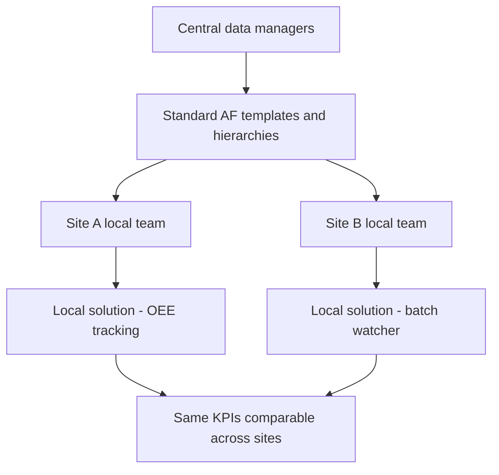

## Plain English

A chemical plant turns raw materials into products through reactors, columns, dryers and many pumps and
exchangers. Some plants run continuously; others make product in batches. Either way, managers want to
know three things: how much product they made from the feed (**yield**), how much energy it took, and
how well the equipment ran (**OEE**).

The PI System collects the process data and, through AF templates, gives every plant the same
calculations. The challenge in chemicals is scale: a company may have dozens of sites making different
products, so one solution cannot simply be copied.

> [!TIP]
> The [Chemicals hub](#/industries/chemicals) shows typical tags, templates and KPIs.

## Deep Dive

**KPIs.** OSIsoft's oil and gas/chemicals deck lists chemical KPIs: yield, energy (a 6-tier
breakdown), material balance, **controllable margin** and OEE. **HC loss** (hydrocarbon loss) is the
material that a material balance cannot account for.

**Central-to-local.** Syensqo's central data managers create standardised AF templates and hierarchies;
local teams build solutions on them. AF holds asset templates and batch phases. In one year the
specialty polymer division grew from 200 to more than 4,000 AF elements, with 600 templates and 60,000
data points in the PI Data Archive. Syensqo reported rollout-time reductions: OEE tracking solution from
26 weeks to 5 weeks, and batch watcher from 11 weeks to 4 weeks. It feeds Seeq and Ekhosoft from AF and
is introducing AVEVA PI Data Infrastructure "with aggregate tag licensing".

**One data layer for everyone.** dsm-firmenich built a global **Operations Data Layer (ODL)** on PI
Server and AF that supports 3,500 users and uses OEE for day-to-day value across batch and continuous
operations.

**Very large scale.** Covestro's monitoring platform on PI "unifies more than one million real-time data
streams and contextualizes thousands of critical assets".

## Worked Example

**Specific energy per plant.** You want energy used per tonne of product for every plant, rolled up to
site level.

1. On the plant element template, add attributes for Energy (for example MWh) and Product (tonnes),
   both totalled over the same period.
2. Add an analysis: `Specific Energy = Energy / Product`.
3. At site level, sum Energy and Product across child plants first, then divide. Do not average the
   plant ratios, because a small plant would count as much as a large one.

Plant A: 1,200 MWh for 400 t gives 3.0 MWh/t. Plant B: 300 MWh for 50 t gives 6.0 MWh/t. The site value
is (1,200 + 300) / (400 + 50) = 3.33 MWh/t, not the simple average of 4.5.

> [!VERIFY]
> This KPI is an analogy to Covestro's "CO2 per ton of product". The source does not publish
> Covestro's calculation, so the template layout here is illustrative.

## Diagram

## Common Mistakes

- **Copying a whole solution site to site.** It fails when sites make different products. Syensqo keeps
  templates central and solutions local.
- **Ignoring alarms and notifications.** Before adding anomaly detection, Covestro saw overlooked
  notifications and unplanned shutdowns cause significant losses.
- **Averaging ratios.** Roll up totals, then divide, as in the worked example.
- **Merging figures from different sources.** MOL's "EBITDA improvement $500M-550M" (OSIsoft 2015 deck)
  and "$1 billion in EBITA since 2010" (OSIsoft 2023 overview) are different claims.

## Real-World Scenario

**Covestro.** Covestro uses PI with AI anomaly detection. The AVEVA success story reports energy
consumption reduced by 30% and CO2 emissions reduced by 39% per ton of product, and says it is on track
for a 50% reduction by 2030 (a target, not a result). See [Covestro](#/cases/covestro).

**MOL Downstream.** Across 6 refineries, OSIsoft's EMEA 2015 deck reports yield increase 5%, energy
consumption decreased 2% YOY, HC loss -30% and EBITDA improvement $500M-550M. See
[MOL Downstream](#/cases/mol-downstream). Also read [Syensqo](#/cases/syensqo) and
[Nutrien](#/cases/nutrien).
