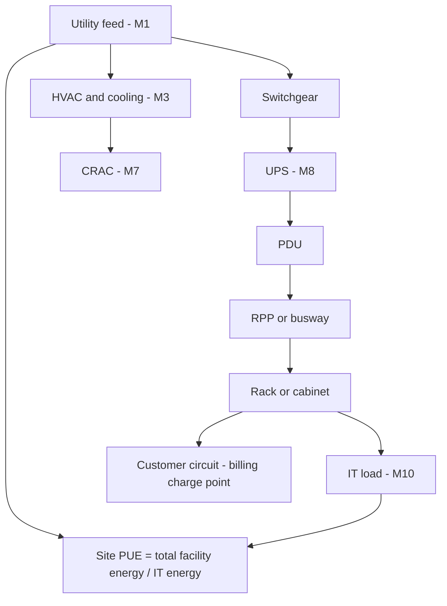

## Plain English

A data centre is a building full of servers. The servers need power, and so does everything that keeps
them alive: cooling, UPS systems, lighting. The industry measures how much overhead there is with
**PUE** (Power Usage Effectiveness):

`PUE = total facility energy / IT equipment energy`

A PUE of 1.0 would mean every kilowatthour goes to the servers. Equal overhead and IT energy gives a PUE
of 2.0.

The PI System collects readings from the whole power chain (utility feed, switchgear, UPS, PDUs, racks)
and from cooling equipment, so operators can calculate PUE, plan capacity and bill customers.

> [!TIP]
> See the [Data Centres hub](#/industries/data-centres) for typical tags, templates and KPIs.

## Deep Dive

**Definitions.** The Green Grid defines PUE as "energy entering the facility divided by the energy used
by the IT equipment". **Partial PUE** breaks the overhead into specific functions such as cooling.
Digital Realty's 2017 talk cited federal targets: report PUE below 1.4 by 2018, with below 1.2
encouraged. It also warned that "PUE calculations become very complex when power crosses a boundary into
or out of a system".

**Where to measure.** Microsoft's 2009 list of measurement points runs from M1 (utility total load)
through M3 (HVAC/mechanical), M7 (CRAC) and M8 (UPS) to M10 (IT asset power).

**The AF model.** Digital Realty's model (with Casne Engineering) covered utility feed, UPS, PDU, RPP,
BCM, cabinets and cages, kW models, breakers, panels, channels and customers. It used a templated AF
model "to enforce tag consistency". Aligned Energy builds billing "charge points" at busway level for
shared PDUs and at PDU-output level for dedicated PDUs.

**Data sources.** PayPal's PI sources are power management systems, building automation systems and
Raritan power strips. Dell EMC's micro modular data centres use PI Connector for Redfish to pull server
data, plus a Modbus connector.

## Worked Example

**Monthly PUE for a site.** Over one month the utility meter (M1-type) totals 1,500,000 kWh and the IT
load meters (M10-type) total 1,000,000 kWh.

`PUE = 1,500,000 / 1,000,000 = 1.5`

If cooling used 350,000 kWh of the overhead, a cooling partial ratio can be reported alongside it.

In AF, put the calculation on the site element and use totals over the same period for both meters:

```text
PUE = TagTot('Utility Total kW', 't', '*') / TagTot('IT Load kW', 't', '*')
```

Use energy (kWh) totals, not one instantaneous kW reading, for a reportable PUE. A single snapshot can
be badly skewed by a short spike on either side.

> [!VERIFY]
> The expression shape is illustrative only. Check the time range arguments and units against your own
> analysis design.

## Diagram



## Common Mistakes

- **Too many vendors.** Too many software vendors caused tag errors at Equinix. Several small
  integration projects were easier to justify and cheaper than one big IT project.
- **Assuming full visibility.** Landlord-owned facilities limit data visibility. Digital Realty also hit
  IT security restrictions and gaps in context data.
- **Not planning for divestiture.** Separating a shared PI System (eBay/PayPal) means "untangling" tags,
  AF and notifications. Plan namespaces for that.
- **Using instantaneous kW for PUE.** Use energy totals over the same period.

## Real-World Scenario

**Equinix replaces SCADA in 6 weeks.** With DST Controls, Equinix converted 15,000 tags and 115 HMI
screens to PI, connected 108 controllers and reorganised about 2,000 alarms and notifications, covering
a 54,488 sq ft Silicon Valley site in 6 weeks. Equinix and DST reported going from 6 software vendors
to 1 and from 2 SCADA servers to 1 PI server (OSIsoft UC 2011). See [Equinix](#/cases/equinix).

Also read [Digital Realty](#/cases/digital-realty) ("Time savings of over 50% in viewing reports"),
[Aligned Energy](#/cases/aligned-energy), [PayPal](#/cases/paypal) and [Dell EMC](#/cases/dell-emc).
