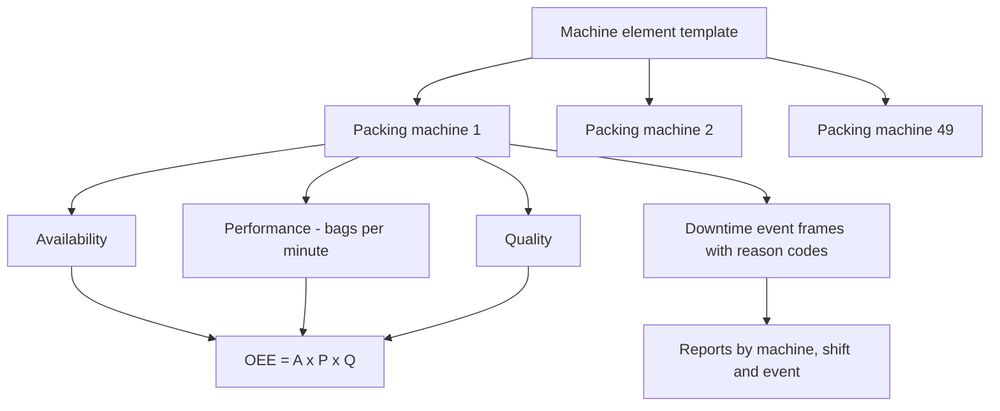

## Plain English

Food and beverage plants run packing lines, fillers, ovens and fermenters, often making many products on
the same equipment. Their key questions are: how much of the time did the line run, how fast did it run,
and how much good product came out? Together these make **OEE** (Overall Equipment Effectiveness).

They also care about **weight**. Underfilling breaks the law; overfilling gives product away for free
(**giveaway**). And they clean equipment between products with automated **Clean-In-Place (CIP)**
cycles.

The PI System collects machine data, and AF templates and event frames turn it into OEE and downtime
reports for every machine, shift and site.

> [!TIP]
> See the [Food & Beverage hub](#/industries/food-bev) for typical tags, templates and KPIs.

## Deep Dive

**OEE in AF.** Illovo Sugar Africa tracks 49 form-fill-seal (FFS) packing machines across 5 sites in 3
countries. AF templates define the hierarchy and provide OEE broken into availability, performance and
quality; template changes cascade to all 49 machine elements. Captured variables include bags-per-minute,
shifts and downtime-reason codes. PI Server event frames cover predefined reporting periods, and reports
are analysed by machine, by shift and by downtime event, hourly, daily and weekly.

**Batch and CIP.** OSIsoft's event frames material uses CIP as a demo. Its phases are pre-rinse,
caustic main wash, final rinse and acid second wash, with KPIs for protocol adherence and cost/duration
deviations.

**Small sites and edge data.** Cargill runs PI System at "over 200 plants globally". Smaller sites
(feed mills, grain elevators, ships, port terminals) with only a few hundred data streams use AVEVA Edge
Data Store to forward data to a central PI Server. Lab robot protein and fat results are sent as
structured JSON through an AVEVA adapter.

**Analytics.** Deschutes Brewery applied machine learning to PI data to control fermenter temperature
spikes during cooling and to predict phase transitions.

## Worked Example

**OEE for one shift.** A filler has 480 minutes of planned production time. It ran for 400 minutes. Its
ideal cycle time is 0.5 seconds per unit and it made 40,000 units, of which 38,000 were good.

1. Availability = run time / planned time = 400 / 480 = 0.833.
2. Performance = (ideal cycle time x total count) / run time = (0.5 s x 40,000) / (400 x 60 s) =
   20,000 / 24,000 = 0.833.
3. Quality = good count / total count = 38,000 / 40,000 = 0.95.
4. OEE = A x P x Q = 0.833 x 0.833 x 0.95 = about 0.66, or 66%.

In PI, a downtime event frame opens whenever the machine state is not Running, with a reason-code
attribute. Summing event-frame durations gives the downtime used in availability.

## Diagram

## Common Mistakes

- **Trusting shift log sheets.** Illovo's starting point was log sheets that gave little reliable
  machine data.
- **Citing non-PI stories.** Nestlé (Waverly) uses AVEVA Historian/CONNECT and General Mills uses System
  Platform. They are AVEVA stories but not PI System examples.
- **Building OEE per machine by hand.** Use one template so a change reaches every machine.
- **Mixing up CIP.** In food plants CIP means Clean-In-Place, not NERC CIP security standards.

## Real-World Scenario

**Illovo Sugar Africa.** The AVEVA success story reports "50% improvement in performance", "25%
improvement in availability", and "30% improvement in OEE in three months". See
[Illovo](#/cases/illovo-sugar).

**Kellogg's Valls.** AVEVA reports: "Achieved CPG best-in-class rating for OEE of 80%"; "Reduced CCP by
64%, product failures by 73%, and minor line stops by 67%"; "Increased mean time between failures rate
by 180%". The page does not expand "CCP", so do not guess its meaning. See
[Kellogg's](#/cases/kelloggs). Also read [Tyson Foods](#/cases/tyson-foods),
[Deschutes Brewery](#/cases/deschutes-brewery) and [Cargill](#/cases/cargill).
