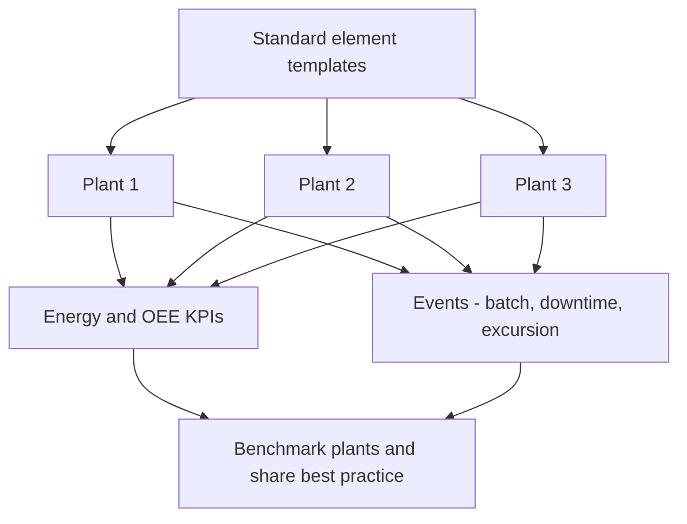

## Plain English

Manufacturers often run many plants that grew up separately. Each plant has its own machines, meters
and ways of recording data. That makes it hard to answer simple questions like "which plant uses the
least energy per car?".

The PI System helps by giving every plant the **same data model**: the same AF templates, the same
attribute names, the same calculations. Once data looks the same everywhere, plants can be compared and
good practices shared.

Two common goals: an **Energy Management System (EnMS)** that monitors energy across plants, and **OEE**
for day-to-day performance.

> [!TIP]
> See the [Manufacturing hub](#/industries/manufacturing) for typical tags, templates and KPIs.

## Deep Dive

**Standard models for energy.** Toyota Motor Europe built a single centralised energy monitoring system
(EnMS) on PI System to standardise data models across its European plants. Before, large differences in
plant monitoring capability and no standard data model blocked benchmarking. Michelin collects and
standardises energy data from 15 production sites.

**Events.** OSIsoft lists three event categories used in manufacturing: Batch, Downtime and Excursion.
Event frames support S88/S95 downtimes and excursions. An **excursion** is a period when a value is
outside its limits. OSIsoft's example event frame is "on asset Boiler-352, type 'High Violation', lasting
12 min 24 sec" with attributes such as Fuel Gas Flow.Avg.

**OEE and context.** dsm-firmenich uses OEE as its day-to-day KPI, contextualises PI data in
Shiftconnector, and added an AI copilot for troubleshooting and onboarding.

## Worked Example

**An excursion event frame.** You want an event every time a boiler's temperature goes above its high
limit.

1. On the boiler element template, add Temperature (PI Point) and a High Limit attribute.
2. Create an event frame template, for example "High Violation".
3. Add an event frame generation analysis: start when Temperature > High Limit; end when it falls back.
4. Capture summary attributes on the event, such as the average of a related flow during the event
   (like OSIsoft's Fuel Gas Flow.Avg).
5. Report the count and total duration of excursions per boiler per week.

Because the logic sits on the template, every boiler in every plant gets the same excursion events, so
plants can be compared.

## Diagram

## Common Mistakes

- **No standard data model.** Without one, plants cannot be benchmarked (Toyota).
- **Citing non-PI stories.** Henkel's OEE/energy story (OEE +15%) and P&G's 90-plant standardisation use
  AVEVA MES/System Platform, not PI. Do not cite them as PI cases.
- **Quoting a range as a single number.** Michelin reports "Up to 10% savings in the initial few months",
  energy reduced "by as much as 16%", and a quote "we save from 3% to 16%". Keep the hedges.

## Real-World Scenario

**Toyota Motor Europe.** With its PI-based EnMS, AVEVA reports that validating and sharing data now
takes "less than one minute". See [Toyota Motor Europe](#/cases/toyota-motor-europe).

**Syensqo.** AVEVA reports a 25% maintenance cost reduction and a 50% reduction in OEE breakdown losses
(both under one year), and a 60% reduction in batch duration variability (three months). See
[Syensqo](#/cases/syensqo) and [Michelin](#/cases/michelin).
