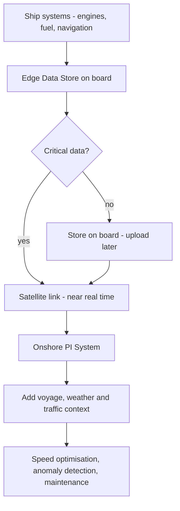

## Plain English

A ship is a floating plant: main engines, generators, boilers, cranes and navigation systems, all
producing data. But it is often far from land, with a slow, expensive and unreliable satellite link.

So marine PI deployments keep data **on board** first and send it **ashore** when they can. The most
important data goes first, in near real time; the rest waits until bandwidth is cheaper or available.

Why bother? Fuel. Caterpillar notes fuel is nearly 70% of a RORO vessel's lifetime cost, and vessels may
operate for about 50 years. Small efficiency gains add up to a lot of money and emissions.

> [!TIP]
> See the [Marine & Transport hub](#/industries/marine-transport) for typical tags, templates and KPIs.

## Deep Dive

**On board and on shore.** Caterpillar's CAT Asset Intelligence "whole-ship monitoring" is powered by PI
System, with PI Servers onboard and onshore and PI connectors.

**Edge storage and prioritised transfer.** CSL Group (a self-unloading bulk fleet) uses AVEVA PI Data
Infrastructure across over 40 vessels. AVEVA Edge Data Store captures data onboard, sends critical data
by satellite in near real time and uploads non-critical data later. Cargill ships store data locally when
out of network range, using Edge Data Store and an AVEVA Adapter for Modbus.

**Context.** CSL enriches vessel data with voyage, weather, traffic, geofencing and compliance context
for just-in-time speed optimisation, outlier detection and predictive maintenance. Weather and ocean
conditions create operational data "noise" that complicates marine analytics (Caterpillar).

**Training.** Delfi ILS Solutions' ShipView, built on PI System, feeds live ship automation data into 3D
crew-training simulations.

## Worked Example

**Deciding what goes over the satellite link now.** A vessel produces engine, fuel, navigation and
hull data. Sort each stream into two groups.

| Stream | Path |
|---|---|
| Fuel consumption, main engine alarms, position | Critical: send in near real time |
| High-frequency vibration history, detailed cylinder logs | Non-critical: store on board, upload later |

Then make sure the edge store keeps everything while the link is down, so nothing is lost. CSL reported
up to 50% upload bandwidth reduction ship-to-shore with this kind of approach.

The split of streams in the table is an example; choose yours from what shore teams actually need in
real time.

## Diagram

## Common Mistakes

- **Treating the link as always on.** Limited, unreliable bandwidth needs prioritised critical and
  non-critical data paths.
- **Ignoring crew turnover.** Frequent crew turnover causes inconsistent data (CSL).
- **Keeping data on each ship.** Onboard data silos prevent cross-fleet learning (Caterpillar).
- **Assuming fuel is fuel.** CSL found biofuel energy content 12-15% lower than conventional fuel,
  requiring more fuel per unit of performance.

## Real-World Scenario

**CSL Group.** AVEVA reports 8,233 mt CO2e avoided across 11 vessels in a year (third-party verified), a
29% carbon intensity reduction, "over 300" anomaly detections and up to 50% upload bandwidth reduction
ship-to-shore. The CO2 figure is notable because a third party verified it; most success-story figures
are not independently checked. See [CSL Group](#/cases/csl-group).

**Caterpillar.** AVEVA reports about $450,000 per vessel per year from timing barnacle removal (hull
fouling) and about $10,000 saved in 2018 by catching an abnormal cylinder temperature on a cruise liner.
See [Caterpillar](#/cases/caterpillar-marine) and [Delfi ILS](#/cases/delfi-ils).
