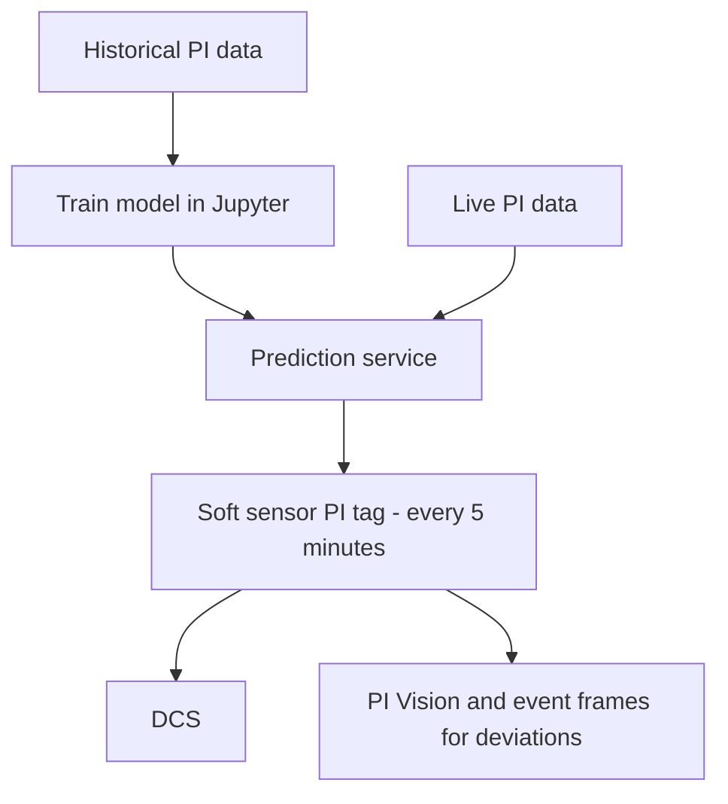

## Plain English

A mine is a chain of processes: drilling, loading, hauling, crushing, grinding, concentrating, and then
rail and port. Each step depends on the one before. If the trucks are late, the crusher starves; if the
crusher stops, the mill slows.

The PI System gathers data from fleet management, plant control systems, lab systems and environmental
stations so a remote operations centre can see the whole chain. Mines also use PI history to train
**soft sensors**: models that estimate a measurement that is hard or expensive to take directly.

> [!TIP]
> See the [Mining & Metals hub](#/industries/mining) for typical tags, templates and KPIs.

## Deep Dive

**A remote operations centre.** ArcelorMittal Mining Canada (AMMC) ran 2 PI Servers holding about
140,000 PI points, with PI AF, Analytics, Event Frames, Notifications and Manual Logger, plus 7
interface types with 50+ instances (PI World 2019). Other sources included Wenco FMS (fleet
management), Minesight and CAT terrain models. AMMC used a single AF template "for all historical events
across all units".

Its Operations Management System had three levels:

| Level | Audience | Content |
|---|---|---|
| 3 | Management | Overall mine view |
| 2 | Process owners | Value driver tree per process (drilling, loading, hauling) |
| 1 | Operators | Equipment dashboards |

**Mining KPIs at AMMC.** Mine plan conformity by material type and shovel face (target above 80%);
production by pit, haul cycle time and inventories; Road Analysis Control alarms; and **match factor**
for haul fleet utilisation.

**Soft sensors.** Hindustan Zinc (HZL) trains a **P80** model in Jupyter on historical PI data, feeds it
live PI data, and publishes predictions every 5 minutes to PI and then to the DCS. HZL tracks process
deviations with Event Frame analyses and uses Power BI to find frequently deviating parameters.

**Compliance.** Barrick Goldstrike automated air-quality permit reporting under three Air Quality
Operating Permits; the AF model returns the maximum or minimum hourly average. Vale centralised data
from 35 environmental monitoring stations.

## Worked Example

**Building a soft sensor loop, HZL style.**

1. Pull historical PI data for the grinding circuit.
2. Fit a model. HZL used a second-order regression for P80 and reported about 95% accuracy.
3. Read live inputs from PI on a schedule.
4. Write the prediction back to a PI tag every 5 minutes.
5. Send the PI value on to the DCS so operators and control loops can use it.
6. Keep checking the model against new reference measurements (good practice, not from the source).

HZL reported that the P80 soft sensor eliminated the need for 6 online particle size analysers. Its
sulphide sulphur (S/S) soft sensor for roasters is a Random Forest model at about 90% accuracy.

## Diagram

## Common Mistakes

- **Relying on sensors you cannot reach.** Underground sensors are hard to maintain. Newcrest used
  model-driven virtual sensors to keep operating through sensor failure.
- **Spreadsheet compliance.** Manual field recording and interdependent spreadsheets make compliance
  reporting slow and error-prone (Barrick).
- **Teaching impossible figures.** AMMC stated that concentrator slowdowns from low crusher feed were
  reduced by "300%". A reduction of more than 100% is mathematically unclear. Check with the author
  before you repeat it.
- **Treating illustrative quotes as results.** The Rio Tinto page's "100% availability / 80% utilization"
  numbers are illustrative quotes, not results.

## Real-World Scenario

**Newcrest, Cadia.** Using redundant PI servers and model-driven virtual sensors, Newcrest's Cadia mine
reported throughput up 650,000 tons in the first six months and crushing-circuit downtime down 50%
(AVEVA success story). See [Newcrest](#/cases/newcrest-mining).

**Ok Tedi.** With AVEVA Production Management and Plant SCADA on PI, integrator Mipac reported copper
recovery +2.4% and gold recovery +7.4% (2025). See [Ok Tedi](#/cases/ok-tedi-mining). Also read
[Vale](#/cases/vale), [Alcoa](#/cases/alcoa) and [AMMC](#/cases/arcelormittal-mining-canada).
