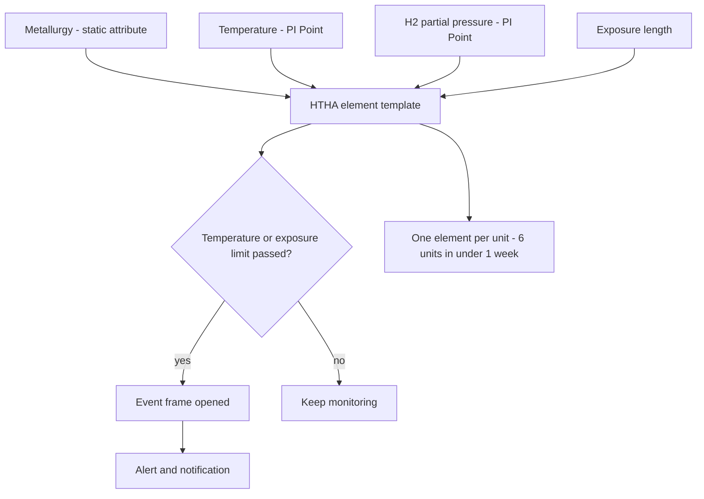

## Plain English

Oil and gas has three parts, and the PI System is used in all of them.

- **Upstream** finds and produces oil and gas: wells, platforms and floating production vessels (FPSOs).
  PI use cases include the digital oil field, production optimisation, lifting cost reduction,
  reservoir optimisation, and drilling and completions optimisation.
- **Midstream** moves and stores it: pipelines, compressor stations and storage. Use cases include gas
  compression, storage and quality, and natural gas capacity.
- **Downstream**, which OSIsoft calls **HPI** (Hydrocarbon Processing Industries), refines it. Use cases
  include interlock statuses, operating envelopes, alarm management, column dashboards, APC monitoring,
  crude blending control, corrosion control and catalysts.

The common thread is the same everywhere: many sites, many control systems and historians, and a need
to see all of it in one consistent way. That is why oil and gas companies lean heavily on **PI AF**
(Asset Framework) templates.

> [!TIP]
> Open the [Oil & Gas industry hub](#/industries/oil-gas) for typical tags, templates and KPIs. This
> lesson focuses on the patterns and the real examples behind them.

## Deep Dive

**From a "spider web" of tags to an asset model.** OSIsoft's 2015 deck describes a Gulf of Mexico
operator with "3+M tags with diverse naming from 29 offshore DCS historians" and 650 assets. A
tag-based architecture like this makes integration and application management hard. The operator moved
all analytics, visualisation and collaboration onto a PI AF asset data object model. Eni Global E&P did
something similar: PI AF collectives on all major production assets, PI-to-PI for data quality and
security, and a global E&P AF data object model "with extensive templates".

**Calculate once, use many times.** YASREF (Yanbu Aramco Sinopec refinery) used the PI System as the
integration and application infrastructure for 23 separate applications. It ran "all calculations and
analytics once in the infrastructure" and reported a reduction of over 50% in standard applications.

**KPIs you will meet.** The OSIsoft deck names yield accounting (Sigmafine on PI AF), first- and
second-level material balancing, Plan vs Actual (PvA), a 6-tier energy KPI breakdown, HC
(hydrocarbon) loss, flare activities, preventable lost production, lifting cost, cost per **BOED**
(barrels of oil equivalent per day), controllable margin, EBITDA and OEE. It also cites benchmark
targets drawn from "500+ customer use cases":

| Area | Benchmark (as stated by OSIsoft, 2015) |
|---|---|
| E&P | cost per BOED reduced 2-5% YOY |
| Logistics | controllable margin improved 2-5% YOY |
| HPI | controllable margin improved 1-5% YOY |

**Midstream at scale.** Enbridge integrated "more than 350,000 tags" when it consolidated 37 proprietary
SCADA systems onto AVEVA Enterprise SCADA, and uses PI Server for calculations, analytics and reporting,
including ESG metrics. TC Energy combined AWS machine-learning models with PI AF for **linepack**
forecasting and gas-control dashboards. PG&E used PI AF for alarm management, notification and
condition-based monitoring after a mandate to implement NTSB and PHMSA 49 CFR 192 following the
9/9/2010 gas explosion.

**Field data.** Cameron LNG (three trains, 13.5 MTPA) runs a PI Server with "~70,000 PI tags, over 5,000
asset framework elements" and feeds LoRaWAN wireless sensors (temperature, vibration, valve position,
weather) into the PI System.

## Worked Example

**A corrosion template that rolled out in under a week.** A refinery built a PI AF template for **High
Temperature Hydrogen Attack (HTHA)**. The source names the inputs and outputs:

- Inputs: metallurgy, temperature, hydrogen partial pressure and exposure length.
- Outputs: alerts, notifications and event frames on temperature/exposure limits.

It was "tested and rolled out in 6 units in under 1 week". That speed comes from templates: you build
the logic once on an element template, then create one element per piece of equipment.

When you design your own version, decide for each input whether it is a fixed property of the
equipment (metallurgy does not change minute to minute) or a live measurement from a PI Point
(temperature, partial pressure). The source lists only the inputs and outputs, so the exact attribute
layout is your design choice.

> [!VERIFY]
> The source does not publish the template's attribute list or limit curve. Treat any detailed layout
> as your own design, not as the refinery's.

## Diagram

## Common Mistakes

- **Staying tag-centric.** Millions of tags with inconsistent names across dozens of historians make
  every new application an integration project. The cited remedy is an AF asset data object model.
- **Ignoring the offshore link.** Offshore data transmission brings security, performance and
  reliability issues. Eni used PI-to-PI for data quality and security.
- **Scaling before proving value.** Noble Energy's lesson: enterprise agreements need champions,
  defined business use cases and proven ROI before the rollout scales. Its data-collection coverage
  was still phased by asset (for example Marcellus 85%, DJ Basin under 1%).
- **Mixing up figures.** The Eni success-story page also shows a DCP Midstream "$25M" figure. That
  figure belongs to DCP, not Eni. Likewise MOL's "$500M-550M" EBITDA improvement (2015 deck) and the
  "$1 billion in EBITA since 2010" (2023 overview) are different claims from different years; never
  merge them.

## Real-World Scenario

**Noble Energy and the Aseng FPSO.** Noble Energy evaluated three companies in 2010 to replace its Cygnet
system, chose PI, and piloted domestically in 2011-2012. It put PI in place before the Aseng FPSO
startup. The company reported that using PI during that startup helped engineers increase production by
an estimated 10,000 barrels of oil per day. Note the wording: "estimated", and reported by the company
itself in an OSIsoft seminar. See [Noble Energy](#/cases/noble-energy).

Other cases to read: [DCP Midstream](#/cases/dcp-midstream) ("$25M saved in fiscal year 2017 from
improved plant operations", reported by AVEVA), [PETRONAS](#/cases/petronas),
[Pertamina 2014](#/cases/pertamina-2014) and [YASREF](#/cases/yasref).
