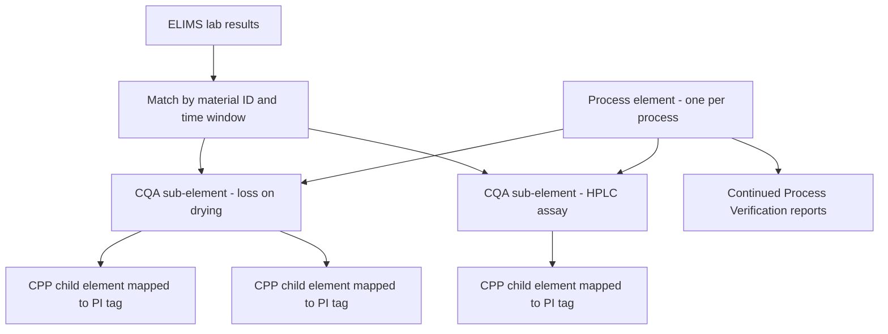

## Plain English

Drug makers work under strict rules called **GxP** (Good Manufacturing, Laboratory and Clinical
Practice). In the US, **21 CFR Part 11** sets the rules for electronic records and electronic
signatures. If a company uses the PI System to keep records the regulations require, those records must
be trustworthy: you must know who changed what and when, and nobody may quietly overwrite history.

So in pharma the PI System is used for the same things as elsewhere, such as batch analysis, process
monitoring and reporting, but it runs inside a **validated environment**. Changes are controlled, tested
and documented. J&J/Janssen describes the PI System as a "GMP-critical application".

> [!IMPORTANT]
> No software is "Part 11 compliant" on its own. Compliance depends on how the regulated company
> configures, validates and operates the system. FDA places that responsibility on the regulated firm.

## Deep Dive

**What 21 CFR 11.10 asks for.** Key controls, quoted or paraphrased from the regulation:

| Clause | Requirement |
|---|---|
| 11.10(a) | "Validation of systems to ensure accuracy, reliability, consistent intended performance, and the ability to discern invalid or altered records." |
| 11.10(b) | Accurate and complete copies of records in human-readable and electronic form |
| 11.10(c) | Protect records "to enable their accurate and ready retrieval throughout the records retention period" |
| 11.10(d), (g) | Limit access to authorised individuals; authority checks on who can sign, alter records or operate |
| 11.10(e) | "Use of secure, computer-generated, time-stamped audit trails to independently record the date and time of operator entries and actions that create, modify, or delete electronic records." Record changes "shall not obscure previously recorded information." |
| 11.10(f), (h) | Operational checks on step sequencing; device (terminal) checks |
| 11.10(i), (j), (k) | Training; written accountability policies for e-signatures; control of systems documentation |

**FDA's 2003 guidance.** FDA interprets Part 11's scope narrowly: it applies to records required by
**predicate rules** that are kept electronically. FDA exercises enforcement discretion on validation,
audit trail, record retention and record copying requirements, but predicate rules still apply and
validation should rest on a documented risk assessment. Access limits, system checks, training,
accountability, documentation controls and the e-signature sections stay enforced.

**Data integrity and ALCOA.** OSIsoft life-sciences material defines data integrity as accuracy and
consistency of data over its full life cycle, and lists **ALCOA**: attributable, legible,
contemporaneous, original, accurate.

**PI tools in validated environments.**

- **AVEVA PI Audit Reporter** is a "web-based audit trail review and reporting tool". Remote agents
  collect audit records from PI Data Archive and PI AF servers into one searchable interface. It
  preserves e-signatures, user attribution and comment history, tracks change control numbers, and
  names 21 CFR Part 11, NERC CIP and ISO as supported standards.
- The PI Data Archive documentation has a topic titled "Audit Database".

> [!VERIFY]
> How the PI Data Archive audit database and the PI AF audit trail are enabled, and exactly what they
> record, could not be read from AVEVA's documentation. Check the current docs before configuring them.

**From PI Batch to Event Frames.** PI Batch (first released March 2001) stored batches in the Data
Archive with a fixed structure and allowed only one unit batch per PI Unit at a time, so customers used
"phantom PI Units". PI Event Frames (first released November 2011, stored in the AF SQL Server database)
support unlimited overlapping events per unit and an HA write architecture. Migration is included in
PI Server 2015.

## Worked Example

**Linking lab results to process data (Janssen Cork).** Janssen Cork modelled AF on S88 (ISA-88):

1. One AF element per process.
2. A sub-element for each **CQA** (Critical Quality Attribute), such as loss on drying or HPLC assay.
3. Child elements for the **CPPs** (Critical Process Parameters) that affect it, each mapped to PI tags.
4. Lab results came from ELIMS and were linked to batches by material ID and time window.

This structure answers the question "which process conditions explain this quality result?" and
supported Stage 3 of FDA's process validation guidance, **Continued Process Verification (CPV)**.

> [!TIP]
> Direct queries to a LIMS database were too slow at Janssen, so they built an intermediate SQL cache.

## Diagram

## Common Mistakes

- **Saying "PI is Part 11 compliant".** Compliance depends on configuration, procedures and validation
  by the regulated company.
- **Validating site by site.** It is costly. J&J moved to one common "lean validation" approach rolled out
  with standardised PI deployments (2014).
- **Trusting the latest software blindly.** OSIsoft recalled PI Event Frames Generator v4.0.21.200 and
  Genentech reverted to v4.0.11.104.
- **Under-sizing SQL.** Genentech's guidance: AF Server at least 16 GB memory; SQL Server 12 GB
  dedicated memory, auto-growth configured, replication removed.
- **Underestimating change resistance.** Re-validation effort, a delayed migration tool and early-adopter
  risk slowed adoption in validated plants.

## Real-World Scenario

**Genentech migrates batch data.** Genentech migrated batch data from April 2006 (7.2 million events) to
Event Frames using the EMDVB interface on PI Server 2015 R2 / AF Server 2015 R2. The migration needed 3
days of downtime affecting only batch data (reported by Genentech and Control Systems Integration,
OSIsoft UC 2016). Separately, with RoviSys, Genentech "Moved 130 billion events across 27,000 AVEVA PI
System tags" and needed to "prove that we were moving this with 100% data integrity" (AVEVA). See
[Genentech 2016](#/cases/genentech-2016) and [Genentech migration](#/cases/genentech-migration).

**A biotech validation lifecycle.** E Tech Group enabled the audit trail on the PI Server for GMP
auditing, wrote URS, FS and SDS documents, ran FAT and SAT, and kept the exported tag list as a living
appendix to the SDS. See [E Tech biotech](#/cases/etech-biotech). Also read
[Pfizer](#/cases/pfizer-groton) and [Roche](#/cases/roche-ripin), and the
[Pharma hub](#/industries/pharma).
