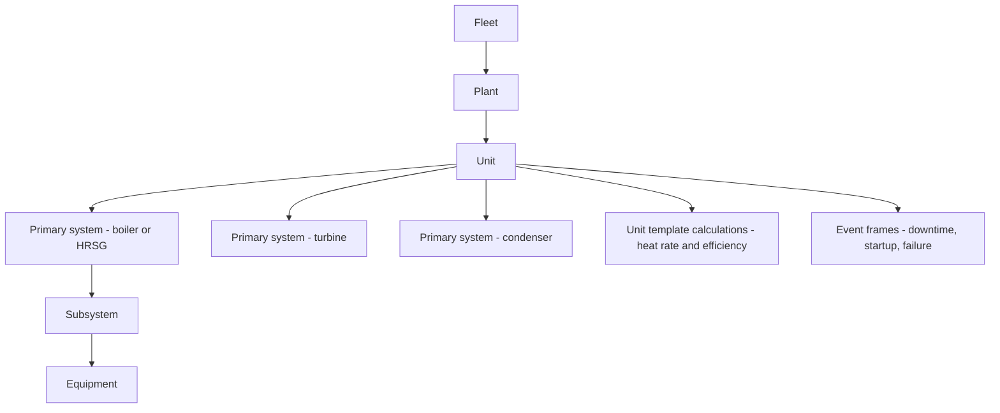

## Plain English

Power companies were some of the PI System's earliest and biggest users. OSIsoft's 2012 deck claimed PI
was used by "about 60% of USA power generation" and "100% of North American ISOs/RTOs" (claims made by
OSIsoft about itself, in 2012).

What do they use it for?

- **Plant efficiency.** The key number is **heat rate**: how much fuel energy it takes to make one
  kilowatthour. Lower is better.
- **Equipment health.** Condition-based maintenance from vibration, temperature and amps; boiler tube
  monitoring; start-up and shut-down analysis.
- **Compliance.** Emissions limits, and the NERC CIP security standards for North American grids.
- **Grid and renewables visibility.** Substations, feeders, wind turbines and solar parks, often shown on
  maps.

> [!TIP]
> See the [Power & Utilities hub](#/industries/power) for tags, templates and KPIs.

## Deep Dive

**Heat rate, by the book.** EIA defines heat rate as "the amount of energy used by an electrical
generator or power plant to generate one kilowatthour", in Btu per **net** kWh. Net generation is what
is delivered to the transmission line after the plant's own use (auxiliary load). EIA states that
3,412 Btu is the energy equivalent of 1 kWh, so:

`Efficiency (%) = 3,412 / heat rate x 100`

At 10,500 Btu/kWh that is about 33%; at 7,500 Btu/kWh about 45%.

**The power hierarchy.** OSIsoft's 2015 power deck gives the equipment hierarchy as plant, unit,
primary system, subsystem, equipment. Transmission and distribution (T&D) assets are substations,
feeders and equipment. Attribute aliases normalise inconsistent tag names, and element templates carry
calculations, notifications and performance curves. Event types for power include downtime, startup
and failure; event frames come from templates, are triggered by start conditions and can be backfilled
into history.

**Where the losses are.** The 2012 deck states that most outages and de-rates are boiler-related, the
highest lost-margin system. It cites a best-practice maintenance mix of under 10% reactive, 35%
preventive and 55% predictive, against more than 55% reactive for the average plant.

**Grids and renewables.** Dominion Energy built an AF SDK application that ingests SCADA, EMS, ADMS, SAP
and GIS data into an "evergreen" AF model of about 28,000 elements with "upwards of 135,000 analyses".
PJM shows PI data on Esri ArcGIS maps ("1.6 million pieces of information"). ENTEGA compares
theoretical with actual power per wind turbine, colour-coded red/yellow/green.

**Security.** Power decks reference NERC CIP and the Electronic Security Perimeter (ESP), which limits
direct access to cyber assets.

## Worked Example

**Heat rate as an AF analysis.** A unit burns fuel at 100,000 lb/h with a higher heating value of
10,500 Btu/lb, and delivers a net 100 MW.

1. Fuel energy per hour = 100,000 x 10,500 = 1,050,000,000 Btu/h.
2. Net output per hour = 100 MW x 1,000 = 100,000 kWh.
3. Heat rate = 1,050,000,000 / 100,000 = 10,500 Btu/kWh.
4. Efficiency = 3,412 / 10,500 x 100 = 32.5%, which EIA rounds to about 33%.

In AF you would put this on the unit template, so every unit gets the same calculation:

```text
HeatRate = 'Fuel Flow' * 'HHV' / ('Net MW' * 1000)
Efficiency = 3412 / HeatRate * 100
```

> [!VERIFY]
> The formula comes from EIA's definition. The AF expression layout and attribute names are an
> illustration, not a published AVEVA template.

Use **net** MW, not gross. Using gross output makes the plant look more efficient than it is.

## Diagram



## Common Mistakes

- **Using gross instead of net kWh** in heat rate. EIA's definition uses net generation.
- **Weak naming conventions.** Luminant's lesson: naming matters, especially for element-relative PI
  Vision displays.
- **Backfilling blind.** Luminant advises documenting the analysis backfill sequence and knowing asset
  interdependencies before backfilling.
- **Over-ambitious hierarchy.** Longannet tried to mirror its Maximo work-management structure, found
  mapping all tags too difficult, and cut the structure back to metrics only.

## Real-World Scenario

**Luminant: 13 applications into one AF model.** Luminant (17,814 MW) replaced three tools and 13
applications for thermal performance analysis with PI AF. One element template produced 24 elements;
substitution parameters generated PI tags and attribute references; Excel calculations became AF
analysis templates with backfill. The company reported that PI AF on its most recent combined-cycle
unit saved $160K, against third-party applications that historically cost "$100K+ per unit". See
[Luminant](#/cases/luminant).

**Longannet (ScottishPower).** PI ACE calculated 24 PI-based metrics every 10 minutes. Capula reported,
2014 YTD vs 2013: availability up 12.4%, tube leaks down 0.14 per 1000 running hours, NOx reduced by
0.1 t/GWh. See [Longannet](#/cases/scottishpower-longannet). Also read
[Xcel Energy](#/cases/xcel-energy) and [Ontario Power Generation](#/cases/ontario-power-generation).
