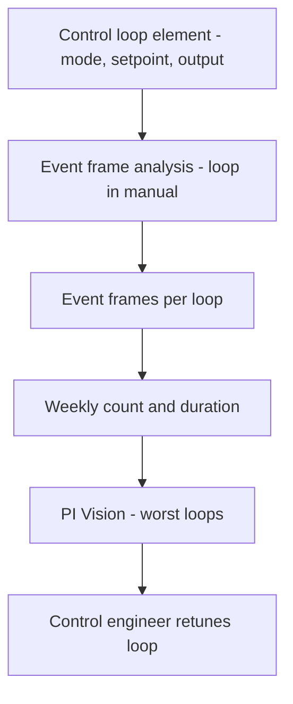

## Plain English

A pulp mill turns wood into pulp; a paper machine turns pulp into paper. Mills are big energy users and
often make their own steam and power from biomass. They also use a lot of water.

The PI System helps mills in three ways seen in the sources:

- **Find badly performing control loops**, so the process runs smoothly.
- **Decide whether to buy grid power or make more steam and power on site.**
- **Model the whole production chain**, from the forest to the dryer, in real time.

Pulp production is measured in **air-dry tonnes (ADt)**.

> [!TIP]
> See the [Pulp & Paper hub](#/industries/pulp-paper) for typical tags, templates and KPIs.

## Deep Dive

**Control-loop monitoring at Ence.** Ence built a control-loop monitoring and diagnostics tool for its
pulp mills from PI Server asset framework and event frames, visualised in PI Vision. Control-loop
monitoring tracks PID loop performance, for example time in manual or oscillation, to find poorly tuned
loops.

**Water planning at Ence.** Ence contextualises water-usage data with AF and publishes it to CONNECT,
where deep-learning models predict river flow so the mill can plan water consumption.

**Energy at Sappi.** Sappi Fine Paper's Somerset mill uses PI System to decide whether to buy more grid
energy or raise steam production in its own boiler, balancing generated and purchased power. Sappi states
over 80 percent of total energy use comes from renewable sources.

**Mill-wide models at Klabin.** Klabin collects data from over 25,000 assets. Its integrator says "we
have 85,000 variables of the various integration systems, and the PI System keeps it all in one place".
It built real-time digital models of pulp production from tree harvesting through drying.

## Worked Example

**A loop-health element.** You want to flag loops that operators keep switching to manual.

1. Create a control-loop element template. Each loop needs its mode (auto or manual) as an attribute.
2. Add an event frame generation analysis that starts an event when the mode is manual and ends it
   when the mode returns to auto.
3. Each week, count the events and total their duration per loop.
4. Show the worst loops in a PI Vision table so control engineers can retune them.

This follows the idea of Ence's tool (AF plus event frames, shown in PI Vision). The exact attributes
Ence used are not published, so treat this layout as your own design.

## Diagram

## Common Mistakes

- **Evaluating changes offline.** Without integrated models, evaluating proposed production changes took
  hours at Klabin.
- **Running energy blind.** Without visibility, buy-vs-generate decisions cannot be optimised (Sappi).
- **Quoting a garbled unit.** The Ence page gives "1,500 MWh saved per pulp mill" in one place and
  "1,500 MWs per hour per year" in the body. The second is not a valid unit. Quote the clear version,
  attributed to AVEVA, and note the inconsistency.

## Real-World Scenario

**Klabin.** AVEVA reports production up 3,400 air-dry tons per year and maintenance costs cut by nearly
$10 million. See [Klabin](#/cases/klabin).

**Ence.** AVEVA reports 15% emissions reduction (pulp mills); 1,500 MWh saved per pulp mill; summer
water-shortage downtime from 15 days to zero; €150,000/year biomass savings; and nearly 900 manual
interventions avoided per day. See [Ence](#/cases/ence) and [Sappi](#/cases/sappi-fine-paper).
