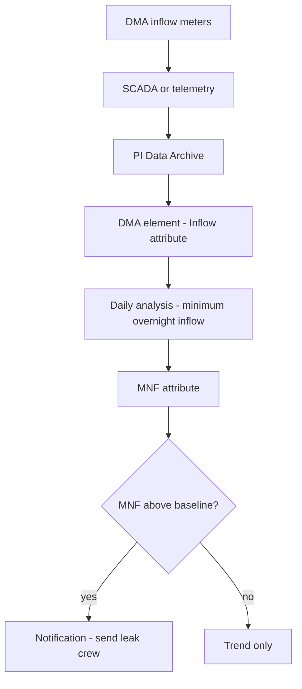

## Plain English

A water utility treats water, pumps it through many kilometres of pipe, and bills customers for what
their meters record. The gap between water put into the system and water billed is the big problem.
That gap is called **non-revenue water (NRW)**.

The PI System helps by bringing flow, pressure, level and quality readings from SCADA, telemetry and
meters into one place, so engineers can see where water is lost and act quickly.

Typical water use cases listed by OSIsoft (2015):

- real-time water loss control
- advanced pressure management to reduce main breaks
- chlorine verification for water quality
- pump-station KPI forecasting
- meter data management and sewer meter billing

> [!TIP]
> The [Water hub](#/industries/water) lists typical tags, templates and KPIs.

## Deep Dive

**Non-revenue water.** In the IWA/AWWA water balance, NRW is "the sum of Unbilled Authorized
Consumption, Apparent Losses, and Real Losses".

| Part | What it is |
|---|---|
| Unbilled authorised consumption | Water used legitimately but not billed |
| Apparent losses | Customer metering inaccuracies, unauthorised use such as hydrant theft, billing data errors |
| Real losses | "the annual volume lost through all types of leaks, breaks, and overflows on mains", plus reservoirs and service connections up to the customer meter |

A **water audit** "compares volumes of water treated and pumped to volumes consumed by customers".

**District Metered Areas (DMAs).** A DMA is a hydraulically discrete zone with metered inflows. At night
legitimate use is low, so the lowest overnight inflow, the **minimum night flow (MNF)**, is mostly
leakage. If MNF rises, a new leak has probably appeared.

**KPIs.** OSIsoft's 2015 water deck lists DMA night flows, main breaks per year, non-revenue water,
energy consumption and pump efficiency.

**Scale examples.** Compesa (Brazil) telemeters 5,300 variables across 238 sources, 200 wells, 234
pumping stations, 500 treatment stations and 519 reservoirs, with alarms on level, pressure, flow,
communication failure, rainfall and power factor. Halifax Water in 2013 ran a single PI 2010 server
with 5,000 tags and 10 OPC interfaces. Both show you do not need millions of tags to get value.

Units you will meet: m³/hr, gpm and MLD (million litres per day).

## Worked Example

**An MNF analysis on each DMA.** Give the DMA element template an Inflow attribute (a PI Point) and an
output attribute called MNF.

1. Schedule an analysis once a day.
2. Calculate the minimum of Inflow over an overnight window, for example 02:00 to 04:00.
3. Write the result to MNF.
4. Add a notification if MNF rises above the DMA's baseline.

Because it is on the template, every DMA gets the same analysis.

> [!VERIFY]
> The 02:00-04:00 window is an example. The source states the MNF values, not the window, so pick a
> window that matches your own night-time demand.

Halifax Water's Mt. Edward East 24" DMA shows what a baseline looks like over time: MNF fell from
70 m³/hr (2006) to 60 m³/hr (2011).

## Diagram

## Common Mistakes

- **Assuming you are doing well.** Halifax Water found it was doing worse than it thought once an IWA
  audit was done.
- **Expecting analytics to fix bad metering.** Creating DMAs needs new instrumentation and zone
  reconfiguration. PI analytics are only as good as the meters behind them.
- **Assuming SCADA exists everywhere.** Some former municipalities merged into Halifax Water had no
  SCADA capable of supporting the programme; PI became the central platform.
- **Mixing apparent and real losses.** Theft and billing errors are apparent losses; leaks are real
  losses. They need different fixes.

## Real-World Scenario

**Halifax Water, water loss control.** Halifax set up 70 DMAs and monitored MNF in PI. Its GM reported,
at the OSIsoft UC 2013, that system inputs fell from 168 MLD (2000) to 131 MLD (2012), with "$600,000"
direct annual savings in recovered water. OSIsoft's 2015 water deck adds that average main breaks fell
from 23 to 12 per year with advanced pressure management. See [Halifax Water](#/cases/halifax-water).

Other cases: [Colorado Springs Utilities](#/cases/colorado-springs-utilities) ("Analysis reporting time
decreased from three weeks to fifteen minutes"), [White House Utility
District](#/cases/white-house-utility-district) ("saved US $2M"), [San Jose
Water](#/cases/san-jose-water) and [Yorkshire Water](#/cases/yorkshire-water).
