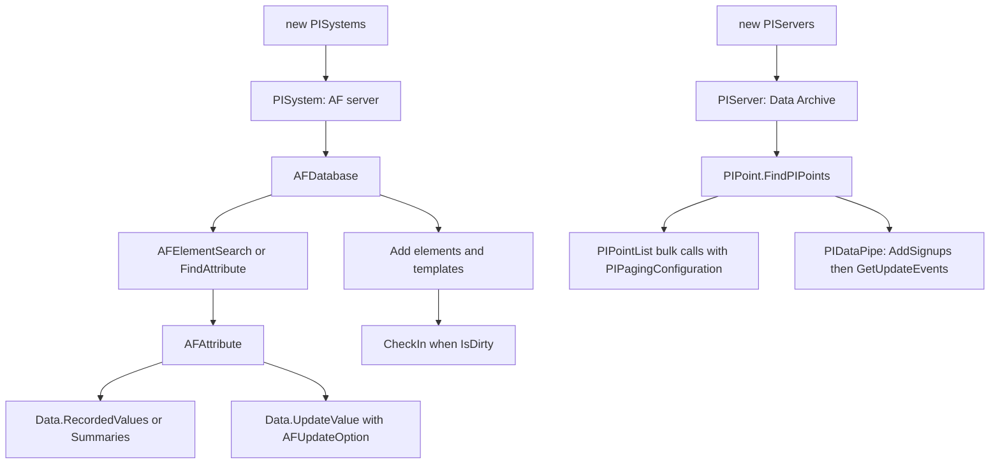

## Plain English

**AF SDK** is the .NET library that the PI System's own services use. PI Analysis Service, PI
Notifications Service and PI Web API are all built on it. OSIsoft describes it as the most performant
way to reach PI data on Windows and the most flexible way to move data in and out of PI.

A typical AF SDK program does four things:

1. **Connect** to an AF server (a `PISystem`) and a database, or to a Data Archive (a `PIServer`).
2. **Find** what it needs: an attribute by path, elements by search, PI points by name.
3. **Read or write** time-series values, one object at a time or in bulk.
4. **Commit** any changes to AF objects with `CheckIn()`.

AF SDK accepts the same PI time expressions you use elsewhere, such as `*` and `*-10h`.

## Deep Dive

**Connecting.**

```csharp
PISystems systems = new PISystems();
PISystem af = systems.DefaultPISystem;            // or systems["<AFServerName>"]
AFDatabase db = af.Databases["Green Power Company"]; // or af.Databases.DefaultDatabase
PIServer da = new PIServers().DefaultPIServer;
```

**Finding things.**

- Attribute by path: `AFAttribute.FindAttribute(@"\Meters\Meter001|Energy Usage", db)`. The `|`
  separates element path from attribute name.
- Elements by query: `new AFElementSearch(db, "Meters", "Template:MeterBasic")`, then
  `FindObjects()`. Set `CacheTimeout` (for example 5 minutes) to cache results.
- Event frames: `new AFEventFrameSearch(db, name, AFSearchMode.StartInclusive, start, end, query)`.
- PI points: `PIPoint.FindPIPoint(server, tagname)` or `PIPoint.FindPIPoints(server, names, attributes)`.

**AFSearch query strings** use `Field:value` tokens, with values optionally quoted:
`Template:'Pump' Name:'P*'`. AF SDK 2.9.5 added nested queries such as
`Element:{Name:'Boiler*'} Name:'Feed Rate'`; a nested query cannot contain its own nested query. AF
2018 SP2 added an OR operator and an OwnerName field.

**Reading values.**

| Call | Returns |
|---|---|
| `attr.Data.RecordedValues(timeRange, AFBoundaryType.Inside, uom, filter, includeFiltered)` | archived values |
| `attr.Data.RecordedValuesByCount(time, 100, false, AFBoundaryType.Interpolated, uom, filter, false)` | the 100 values before `time` |
| `attr.Data.InterpolatedValues(timeRange, new AFTimeSpan(...), uom, filter, false)` | evenly spaced values |
| `attr.Data.Summaries(timeRange, 1 h, AFSummaryTypes.Average, AFCalculationBasis.TimeWeighted, AFTimestampCalculation.EarliestTime)` | `IDictionary<AFSummaryTypes, AFValues>` |
| `attr.Data.EndOfStream` | the current value |
| `point.RecordedValues(timeRange, AFBoundaryType.Inside, null, false, 0)` | point values (args: range, boundary, filter, includeFiltered, maxCount) |

Pass a unit from `PISystem.UOMDatabase.UOMs["K"]` and the server converts values for you.

**Bulk calls.** `PIPointList.RecordedValues(..., pagingConfig, maxCount)` and
`AFAttributeList.Data.Summaries(..., pagingConfig)` take
`new PIPagingConfiguration(PIPageType.TagCount, 100)`.

**Writing.** `attr.Data.UpdateValue(new AFValue(v, time, uom), AFUpdateOption.Insert)`; bulk with
`AFListData.UpdateValues(values, AFUpdateOption.Insert)` or `AFUpdateOption.Remove`.

**Building AF.** `db.Elements.Add(...)`, `db.ElementTemplates.Add(...)`,
`template.AttributeTemplates.Add(...)`, `DataReferencePlugIn = PISystem.DataReferencePlugIns["PI Point"]`,
and `AFDataReference.CreateConfig` to create the PI points. Event frame templates are element
templates with `InstanceType = typeof(AFEventFrame)`. Finally `if (db.IsDirty) db.CheckIn();`.

**Live data.**

- `PIDataPipe(AFDataPipeType.Snapshot)` then `AddSignups(points)`, poll `GetUpdateEvents(1000)`,
  then `Close()` and `Dispose()`.
- Pipe types: Snapshot events may never reach the archive (compression) but suit live trends; Archive
  pipes report late; TimeSeries suits future data and RangeDelete notifications. Only PIDataPipe lets
  you choose; AFDataPipe and AFDataCache use a TimeSeries pipe for PI-point attributes.
- `AFDataCache`: `Add(attributes)`, set `CacheTimeSpan`, call `UpdateData()`, `Subscribe(observer)`.

**Authentication.** AF SDK clients set `preferOIDCAuth` (Prompt, Never, Always) in
`%ProgramData%\OSIsoft\AF\AFSDK.config` to use OpenID Connect.

## Worked Example

Read the last 100 good temperatures of a reactor in kelvin and write a result back (calls from
AVEVA's event-triggered calculation sample, assembled into one snippet):

```csharp
PISystems myPISystems = new PISystems();
PISystem myPISystem = myPISystems.DefaultPISystem;
AFDatabase db = myPISystem.Databases["Green Power Company"];
AFElement el = db.Elements["Reactor_1001"];
AFValues temps = el.Attributes["Temperature"].Data.RecordedValuesByCount(
    AFTime.Now, 100, false, AFBoundaryType.Interpolated,
    myPISystem.UOMDatabase.UOMs["K"], "", false);
temps.RemoveAll(v => !v.IsGood);
el.Attributes["Moles"].Data.UpdateValue(
    new AFValue(42.0, AFTime.Now, myPISystem.UOMDatabase.UOMs["mol"]), AFUpdateOption.Insert);
```

1. `isForward = false` means "the 100 values *before* the time".
2. `RemoveAll(v => !v.IsGood)` drops bad values before any statistics.
3. The sample keeps running with an `AFDataCache` and checks its update queue every 5000 ms
   (`UpdateCheckIntervalMS`), with `CacheTimeSpanSeconds` 86400. It uses AF SDK 2.10.9 on .NET
   Framework 4.8.

## Diagram



## Common Mistakes

- **Forgetting `CheckIn()`.** AF changes stay local and are never committed.
- **Only calling a timer-driven calculation from the timer.** `System.Timers.Timer` waits a full
  interval (60000 ms in the sample) before the first tick, so call the calculation once at start.
- **Not filtering bad values** (`IsGood == false`) before computing statistics.
- **Single braces in C# interpolated query strings.** Write `$"Element:{{Name:'{elemName}'}}"`.
- **Nesting a nested query.** `Element:{ ... Parent:{...} }` inside an attribute search failed.
- **Delete-then-insert without a safety copy.** The sample's value swap is "not safe against
  failure"; persist data first.
- **Assuming a snapshot pipe sees only archived values.** Snapshot events may never be archived.
- **Running newer samples on old AF SDK.** Samples built on 2.10.9 may need code changes for older
  versions.

## Real-World Scenario

AVEVA's AF SDK Getting Started Guide (version 1.1.2, written against AF 2.10) teaches these patterns
with a "Green Power Company" database imported from XML. Its five exercises follow the real life of
an integration project: connection and hierarchy basics, searching for assets, reading and writing
data, building an AF hierarchy, and working with event frames. For example, exercise 3 computes hourly
time-weighted energy averages for every meter with `AFAttributeList.Data.Summaries` and a
`PIPagingConfiguration` of 100 tags per page, so one call covers all meters without overloading the
Data Archive.
