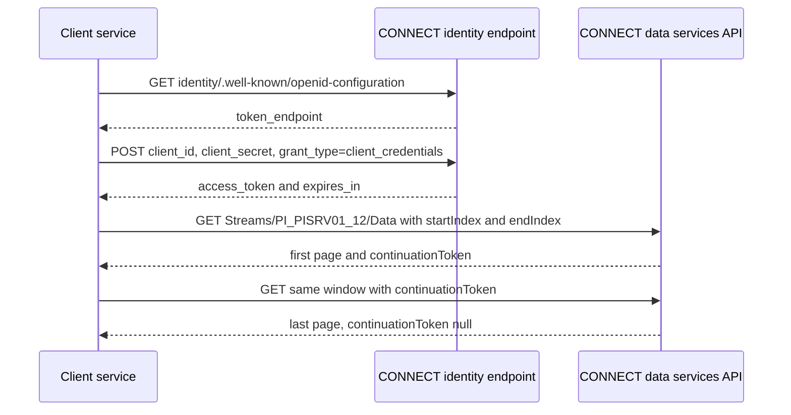

## Plain English

**CONNECT data services** is AVEVA's cloud store for time-series data. It was formerly AVEVA Data Hub
(ADH), and before that OSIsoft Cloud Services. It is powered by the **Sequential Data Store (SDS)**.

The building blocks:

- A **tenant** is your account. Inside it are **namespaces**, which keep types, streams and data views
  apart (for example production and test).
- An **SdsType** describes what one event looks like, with one key (index) property; for time series
  the key is a DateTime.
- An **SdsStream** is a sequence of events of one type.
- A **data view** queries many streams and returns aligned tables.

Everything is REST under one base URL:

```text
{resource}/api/{version}/Tenants/{tenantId}/Namespaces/{namespaceId}
```

An example resource is `https://uswe.datahub.connect.aveva.com` with version `v1`. Preview APIs use
`{version}-preview`.

> [!NOTE]
> The product names and the dates of each rename are not confirmed by a dated source in this course's
> research. The API shape above comes from AVEVA's own sample libraries.

## Deep Dive

**Authentication.** CONNECT uses OpenID Connect / OAuth 2.0 with third-party identity providers; it
does not store user accounts. Three flows:

| Flow | For | Tokens |
|---|---|---|
| Client Credentials | machine-to-machine services | access token, no refresh token |
| Authorization Code + PKCE | single-page and native apps | silent refresh, no refresh token |
| Hybrid | thick apps with a server component | access and refresh tokens |

Client-credentials steps: GET `{resource}/identity/.well-known/openid-configuration`, read
`token_endpoint`, POST a form with `client_id`, `client_secret` and `grant_type=client_credentials`,
then read `access_token` and `expires_in`. AVEVA's sample reuses a cached token only while more than 5
minutes remain.

**Headers.** `Authorization: Bearer <token>`, `Content-type: application/json`,
`Accept: application/json`; optional `Accept-Verbosity` (verbose or non-verbose, controls whether
default-valued fields are returned), `Request-Timeout` and `Community-id`.

**Streams and data.**

- `/Streams` (GET with `query`, `skip`, `count`); `/Streams/{id}` (GET, POST get-or-create, PUT
  create-or-update, DELETE); `/Streams/{id}/Type`, `/Tags`, `/Metadata`.
- `/Streams/{id}/Data`: GET with `index` or a `startIndex`/`endIndex` window; POST inserts; PUT
  updates; PUT `?allowCreate=false` replaces; DELETE by index or window.
- Also `/Data/First`, `/Data/Last`, `/Data/Summaries`, `/Data/Sampled`, `/Data/Transform`,
  `/Data/Transform/Interpolated` and bulk `/Bulk/Streams/Data/Joins`.
- Window reads page with `count` and `continuationToken`; loop until the token is null.
- Search: exact `Id:StreamDemo1` or wildcard `S*`.

**Data views.** `/dataviews/{id}` (POST, PUT, GET, DELETE), `/dataviews` (skip, count default 100),
`/Resolved/DataItems/{queryId}`, `/Resolved/IneligibleDataItems/{queryId}`,
`/Resolved/AvailableFieldSets`, and `/data/interpolated` (startIndex, endIndex, interval, count, form,
cache) and `/data/stored`. Paging follows links in the HTTP `Link` header.

**Data from PI.** Streams written by the PI to Data Hub transfer are read-only, with IDs
`PI_<DataArchiveName or alias>_<PointId>`. PI-generated types include IsQuestionable, IsSubstituted,
IsAnnotated, SystemStateCode and DigitalStateName. For compressed points only archived values are sent.

**OMF into CONNECT.** POST to `{resource}/api/{version}/tenants/{tenantId}/namespaces/{namespaceId}/omf`
with a client-credentials client and an OMF connection set up in the portal. CONNECT accepts only the
Dynamic type classification and no Link type data.

**Other features.** Communities share streams across tenants (when a CommunityId is set, the samples
ignore the namespace ID). Streaming Updates use a Signup resource. HTTP **207** (partial success) is
treated as an error by AVEVA's library.

## Worked Example

Read one day of a PI tag that was transferred to the cloud.

1. Get a token: GET the discovery document, POST `client_id`, `client_secret` and
   `grant_type=client_credentials` to its `token_endpoint`, keep `access_token`.
2. Find the stream: `GET .../Streams?query=ID:PI_PISRV01_* AND Name:sinusoid`. Its ID looks like
   `PI_PISRV01_12`.
3. Read the window:

```http
GET https://uswe.datahub.connect.aveva.com/api/v1/Tenants/{t}/Namespaces/{ns}/Streams/PI_PISRV01_12/Data?startIndex=2024-01-01T00:00:00Z&endIndex=2024-01-02T00:00:00Z&count=250000
Authorization: Bearer <token>
```

4. If the response has a `continuationToken`, repeat the call with it until it comes back null.
5. Remember that only archived values of compressed PI points were sent, so compare against PI's
   archive, not its snapshot.

A time-series SdsType built by AVEVA's sample:

```json
{"Id": "Value_Time", "SdsTypeCode": "Object", "Description": "A Time-Series indexed type with a value",
 "Properties": [{"Id": "value", "IsKey": false, "SdsType": {"Id": "doubleType", "SdsTypeCode": "Double"}},
                {"Id": "time",  "IsKey": true,  "SdsType": {"Id": "string", "SdsTypeCode": "DateTime"}}]}
```

## Diagram



## Common Mistakes

- **Ignoring `continuationToken`.** Only the first page of data is read.
- **Treating HTTP 207 as success.** Some items in the collection failed.
- **Granting broad roles.** Read-only access to the stream, or Tenant Member, is enough for reads.
- **Storing client secrets in plain config files.** AVEVA's samples warn this is insecure.
- **Writing to PI-transferred streams.** They are read-only.
- **Sending OMF Link data or a non-Dynamic type to CONNECT.** It is not accepted.

## Real-World Scenario

When historian data moves to the cloud, someone has to prove nothing was lost. AVEVA's
transfer-verification sample does this. On the cloud side it finds each stream with `ID:PI_<SERVER>_* AND Name:<TAG>`, reads data
windows with `count=250000` and follows `continuationToken` until it is null. On the PI side it reads
the same points with PowerShell Tools. Because the PI to Data Hub agent sends only archived data for
compressed points, the comparison covers archived values only. The sample asks only for read access
to the streams (or Tenant Member) rather than broader roles.
