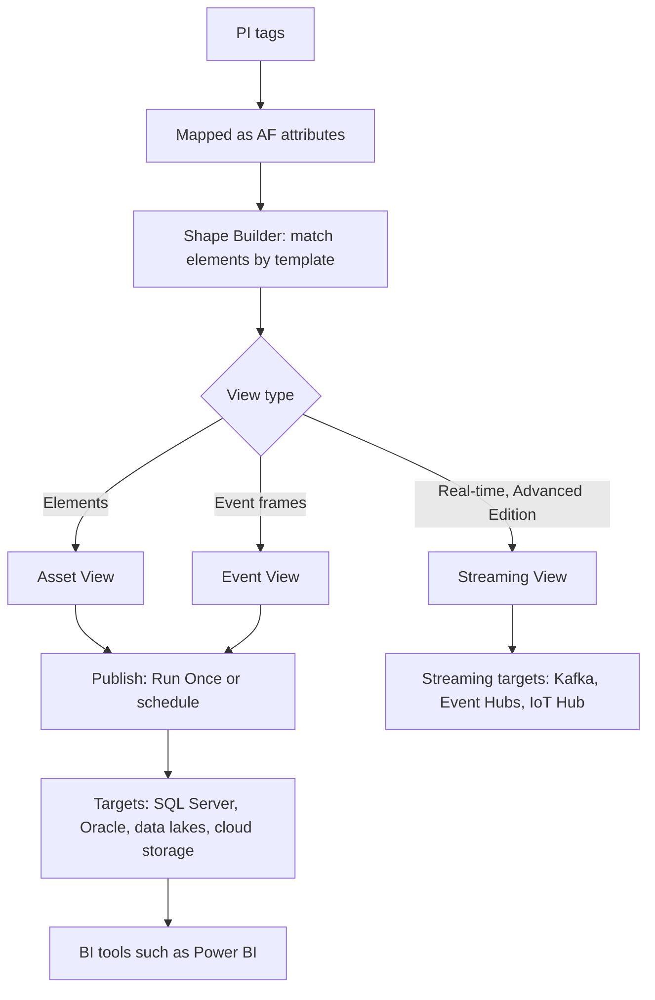

## Plain English

Data scientists and BI teams want tidy tables: one row per asset per hour, with columns such as
temperature, flow and month. PI data is stored as tags and AF attributes. **PI Integrator for Business
Analytics** bridges the two. It "reads data from PI Asset Framework and writes the data to a variety of
3rd-party platforms", which it calls **targets** (for example SQL Server, a data lake or Kafka).

You do the work in a web UI:

1. Build a **shape**: a pattern of AF elements and attributes, matched by template.
2. Turn it into a **view** with a time range and interval.
3. **Publish** the view once, on a schedule, or (Advanced Edition) as a continuous stream.

> [!IMPORTANT]
> PI tags cannot be used directly. They must first be mapped as AF attributes.

## Deep Dive

**Pipeline.** OSIsoft's 2015 description of the processing steps: **Cleanse** (data quality),
**Augment** (model normalisation), **Shape** (data compatibility and aggregation) and **Transmit**
(push to targets).

**View types.**

| View | Based on | Columns from |
|---|---|---|
| Asset View | elements and element templates | asset attributes |
| Event View | event frames and event frame templates | event frame attributes |
| Streaming View | for streaming targets such as Apache Kafka, Azure Event Hub, Azure IoT Hub | streamed real-time data |

A view has a start and end time and an interval set in "Edit Value Mode" (for example 1 hour). It
produces a TimeStamp column and can add Month, Month Name, Week of the Year and Hour columns. Shape
elements are matched by template (optionally including derived templates) and can be filtered by
asset name or template.

**Editions (2018).**

- **Standard Edition:** scheduled bulk updates. Targets included SQL Server, Azure SQL Data Warehouse,
  Oracle RDBMS, Azure SQL Database, Apache Hive, Hadoop HDFS, Azure Data Lake Store, flat files and
  ODBC.
- **Advanced Edition:** a superset that adds continuously streaming data, with Apache Kafka, Azure IoT
  Hub and Azure Event Hubs, Confluent Avro Schema Registry support with Kafka, and attribute-value-pair
  or raw "package" transmission. "In short, Advanced Edition supports streaming views while Standard
  Edition does not."

The 2020 R2 course listed Amazon (Kinesis Data Streams, Redshift, S3), Apache (Hive, Kafka), Azure
(Data Lake Storage Gen 1, Event Hubs, IoT Hub, SQL Database, SQL Data Warehouse), Google (BigQuery,
Cloud Storage, Cloud Pub/Sub), HDFS, Microsoft SQL Server, Oracle, SAP HANA ODBC, Text file and PI
View.

**Licensing.** By stream count. A stream is a unique PI tag used in a view, counted once across all
views. Publishing static attributes does not consume streams. Removing a view clears its buffered data
but "does not free up the available output streams allowed with your license".

**Behind the scenes.** Backend SQL databases are PIIntegratorDB, PIIntegratorLogs and
PIIntegratorStats. In the course the web UI ran at `https://pisrv01.pischool.int:444`. PI Integrator
also sits in the PI SQL architecture alongside PI SQL Data Access Server (Integrator Framework), and it
already supported TLS certificates before the PI Server 2023 OpenID Connect work.

**History.** In 2015 there were Business Intelligence, Data Warehouse and SAP HANA editions. PI
Integrator for Microsoft Azure 2016 was repackaged into PI Integrator for BA 2018.

## Worked Example

The 2020 R2 course builds a Power BI report on mixing tanks:

1. Build an **asset shape** on the mixing-tank element template.
2. Create an **asset view** with a 1-hour interval and add Month and Hour columns.
3. **Publish Run Once** to a Microsoft SQL Server target.
4. Import the SQL table into Power BI. Power BI is not a direct target.

For an **event view** of batches, set the Event Frame Duration unit to Second; otherwise "it will be
displayed as a round number of hours".

**Licensing check.** Two views both use the tag `TK101.Level` and one also uses a static attribute
`Capacity`. That consumes one stream: the tag counts once across views, and the static attribute
consumes none.

## Diagram

## Common Mistakes

- **Trying to use PI tags directly.** Map them as AF attributes first.
- **Expecting streaming on Standard Edition.** Only Advanced Edition supports streaming views.
- **Using the PI View target in production.** It is for dev/test, deprecated because of a security
  vulnerability, and "should not be used if a Microsoft SQL Server target is available".
- **Deleting views to free licence streams.** Removing a view does not free its streams.
- **Trusting the preview completely.** Previews may be incomplete, for example missing units.
- **Looking for Power BI in the target list.** Load from SQL Server or another target.

## Real-World Scenario

EDPR, a renewable-energy utility, evaluated PI Integrator for sending PI data to its own analytics
platform (PI World 2019). The presenter said PI Integrator had configuration difficulties and
restrictions for their use case, and the team chose PI Web API channels instead. The lesson for
architects: PI Integrator is strongest when the goal is shaped, template-based tables or streams for BI
targets it supports; a custom application with very specific delivery needs may fit PI Web API better.
