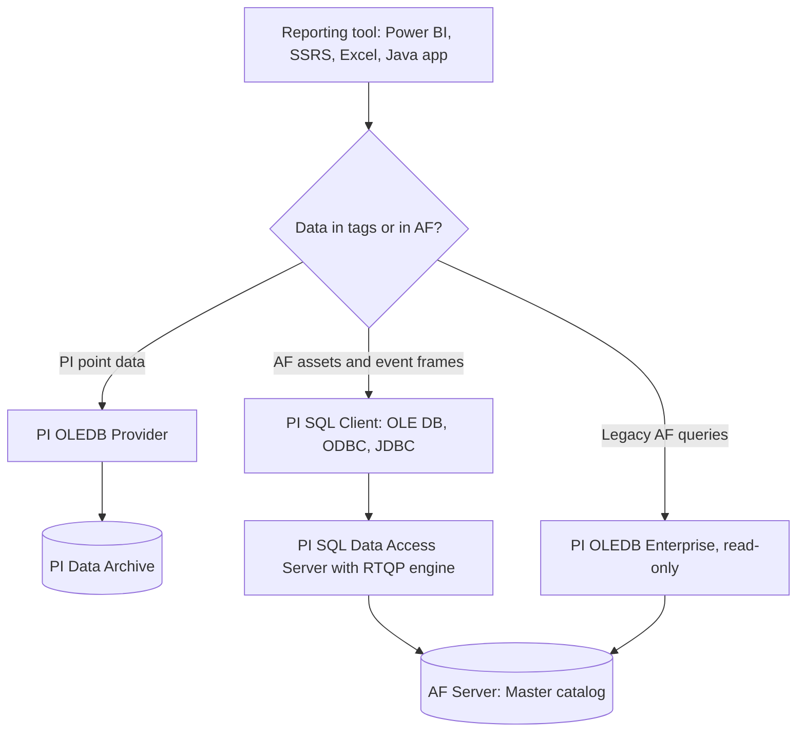

## Plain English

Many reporting tools speak SQL, not REST. The PI System offers a family of SQL drivers so tools such as
SSRS, Power BI, SSIS, SQL Server Linked Server, Excel, Tableau, Spotfire and custom apps can query PI.

There are two halves to remember:

- **PI point data** (the Data Archive): **PI OLEDB Provider**, with read and write access.
- **AF data** (elements, attributes, event frames): **PI SQL Client** talking to the **RTQP engine**
  in PI SQL Data Access Server, or the older **PI OLEDB Enterprise**, which is read-only.

> [!TIP]
> Ask "is my data in tags or in AF?" first. That one answer picks most of the product for you.

## Deep Dive

**The products.**

| Product | Reaches | Access | Transport / notes |
|---|---|---|---|
| PI OLEDB Provider | PI point data | read/write (CRUD) | catalogs piarchive, pipoint, pids, piuser |
| PI OLEDB Enterprise | AF assets, event frames, attribute data | read-only | queries can be migrated to RTQP |
| PI SQL Client (OLE DB, ODBC, JDBC) | one AF database per connection via RTQP | read | 2018 had OLE DB only; 2018 R2 added ODBC and pure-Java JDBC and dropped the AF SDK dependency |
| PI JDBC | PI Data Archive, AF, PI Integrator | CRUD on points, read on AF | JDBC 4.0-4.2, HTTPS only, needs PI SQL DAS |
| PI ODBC | PI data | | ODBC v3 over net.tcp or HTTPS |

PI SQL Client connects to **PI SQL Data Access Server (PI SQL DAS)** over net.tcp or HTTPS.

**PI OLEDB Provider tables.**

- `piarchive..picomp2`: archived (compressed) events with real timestamps. Values are variants.
- `piarchive..piinterp2`: interpolated values at a timestep (default 1 h); recommended over `piinterp`.
- `piarchive..piavg`, `pitotal`, `pimin`, `pimax`: aggregates. `piavg` is time-weighted by default;
  use `pimean` or `calcbasis = 'EventWeighted'` for event-weighted.
- `piarchive..pisnapshot`: the snapshot.
- `pipoint..classic`: classic point-class attributes only. `pipoint..pipoint2` returns all tags and is
  recommended unless you need backward compatibility.
- `PICalcVal` is deprecated; `PIAdvCalcVal` is its successor.

**RTQP.** Each connection targets one AF database, exposed as the only built-in catalog, `Master`.
Tables include `Master.Element.Element`, `Master.Element.Attribute` (current value in `ValueTimeStamp`
and `Value`; there is no snapshot table) and `Master.EventFrame.EventFrame`. Template table-valued
functions such as `[Master].[Element].[GetSummary]` and `GetSampledValues` take the element template
name first and are called with `CROSS APPLY`. Helpers include `ParentName`, `Double`, `Format`, `List`
and `Split`.

**Migrating from PI OLEDB Enterprise to RTQP.** Use `PrimaryPath` and `Template` columns directly
instead of joining hierarchy tables. Subqueries work only in FROM. `OPTION (FORCE ORDER)` and named
parameters are not supported (use positional `?`). Event frame versioning was dropped.

**Connection strings.**

```text
OLE DB: Provider=PISQLClient.1;Data Source=PISRV01\WindFarm;Integrated Security=SSPI
ODBC:   DRIVER=PI SQL Client;Integrated Security=SSPI;AF Server=PISRV01;AF Database=WindFarm
JDBC:   jdbc:pisql://<das_node>/Data Source=<pi_server_name>; Integrated Security=SSPI;
        (class com.osisoft.jdbc.Driver, PIJDBCDriver.jar under PIPC\JDBC)
```

## Worked Example

**15-minute averages for the last hour, only fully good intervals** (PI OLEDB Provider):

```sql
SELECT * FROM [piarchive]..[piavg]
WHERE tag = 'tagname' AND time BETWEEN '*-1h' AND '*' AND timestep = '15m' AND pctgood >= 100
```

**Count archived events since the start of the month:**

```sql
SELECT COUNT(*) FROM piarchive..picomp2 WHERE tag = 'sinusoid' AND time >= BOM('*')
```

**Find tags from two point sources:**

```sql
SELECT tag, descriptor, creationdate FROM pipoint..classic WHERE pointsource = 'R' OR pointsource = '9'
```

**AF elements of two templates** (RTQP):

```sql
SELECT e.PrimaryPath + e.Name, e.Template FROM Master.Element.Element e WHERE e.Template IN ('Boiler', 'Heater')
```

**Insert a value** (PI OLEDB Provider is read/write):

```sql
INSERT piarchive..picomp2 (tag, time, value, status) VALUES ('somePIPoint', 'y+8h', 12.5, 0)
```

## Diagram



## Common Mistakes

- **Choosing PI OLEDB Enterprise for writes.** It is read-only.
- **Using `piinterp` when you wanted archived values.** You get interpolated values on a timestep
  aligned to the query time (one user saw odd timestamps like xx:09:51). Use `picomp2`.
- **Charting `picomp2` values directly.** They are variants; some clients need
  `cast(value as Float32)`.
- **Using `pipoint..classic` to list all tags.** It only covers the classic point class; use
  `pipoint2`.
- **PI time strings through a SQL Server Linked Server** can raise "Conversion failed when converting
  date and/or time from character string"; OPENQUERY worked around it.
- **Selecting RTQP `Value` columns you do not need.** It greatly increases execution time.
- **Expecting RTQP to query PI points directly.** In 2019 Data Archive tables were listed as "Future",
  and a 2022 feedback idea asking for it had "No status".

## Real-World Scenario

The PI World 2020 lab on migrating to PI SQL Client used a wind-farm AF database. Event frames were
joined to their elements with
`Master.Element.Element e JOIN Master.EventFrame.EventFrame ef ON e.ID = ef.PrimaryReferencedElementID`,
and statistics for each event were computed with
`CROSS APPLY [Master].[Element].[GetSummary]('Wind Farm', ...)(e.ID, ef.StartTime, ef.EndTime)`.
Filters such as `e.PrimaryPath LIKE '\West%' AND e.Template = 'Wind Farm' AND e.Name = ?` used a
positional parameter, because RTQP does not support the named parameters the old PI OLEDB Enterprise
queries had used. An idea to add element reference types to RTQP tables was declined in August 2022, so
some OLEDB Enterprise queries cannot be moved one-to-one.
