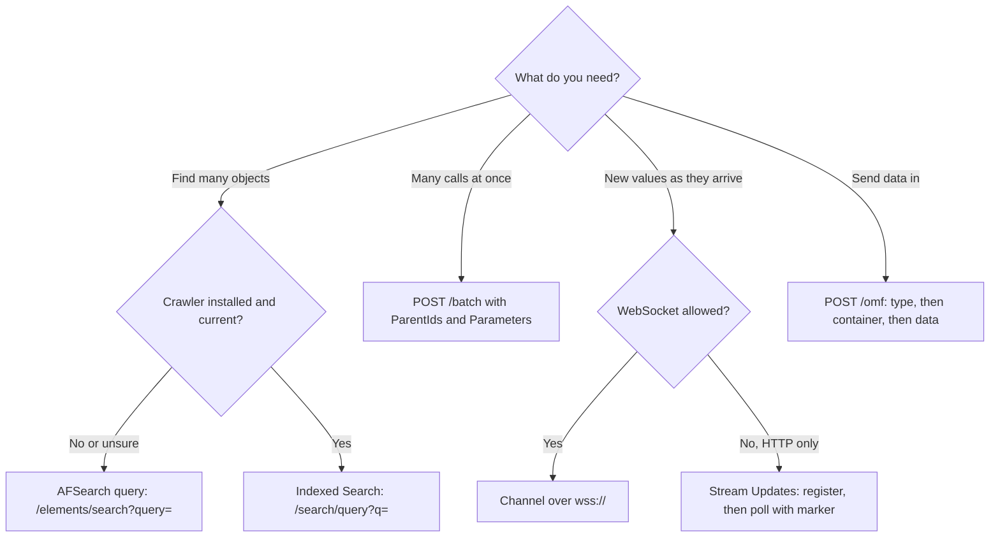

## Plain English

Once you can read one stream, the next questions are about scale:

- **How do I find thousands of objects?** Use search. AFSearch-style query methods
  (`/elements/search?query=...`) need nothing extra. Indexed Search (`/search/query?q=...`) needs a
  separate crawler service.
- **How do I avoid thousands of HTTP round trips?** Put many requests in one **batch**.
- **How do I get new values as they arrive?** Open a **channel** (a WebSocket that the server pushes
  to), or poll **Stream Updates** with a marker over plain HTTP.
- **How do I send data in from a device or app?** Post **OMF** messages to the `/omf` endpoint.

> [!NOTE]
> No webhook (outbound HTTP callback) feature appears in the PI Web API controller lists the research
> examined. Push is through channels; pull is through Stream Updates.

## Deep Dive

**Search.**

| Method | Example | Needs |
|---|---|---|
| AFSearch query (2017 R2+) | `GET /elements/search?databaseWebId={id}&query=Name:=*b* AND Template:=PumpTemplate` | nothing extra |
| Indexed Search | `GET /search/query?q=name:*b* AND afelementtemplate=PumpTemplate AND scope=MyAFDatabase` | PI Web API Crawler |

Query methods also exist for attributes, event frames, analyses, analysis templates and notification
rules. OSIsoft lists their benefits as better performance, less filtering in PI Web API and better
caching. Indexed Search and the Crawler are optional; PI Vision 2020 no longer uses the crawler, but
AVEVA's feedback page does not say Indexed Search was removed.

**Batch.** `POST /batch` (the only action; GET is not supported) takes a JSON object of named
sub-requests. Each has `Method` and `Resource`, and optionally `Content`, `Headers`, `ParentIds`,
`Parameters` and `RequestTemplate`.

- `ParentIds` lists sub-requests that must finish first.
- `Parameters` are JSONPath expressions such as `$.1.Content.WebId`; their results fill `{0}`, `{1}`
  in the child's Resource.
- JSONPath supports `$`, dot notation, index `[0]` and wildcard `[*]`.
- `Content` is a JSON *string*.
- The response has one entry per sub-request with `Status`, `Headers` and `Content`.
- The batch POST itself needs `X-Requested-With`, like any write.

**Channels.** WebSocket subscriptions on `/streams/{webId}/channel`, `/streamsets/{webId}/channel`
or `/streamsets/channel?webId=...&webId=...`. Use `wss://`, not `https://`. Parameters:
`includeInitialValues` (default false) and `heartbeatRate` (default no heartbeat).

**Stream Updates.** HTTP-only. Register with `POST /streams/{webId}/updates` (or
`POST /streamsets/updates?webId=...`) to get a marker, then poll `GET /streams/updates/{marker}`.
Each response includes `LatestMarker` for the next call; results are queued server-side. It appeared as
a CTP around PI Web API 2018 SP1.

**OMF endpoint.** Added in the 2019 release (the root Links include `Omf`). Messages are POSTed to
`{piwebapi}/omf` with headers `messagetype` (type, container or data), `action` (create),
`messageformat` (JSON), `omfversion` (1.2 in AVEVA's sample), optional `compression: gzip`, plus
`x-requested-with` and Authorization. Rules:

- Send **type, then container, then data**.
- PI accepts only a DateTime index property, and only one index.
- An OMF type cannot be changed once defined; a new structure needs a new type.
- AVEVA's sample treats **409** as "type already exists with the same ID and version".
- The OMF option must be selected when installing PI Web API.
- The PI Connector Relay is discontinued; the Fledge OMF plugin docs recommend the PI Web API endpoint.

## Worked Example

Read an attribute's current value and last 10 recorded values, and write to it, in **one** HTTP call
(from AVEVA's Python sample, simplified):

```json
{
  "1": {"Method": "GET", "Resource": "https://srv/piwebapi/attributes?path=\\\\AF01\\OSIPythonDatabase\\OSIPythonElement|OSIPythonAttributeSampleTag"},
  "2": {"Method": "GET", "Resource": "https://srv/piwebapi/streams/{0}/value", "ParentIds": ["1"], "Parameters": ["$.1.Content.WebId"]},
  "3": {"Method": "GET", "Resource": "https://srv/piwebapi/streams/{0}/recorded?maxCount=10", "ParentIds": ["1"], "Parameters": ["$.1.Content.WebId"]},
  "4": {"Method": "PUT", "Resource": "https://srv/piwebapi/attributes/{0}/value", "Content": "{'Value':3.1415}", "ParentIds": ["1"], "Parameters": ["$.1.Content.WebId"]}
}
```

1. Sub-request 1 finds the attribute by path.
2. Sub-requests 2-4 wait for it (`ParentIds`) and take its WebID through `$.1.Content.WebId`, which
   replaces `{0}`.
3. The response holds four entries, each with its own `Status` and `Content`.

**A live subscription** for two streams with initial values and a 10-second heartbeat:
`wss://srv/piwebapi/streamsets/channel?webId={id1}&webId={id2}&includeInitialValues=true&heartbeatRate=10`

## Diagram



## Common Mistakes

- **Using `https://` for a channel.** Channels are WebSockets: use `wss://`.
- **Expecting Indexed Search to find new objects at once.** Results depend on the crawler having
  indexed them.
- **Using `Parameters` without `ParentIds`.** The child may run before the parent's result exists.
- **Sending OMF data before its type and container.** Order is type, container, data.
- **Trying to change an OMF type in place.** Create a new type id or version instead.
- **Forgetting `X-Requested-With` on `POST /batch`.** The batch call is itself a write request.
- **Sending `GET /batch`.** Only POST is supported.

## Real-World Scenario

EDPR, a renewable-energy utility, presented at PI World 2019 how it streams PI data to its own
platform. It used `/piwebapi/streamsets/{webid}/channel` for continuous streaming and scaled to about
**2 million tags** across **4 PI Web API instances**, organised as 39 element groups of about 50,000
tags each (reported by EDPR at PI World 2019). Grouping attributes under elements meant one channel
per element group rather than one per tag. The same presenter said PI Web API was chosen over PI
Integrator because of configuration difficulties and restrictions for their use case.
