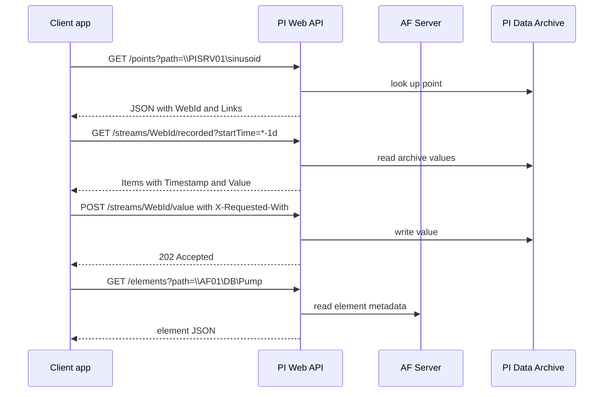

## Plain English

**PI Web API** lets any program that can make an HTTP request read and write PI System data.
It is a RESTful service: every object (a PI point, an AF element, an attribute) is a *resource*
with its own URL, and the response tells you where related resources are through a `Links` object.

- The home page of the API is `https://<server>/piwebapi`.
- The built-in help, where you can try every controller, is `https://<server>/piwebapi/help`.
- Data comes back as JSON.

PI Web API is built on top of **AF SDK**, the Windows-only .NET library. It exposes a subset of
AF SDK and cannot be faster than it, but it works from Linux, Python, browsers and anything else that
speaks HTTP.

To work with an object you usually need its **WebID**, a URL-safe identifier. The normal pattern is:
look the object up by path once, keep the WebID, then call the data endpoints with it.

> [!TIP]
> Think of the path as the object's street address and the WebID as its postcode-plus-house-number:
> short, safe to put in a URL, and safe to store.

## Deep Dive

**Controllers and verbs.** URLs are grouped into controllers, such as Point, Element, Attribute,
AssetServer, AssetDatabase, DataServer, EventFrame, Stream, StreamSet and Batch. The 2018 Swagger
specification also lists Analyses, element templates, security and search endpoints. HTTP verbs map to
operations: **GET** reads, **POST** creates, **PUT** fully updates, **PATCH** partly updates and
**DELETE** deletes.

**Finding objects by path.**

| Object | Request |
|---|---|
| PI point | `GET /points?path=\\<DataArchive>\<tag>` |
| AF element | `GET /elements?path=\\<AFServer>\<Database>\<Element>` |
| AF attribute | `GET /attributes?path=\\<AFServer>\<Database>\<Element>\|<Attribute>` |
| Asset database | `GET /assetdatabases?path=\\<AFServer>\<Database>` |

The pipe `|` separates the element path from the attribute name.

**Streams.** A stream is the time series of a point or attribute: `/streams/{webId}/...`.
Useful endpoints are `value` (current), `end`, `recorded`, `recordedattime`, `recordedattimes`,
`interpolated`, `interpolatedattimes`, `plot` and `summary`. They accept PI time expressions such as
`*-1d` and `*`. Recorded calls take `maxCount`, which defaults to **1000**; `filterExpression` filters
values, where `'.'` means the stream's own value. **StreamSets** read many streams in one call, either
all attributes of an element (`/streamsets/{webId}/value`) or an ad hoc list with a repeated `webId`
parameter.

**Responses.** Values are wrapped in `Items`. Each item has `Timestamp` (ISO 8601, `Z` for UTC),
`Value`, `UnitsAbbreviation`, `Good`, `Questionable`, `Substituted` and `Annotated`. A digital state is
an object: `"Value": {"Name": "Run", "Value": 3}`. Use `selectedFields=Items.Timestamp;Items.Value`
to trim the response. Errors come back as `{"Errors": [...]}`.

**WebID 2.0.** Introduced in PI Web API 2017 R2, WebID 2.0 is an open format clients can build and
decode. Character 1 is the type, character 2 the version (`1`), characters 3-4 the object marker (for
example `DP` PI point, `Em` element, `Ab` attribute, `RS` asset server), then Base64url-encoded IDs or
path. Choose the type with `?webIdType=`:

| Type | Encodes | Breaks when |
|---|---|---|
| Full (F) | IDs and path | most resilient (default) |
| IDOnly (I) | IDs only | the object is deleted |
| PathOnly (P) | path only | the object is renamed |
| LocalIDOnly / DefaultIDOnly | local IDs | not persistent; not load-balancer safe |

**Security settings.**

- PI Web API requires **HTTPS**; there is no plain-HTTP option. The default port is **443**.
- **CSRF defence:** POST, PUT, PATCH and DELETE must carry an `X-Requested-With` header (any value).
- **Authentication:** Basic, Kerberos (Negotiate) and Bearer (OpenID Connect). Bearer and Kerberos
  cannot be enabled together; Basic can be combined with either. AVEVA advises against Anonymous.
  In PI Server 2023, PI Web API is registered with **AVEVA Identity Manager (AIM)** through its Admin
  Utility for OpenID Connect.
- **CORS** attributes (CorsOrigins and others) allow browser apps from another origin.
- **DisableWrites** makes the service read-only; RateLimitMaxRequests, RateLimitDuration and
  MaxReturnedItemsPerCall help against denial of service.
- AF metadata is cached and refreshes every 5 minutes by default; send `Cache-Control: no-cache` to
  bypass it. Time-series data are never cached.

## Worked Example

Read the last day of a tag, hourly, and write a value back.

1. Find the point:
   `GET https://pisrv01/piwebapi/points?path=\\PISRV01\sinusoid` and copy `WebId` from the response.
2. Interpolated hourly values for the last day:
   `GET https://pisrv01/piwebapi/streams/{webId}/interpolated?startTime=*-1d&endTime=*&interval=1h`
3. Only the last 10 recorded values, timestamp and value only:
   `GET .../streams/{webId}/recorded?maxCount=10&selectedFields=Items.Timestamp;Items.Value`
4. The daily average:
   `GET .../streams/{webId}/summary?startTime=*-1d&endTime=*&summaryType=Average`
5. Write a value:

```http
POST https://pisrv01/piwebapi/streams/{webId}/value
X-Requested-With: XmlHttpRequest
Content-Type: application/json

{"Timestamp": "2015-05-25T07:00:00Z", "Value": 42.0}
```

AVEVA's Python sample gets HTTP **202 (Accepted)** for a stream write, so do not test for 200.

**Decoding a WebID.** `F1RSiOPKGTTUcUCFkVGxiCya9gUElTUlYwMQ` is type `F` (Full), version `1`, marker
`RS` (asset server), a 22-character server GUID `iOPKGTTUcUCFkVGxiCya9g`, then `UElTUlYwMQ`, which is
Base64 for `PISRV01`.

## Diagram



## Common Mistakes

- **Forgetting `X-Requested-With` on a write.** CSRF defence rejects POST, PUT, PATCH and DELETE
  without it. GET is not affected.
- **Treating digital states as numbers.** `Value.Value` is the state code; read `Value.Name` for the
  text.
- **Calling `/recorded` to get a value at a past time.** Without a time range it returns recent
  values; use `/recordedattime?time=...`.
- **Storing PathOnly WebIDs for objects that get renamed.** PathOnly breaks on rename; IDOnly breaks
  on delete; Full is the most resilient.
- **Wondering why an AF change in PI System Explorer does not show.** Wait for the 5-minute cache
  refresh or send `Cache-Control: no-cache`.
- **Planning Kerberos and Bearer together.** They cannot both be enabled.
- **Expecting HTTP 200 from writes.** Stream writes return 202 and attribute PUT returns 204 in
  AVEVA's samples.
- **Invalid JSON bodies**, such as trailing commas.

## Real-World Scenario

A wind and solar operator (EDPR, PI World 2019) used PI Web API to feed its own applications. Each
point and element was located once by path (`/points?path=...`, `/elements?path=...`) and its WebID
kept. Current values for all attributes of an element came from one
`/streamsets/{webId}/value` call, and archive windows from
`/streamsets/{webId}/recorded?starttime=*-1h&endtime=*-30m`. Using StreamSets rather than one call per
attribute kept the number of requests manageable as the system grew.
