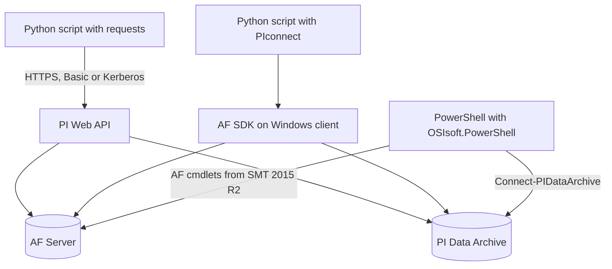

## Plain English

Three common ways to script against PI:

| Approach | Talks to | Runs on | Good for |
|---|---|---|---|
| Python + `requests` + PI Web API | REST over HTTPS | anywhere | cross-platform scripts, notebooks |
| Python + **PIconnect** | AF SDK | Windows with AF SDK | pandas analysis on a PI client machine |
| **PowerShell Tools for the PI System** | Data Archive (and AF from SMT 2015 R2) | Windows | admin automation: points, values, archives, backups |

Other tools follow the same REST pattern. JMP (JSL) scripts, for example, call
`GET elements/{webId}/elements?webidtype=idonly&selectedfields=items.webid;items.name;...` and parse the
JSON.

## Deep Dive

**Python and PI Web API.** AVEVA's sample uses `requests` with either `HTTPBasicAuth(user, pwd)` or
`HTTPKerberosAuth(mutual_authentication='REQUIRED', sanitize_mutual_error_response=False)` from
`requests_kerberos`.

- Read: `GET /streams/{WebId}/value` for the snapshot, `GET /streams/{WebId}/recorded?startTime=*-2d`
  for history, `&selectedFields=Items.Timestamp;Items.Value` to trim.
- Write: send `X-Requested-With: XmlHttpRequest` and `content-type: application/json`.
- Status codes in the sample: a single value write and a 100-value write to
  `/streams/{WebId}/recorded` both return **202**; a `PUT` to a static attribute's value returns **204**.
- The sample needs rights to create and delete AF databases, templates, elements and PI points.
- Platforms that cannot do Kerberos (for example Cybus Connectware) need `Basic` added to PI Web API's
  `AuthenticationMethods` setting; Kerberos is enabled by default.

**PIconnect.** "A python connector to the OSISoft PI and PI-AF databases" that works through the
proprietary SDK; MIT-licensed; release v0.12.4 seen (24 March 2025). Install with
`conda install PIconnect` (preferred) or `pip install PIconnect`.

- `with PI.PIServer() as server:` connects to the default server. If a named server is not found, "a
  warning is raised" and the default is returned.
- `server.search('sinusoid')` returns PI points.
- `recorded_values(start, end, boundary_type='inside', filter_expression='')`,
  `interpolated_values(start, end, interval)`, `summary(...)`, `summaries(...)`,
  `update_value(value, time=None, update_mode=UpdateMode.NO_REPLACE, buffer_mode=BufferMode.BUFFER_IF_POSSIBLE)`
  and the `current_value` property.
- Results are "essentially a decorated version of a pandas.Series". Times are parsed with AF SDK time
  parsing, so `*-48h` works.
- AF: `with PI.AFDatabase(server=..., database=...) as database:` and
  `database.descendant(r"Plant1\Outlet")`.

**PowerShell Tools for the PI System.** Module `OSIsoft.PowerShell`, shipped with PI System Management
Tools 2015 and later, auto-imported on first use. List cmdlets with
`Get-Command -Module OSIsoft.PowerShell`.

- `Connect-PIDataArchive -PIDataArchiveMachineName <name>` returns a connection; pass it with
  `-Connection`.
- `Get-PIPoint -Name <tag>`, `Get-PIPoint -ID <id> -Attributes pointtype`, `-AllAttributes`.
- `Get-PIValue -PointName <tag> -StartTime ... -EndTime ...` or `-Count n`; `Add-PIValue`,
  `Remove-PIValue`; `Set-PIPoint -Attributes @{...}`.
- Archives: `Get-PIArchiveFileInfo`, `Register-PIArchive`, `Unregister-PIArchive`.
- Backups: `Start-PIBackup -BackupLocation <dir> -Connection $con` and `Get-PIBackupState`.
- Timestamps display in UTC.

## Worked Example

**Python, PI Web API** (condensed from AVEVA's samples):

```python
import requests
from requests.auth import HTTPBasicAuth
base = "https://pisrv01/piwebapi"
auth = HTTPBasicAuth("user", "pwd")
attr = requests.get(base + r"/attributes?path=\\AF01\OSIPythonDatabase\OSIPythonElement|OSIPythonAttributeSampleTag", auth=auth).json()
rec = requests.get(f"{base}/streams/{attr['WebId']}/recorded?startTime=*-2d&selectedFields=Items.Timestamp;Items.Value", auth=auth).json()
for item in rec["Items"]:
    print(item["Timestamp"], item["Value"])
r = requests.post(f"{base}/streams/{attr['WebId']}/value", json={"Value": 42},
                  headers={"X-Requested-With": "XmlHttpRequest"}, auth=auth)
assert r.status_code == 202
```

**Python, PIconnect:**

```python
import PIconnect as PI
with PI.PIServer() as server:
    point = server.search('sinusoid')[0]
    data = point.interpolated_values('*-1h', '*', '5m')
```

**PowerShell:** correct three values in one call.

```powershell
$con = Connect-PIDataArchive -PIDataArchiveMachineName PISRV01
Add-PIValue -PointName Sinusoid,SinusoidU,CDT158 -Time "1-Apr-2017 20:00:00","3-May-2017 8:00:00","5-Jun-2017 12:00:00" -Value 100,200,300 -WriteMode ReplaceX -Connection $con
```

## Diagram



## Common Mistakes

- **Disabling certificate checks** (`verify=False` in Python, `Secure(0)` in JSL) in production.
- **Hard-coding passwords.** Kerberos avoids storing them.
- **Testing writes for HTTP 200.** Stream writes return 202, attribute PUT returns 204.
- **Forgetting `X-Requested-With` on writes.**
- **Writing AF paths as normal Python strings.** Use raw strings (`r"Plant1\Outlet"`) or escape the
  backslashes.
- **Expecting meaningful summaries on root elements.** PIconnect warns they "might not have meaningful
  summaries".
- **Reading PowerShell timestamps as local time.** They are shown in UTC.
- **Looking for "Backup-PIDataArchive".** OSIsoft samples use `Start-PIBackup`.

## Real-World Scenario

AVEVA published a PowerShell sample that checks whether data sent from PI to AVEVA Data Hub arrived
intact. It connects with `Connect-PIDataArchive -PIDataArchiveMachineName <name> -OperationTimeout ...`,
reads each point's type with `Get-PIPoint -ID <id> -Attributes pointtype`, and reads a fixed number of
values with `Get-PIValue -PointId <id> -StartTime <t> -Count <n>`. It uses `-Count` rather than an end
time "to avoid differences due to snapshot data", then reads the same window from the cloud side and
compares them. It needs PowerShell 5.1 or later.
