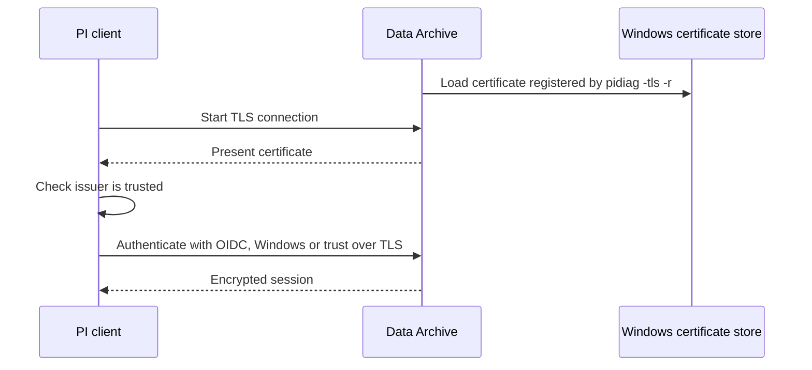

## Plain English

Encryption in transit stops someone on the network from reading or changing PI data and passwords.
The PI System has added it in stages:

- **PI Server 2015** brought **transport security** for the Data Archive using the Windows
  protocol in use: NTLM with RC4/MD5, or Kerberos (Active Directory) with AES256/SHA1.
- **PI Server 2023** added **TLS** with certificates. It "Natively encrypts communication for all AVEVA
  PI System authentication methods (OIDC, Windows, PI Trust)". It is optional for PI Server, but
  required if you use OIDC authentication and AVEVA Identity Manager.
- **PI Web API** has always been HTTPS: "PI Web API has no HTTP option".

A certificate only helps if clients **trust** it. That is where most problems come from.

## Deep Dive

**Data Archive certificate commands** (UC23 claims-authentication deck):

| Task | Command |
|---|---|
| Choose certificate | At install |
| Register or change | `pidiag -tls -r <thumbprint>` (`--register`) |
| Verify | `pidiag -tls -y` (`--verify`) |

**AF Server certificate.** Change it with `AFDiag /CT:<thumbprint>` (`/CertificateThumbprint:`). It is
stored as the registry value `CERTIFICATETHUMBPRINT` under
`HKLM\SYSTEM\CurrentControlSet\Services\AFService`.

**Trust.** Components on one server can share a certificate, which needs to be trusted by all clients.
Self-signed certificates are trusted only locally or where you import them. If OIDC is turned on and
clients do not trust the certificate, there is "No popup if the certificate isn't present", so it just
fails. AF SDK clients have a `preferOIDCAuth` setting in AFSDK.config (Prompt, Never, Always).
Automatic certificate rotation was listed "In development" in 2023.

**PI Web API.**

- Listens on port 443 for HTTPS by default. The installer asks for the certificate and the Admin
  Utility is the only supported place to change it (along with listen port and authentication).
- Certificate choices include self-signed, Windows domain CA, Let's Encrypt or commercial.
- Authentication: OpenID Connect/Bearer, Kerberos, Basic, Anonymous. "Bearer and Kerberos are mutually
  exclusive"; "Anonymous authentication disables all other types", and AVEVA recommends against it.
  Basic exposes credentials on the network.
- CSRF defence: POST, PATCH and DELETE clients must send `X-Requested-With: XMLHttpRequest`.

**PI Vision** is reached at `https://webServer/PIVision` by default.

## Worked Example

A PI Vision server logs "client attempted TLS connection but PInetmgr does not have a certificate
loaded" (message ID 748) when connecting to a collective.

1. On each Data Archive member, run `pidiag -tls -y` to see whether a certificate is registered.
2. On the member without one, find the thumbprint of a suitable certificate in the machine store and
   run `pidiag -tls -r <thumbprint>`.
3. Make sure every client (PI Vision server included) trusts the issuing CA. A self-signed certificate
   would need importing on every client.
4. In the PI Square case, a community member suggested installing each server's certificate on the
   other server without copying private keys; this fix was not confirmed.
5. For AF, repeat with `AFDiag /CT:<thumbprint>` if the AF Server certificate must change.

## Diagram

## Common Mistakes

- **Self-signed certificates on a multi-server system** without importing them to every client.
- **Turning on OIDC before certificates are trusted.** Clients fail with no prompt.
- **Enabling Anonymous on PI Web API**, which disables all other authentication.
- **Using Basic authentication over untrusted networks.**
- **Disabling CSRF defence** to make a third-party tool work (some guides set `EnableCSRFDefense` to
  false).
- **Forgetting certificate expiry.** Rotation was not automatic as of 2023.

## Real-World Scenario

AVEVA's AVEVA World 2023 security session described TLS as an "Optional feature; required for OIDC
Authentication and AIM". A site planning to move PI Vision and PI Web API users to AVEVA Identity Manager
therefore has to deploy trusted certificates to the Data Archive (with `pidiag -tls`), the AF Server
(with `AFDiag /CT`) and PI Web API first, and push the issuing CA to every client. Doing the
certificate work first, and checking it with `pidiag -tls -y`, avoids the silent OIDC failures the deck
warns about.
