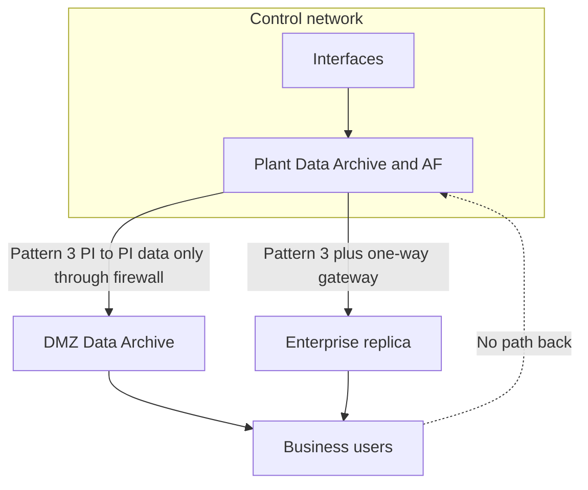

## Plain English

The control network runs the plant. The business network has e-mail, browsers and the internet. PI
data is needed on both sides, but a business user should never be able to reach into the control
network.

The standard answer is a **replica**: copy the data out to a server on the business side, or in a
**DMZ** between the two networks, and let users query that copy. The copy can be made by:

- **PI to PI** through a firewall, carrying data only; or
- a **data diode** (unidirectional gateway), hardware that physically allows traffic one way only.

The idea is old. A 2003 conference design already used a replica database, denied users direct
access through the firewall and allowed a "single secure tunnel" out.

## Deep Dive

**OSIsoft security patterns (PI World 2019).**

| Pattern | What crosses the boundary |
|---|---|
| 1 | Web-facing PI Vision, Notifications and PI Web API sit in a DMZ |
| 2 | Pattern 1 with high availability |
| 3 | PI to PI into a DMZ Data Archive, carrying data only; no user queries cross |
| 3 variant | PI Connector Relay in the DMZ |
| 3+ | One-way, "enforced by physics" |

**Kerberos and firewalls.** A DMZ server still needs to authenticate users. Firewalls block Kerberos
to domain controllers, and OSIsoft listed workarounds: "a trusted domain in the DMZ" or "very specific
firewalls rules". Remember the Data Archive's own needs: TCP/UDP 88 to the KDC, TCP/UDP 135 for SPN
registration and UDP 53 for DNS (see [Hardening and Kerberos](#/learn/hardening-and-kerberos)).

**One-way gateways.**

- Waterfall replicates PI Data Archive (tags, attributes, events, values) and AF from industrial PI
  servers to enterprise replicas through a unidirectional gateway. Users interact normally with the
  replicas, in both directions, without any path back into the plant.
- Waterfall PI Backfill retransmits data to fill gaps without duplicates.
- Waterfall also supports many-to-one aggregation, and can push to AVEVA CONNECT using HTTPS-OMF.
- Owl Cyber Defense demonstrated "OSI PI to PI Replication" over its OPDS-1000 data diode.

**Licensing.** Each PI to PI connection is unidirectional; bidirectional transfer needs two licences.

## Worked Example

Choosing between Pattern 3 and Pattern 3+ for a chemical plant:

1. **Requirement:** business users need hourly reports and live trends; no inbound path to the plant
   is acceptable.
2. **Pattern 3:** plant Data Archive, PI to PI into a DMZ Data Archive, PI Vision on the business
   side reading the DMZ server. A firewall allows only the PI to PI flow. Kerberos in the DMZ uses a
   trusted DMZ domain or tight firewall rules.
3. **Pattern 3+:** replace the firewall path with a data diode; the gateway vendor replicates PI and AF
   to an enterprise replica, and its backfill fills gaps after a link outage.
4. **Decision:** the site's risk assessment sets a high target level for the control zone, so it picks
   Pattern 3+. Users notice no difference: they still query a PI server with the same tags and AF
   model.

## Diagram

## Common Mistakes

- **Letting business PCs query the plant server "just for one report".**
- **Treating a firewall full of exceptions as a DMZ.** Data only, one flow.
- **Forgetting authentication in the DMZ.** Plan the trusted domain or specific Kerberos rules.
- **Assuming PI to PI is two-way on one licence.**
- **Ignoring gaps after a link outage.** Use the gateway's backfill or buffering.

## Real-World Scenario

At the 2018 PI World EMEA conference in Barcelona, Owl Cyber Defense demonstrated "OSI PI to PI
Replication" over its OPDS-1000 data diode. Waterfall's AVEVA PI material describes the same pattern at
fleet scale: industrial PI servers replicate tags, events, values and AF through unidirectional gateways
to enterprise replicas, and many sites can aggregate into one replica. In both cases, OSIsoft's Pattern
3+ applies: the one-way flow is "enforced by physics", not by firewall rules.
