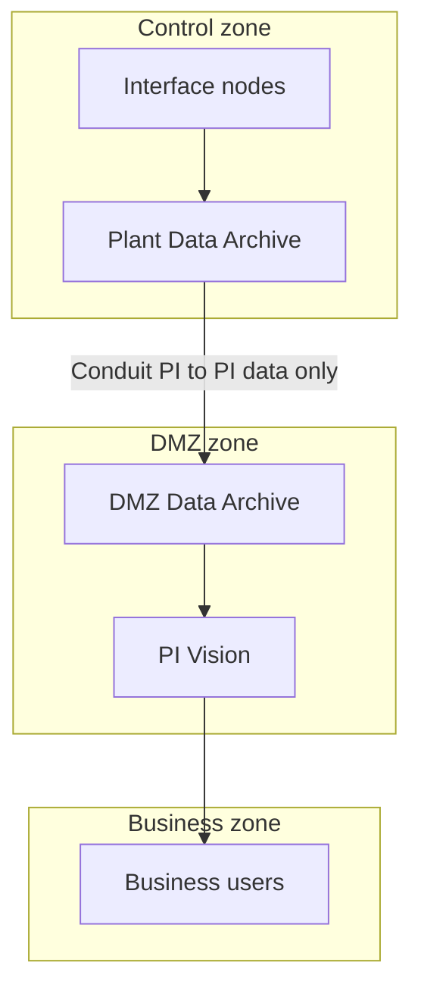

## Plain English

**IEC 62443** is the international family of standards for securing industrial automation and control
systems. It gives asset owners, system integrators and product vendors a shared language.

Two ideas matter most for a PI System:

- A **zone** "is a grouping of assets based on risk". For example, the control network with the
  plant Data Archive and interfaces is one zone; the business network is another.
- A **conduit** is the path through which communication between zones runs, such as a firewall rule
  set or a one-way gateway.

You decide how strong each zone's protection must be by choosing a **security level**.

## Deep Dive

**Document clusters.**

| Cluster | Scope | Examples |
|---|---|---|
| 1-x | General | Concepts and terminology |
| 2-x | Policies and procedures | 2-1 asset owner programme, 2-3 patch management, 2-4 service providers |
| 3-x | System | 3-2 zones and conduits risk assessment, 3-3 system requirements |
| 4-x | Component | 4-1 secure development process, 4-2 component technical requirements |

**Security levels.** The standard "defines four security levels (SL1, SL2, SL3, SL4)" that correlate
countermeasures with adversary strength. A vendor explainer summarises them:

| Level | Protects against |
|---|---|
| SL1 | Casual or coincidental violation |
| SL2 | Intentional violation using simple means |
| SL3 | Intentional violation using sophisticated means |
| SL4 | Sophisticated means with extended resources |

It also distinguishes **SL-T** (target), **SL-C** (capability of a component or system) and **SL-A**
(achieved in practice).

**Foundational requirements.**

1. FR1 identification and authentication control
2. FR2 use control
3. FR3 system integrity
4. FR4 data confidentiality
5. FR5 restricted data flow
6. FR6 timely response to events
7. FR7 resource availability

**AVEVA's position.** AVEVA states its Secure Development Lifecycle is "compliant with the ISA/IEC
62443-4-1 standard" and "has achieved ISASecure SDLA Certification". That certifies the *process*
(4-1), not a PI Server product against 4-2. AVEVA recommends segmenting the network, separating zones
with firewalls and virtual network technology, and defence in depth.

## Worked Example

Mapping a plant PI System (an inference based on the sources, not AVEVA text):

1. **Control zone:** interface nodes and the plant Data Archive.
2. **DMZ zone:** a DMZ Data Archive and PI Vision for business users (OSIsoft security Pattern 3).
3. **Conduit:** the PI to PI link from the plant Data Archive to the DMZ Data Archive, carrying data
   only. For a higher target level, a one-way gateway (Pattern 3+).
4. **FR5 restricted data flow** is met by the data-only or one-way design: no user query crosses into
   the control zone.
5. **FR1 and FR2** map to Windows authentication, PI identities and least-privilege mappings (see
   [Hardening and Kerberos](#/learn/hardening-and-kerberos)).
6. **FR6** maps to monitoring and alerting on PI health and logs.

## Diagram

## Common Mistakes

- **Saying "PI Server is IEC 62443 certified".** The readable evidence is AVEVA's 4-1 SDLA process
  certification.
- **One flat zone** for the control network and the business network.
- **Letting users query the plant Data Archive through the conduit** instead of using a DMZ copy.
- **Picking a security level without a risk assessment** (that is what 3-2 covers).
- **Forgetting the procedural side.** 2-3 patch management applies to PI patches and bulletins too.

## Real-World Scenario

AVEVA's HMI/SCADA security white paper recommends segmenting the network and separating zones with
firewalls and virtual network technology, following defence in depth. OSIsoft's PI World 2019
architecture talk gives the PI-specific version: put web-facing PI Vision, Notifications and PI Web API
in a DMZ, feed the DMZ with PI to PI carrying data only, and where the risk justifies it, enforce the
one-way flow "by physics" with a data diode. Read together, these give a zone-and-conduit design an
auditor can follow.
