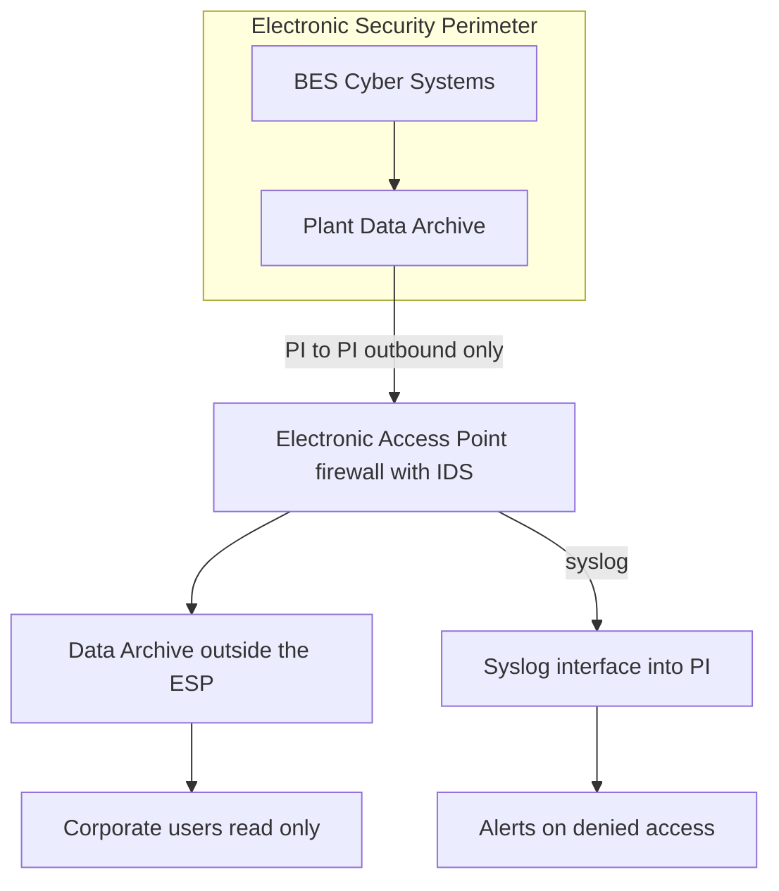

## Plain English

**NERC CIP** (Critical Infrastructure Protection) is the set of mandatory cyber security standards for
the North American bulk electric system. A utility running PI at a generating plant or substation must
show that the PI System does not open a path into protected systems.

The key idea is the **Electronic Security Perimeter (ESP)**: "the logical border surrounding a network
to which BES Cyber Systems (BCS) are connected using a routable protocol." Everything that crosses the
ESP must go through a controlled door, the **Electronic Access Point (EAP)**, and anything not
explicitly allowed is denied.

## Deep Dive

**CIP-005-5 (electronic security perimeters).**

| Requirement | Meaning |
|---|---|
| R1.2 | All External Routable Connectivity leaving an ESP passes through an identified EAP |
| R1.3 | Access is permitted only as needed, with all other traffic denied by default |
| R1.5 | Methods to detect malicious communications; OSIsoft's CIP v5 deck listed an "Access point firewall with commercial IDS module" |

"Malicious communication" is "Not defined in the CIP standards or in audit worksheets", so each
utility must define what it looks for.

**OSIsoft recommendations for PI (2014).**

- "PItoPI across ESP": replicate data out of the ESP rather than letting users query in.
- "Read Only" access where possible.
- Keep web servers and browsing clients out of the DMZ.
- Consider absolute enforcement solutions (one-way hardware).

**Monitoring requirements (older CIP versions, quoted in a 2011 deck).** CIP-005 R3.2 required
detecting and alerting on unauthorised access, and CIP-007 R6 required monitoring cyber security system
events. Sites used a Syslog PI interface to collect firewall logs and retain "electronic access logs
for 90 days".

**What PI can see.** The PI Message Log and network packets were used as intrusion-detection inputs,
but "Anomaly outside the application port cannot be logged by PI Server." PI is a useful collector and
alerting tool, not a replacement for an IDS.

## Worked Example

A generating station keeps its plant PI Data Archive inside the ESP. Corporate engineers need trends.

1. Place a second Data Archive outside the ESP (in a DMZ).
2. Run PI to PI from inside to outside so data leaves the ESP; no user query crosses inward.
3. Route that single flow through the identified EAP firewall, with every other port denied by default
   (R1.2, R1.3).
4. Give corporate users read-only access on the outside server.
5. Keep PI Vision web servers and browsing clients out of the DMZ, as OSIsoft advised, and serve them
   from the corporate network.
6. Feed the EAP firewall's syslog into PI with a Syslog interface and alert on denied connections; keep
   the logs for the required period.

## Diagram

## Common Mistakes

- **Letting corporate clients query the plant Data Archive across the ESP.** Replicate out instead.
- **"Temporary" allow-all rules on the EAP.** R1.3 requires deny by default.
- **Putting web servers and browsing clients in the DMZ.**
- **Assuming PI sees all attacks.** It cannot log anomalies outside its application port.
- **Using old requirement numbers in an audit** without checking the current CIP versions.

## Real-World Scenario

At OSIsoft's 2014 T&D user conference, a CIP version 5 session mapped PI deployments to CIP-005-5 R1.5
with an access point firewall that included a commercial IDS module. The guidance was to run PI to PI
across the ESP, keep access read-only where possible and consider absolute (one-way) enforcement. A
2011 Digital Bond session showed the monitoring side: a Syslog PI interface collected firewall logs so
that the PI System itself provided alerting and the 90-day log retention auditors asked for.
