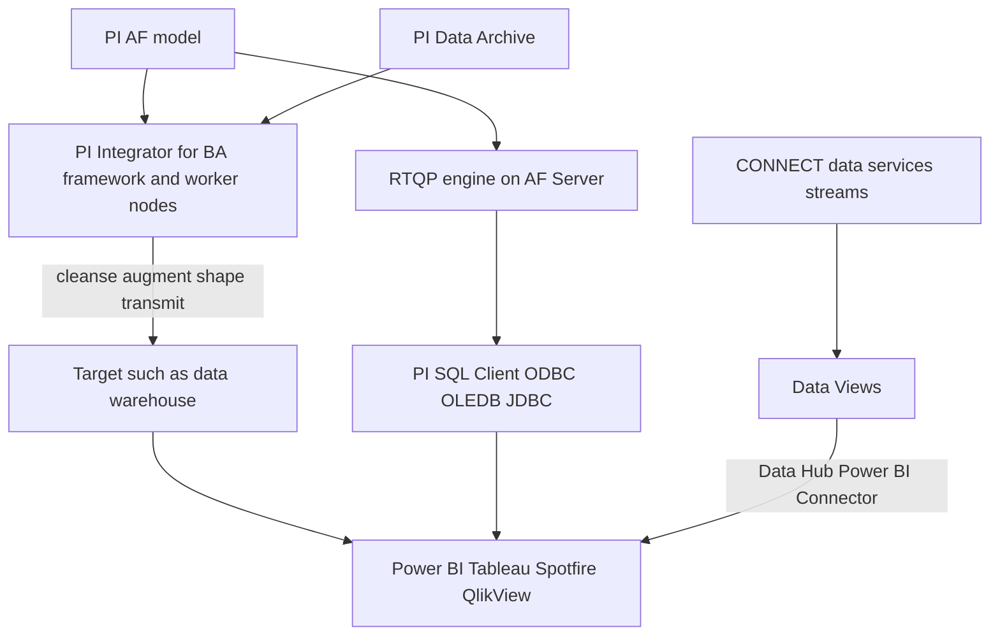

## Plain English

Business intelligence (BI) tools such as **Power BI, Tableau, Spotfire and QlikView** expect tidy
tables: one row per asset per hour, say, with columns for each measurement. PI data is stored as
time series per point, with irregular timestamps. Something has to reshape it.

There are three main routes:

1. **PI Integrator for Business Analytics** "transforms PI System data into a decision-ready format"
   and publishes it to BI tools and data warehouses.
2. **PI SQL Client** lets a tool query PI and AF with SQL through OLEDB, ODBC or JDBC.
3. In the cloud, **Data Views** in CONNECT data services (formerly AVEVA Data Hub) shape stream data,
   and the **Data Hub Power BI Connector** reads them.

## Deep Dive

**PI Integrator for BA.** It "works directly with PI AF (not the PI Data Archive)" when you build a
view's search criteria, so a good AF model matters. Its components are:

- **PI Integrator Framework**, the master service
- **Worker Nodes**: "Up to 5 worker nodes can be added"
- **PI Integrator Sync**, which watches for PI tag and AF changes

The data flow steps are Cleanse, Augment, Shape, Transmit, Pull and Push. Version 1.0 offered fleet
asset reporting and data warehouse integration; 1.1 added Oracle, Hadoop (Hive and HDFS) and event
frames; Azure, SAP HANA, Kafka and Azure Event/IoT Hub targets were on the 2016 to 2017 roadmap.

**PI SQL Client and RTQP.** For the RTQP engine, PI SQL Client "is the recommended tool for new
development projects". RTQP installs only on the PI AF Server and became available in PI Server 2018
SP2, succeeding PI OLEDB Enterprise. Drivers are OLEDB, ODBC and JDBC, over Net.Tcp or HTTPS. PI SQL
Commander Lite is a query tool for trying queries.

**Data Views (cloud).** Data Views "curate operational data for external consumption". They are
defined at runtime with a time range, stored or interpolated data, an interpolation interval and a
data format. Outputs are JSON, CSV, Table and (new in 2023) Parquet. Consumers include the "AVEVA Data
Hub Power BI Connector" and the REST API.

> [!VERIFY]
> A dedicated on-premises Power BI connector for the PI System (for example one built on PI SQL
> Client) was not confirmed in the research sources. Check AVEVA's current documentation before
> recommending one.

## Worked Example

A fleet manager wants a Power BI report of hourly average load and fuel use for every turbine.

1. The AF model already has a turbine template, so she uses PI Integrator for BA, whose view search
   works against AF.
2. She builds an asset view: search root the fleet, template turbine, attributes Load and Fuel Flow,
   hourly averages. Integrator shapes this into one row per turbine per hour.
3. She publishes the view to a target that Power BI reads.
4. Data volumes grow, so the admin adds worker nodes (up to five).
5. For a one-off question from a data scientist, she instead shows him PI SQL Client with ODBC and PI
   SQL Commander Lite to test the query.

## Diagram

## Common Mistakes

- **Expecting Integrator to search raw PI points.** It builds views from PI AF, not the Data Archive.
- **Starting new SQL work on PI OLEDB Enterprise.** PI SQL Client with RTQP is the recommended tool for new projects.
- **Installing RTQP on the Data Archive server.** It installs only on the PI AF Server.
- **Pulling raw irregular data into a BI tool** and reshaping it there, instead of using Integrator views or Data Views.

## Real-World Scenario

AVEVA's 2023 Data Views session described the cloud pattern: an analyst defines a data view over
streams from many sites, chooses interpolated data at a fixed interval, and Power BI reads it through
the AVEVA Data Hub Power BI Connector. Regions in 2023 included West US, North Europe and Australia
East, so teams pick the region nearest their users. On premises, the same job is done by PI
Integrator for BA, whose asset views turn the AF model into BI-ready tables.
