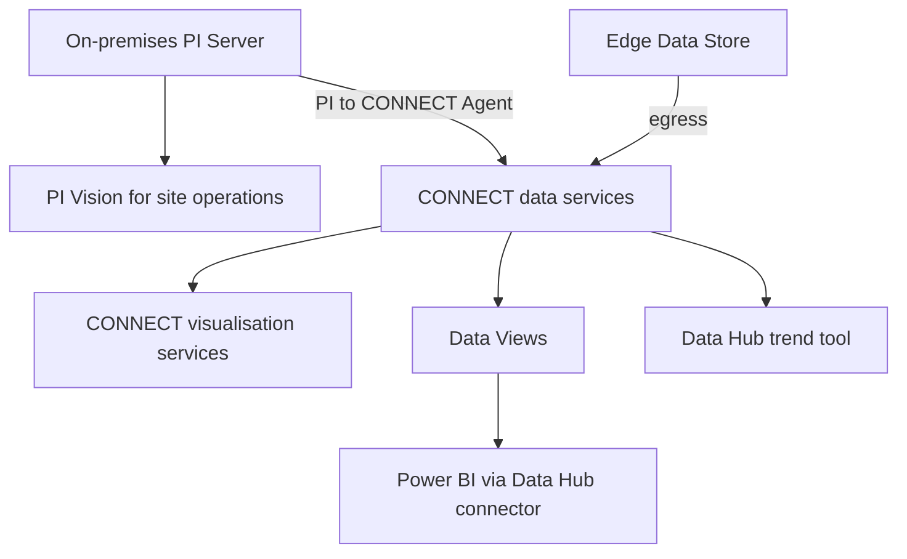

## Plain English

**CONNECT** is AVEVA's cloud "industrial intelligence platform". It was unveiled at Hannover Messe and
reported on 23 April 2024. It offers "native data services, visualization services, modeling and
analytics capabilities" and runs on Microsoft Azure.

Its data foundation is **CONNECT data services** (formerly AVEVA Data Hub). On top of that sit
**visualisation services** for viewing and sharing data in the browser, without running your own
PI Vision server.

On-premises and cloud views live side by side. In AVEVA's 2023 workshop, data that came from Edge Data
Store into Data Hub was viewed in the **Data Hub trend tool**, while the same kind of data in the PI
System was viewed in **PI Vision**.

## Deep Dive

**Architecture.** AVEVA's 2023 connectivity architecture lists "AVEVA Connect, visualization
services", with edge devices that pair and bootstrap to "AVEVA Connect, common cloud platform".

**Getting shaped data out.** **Data Views** curate stream data for external use. They are defined at
runtime (time range, stored or interpolated data, interval, format) and output JSON, CSV, Table or
Parquet. They feed the AVEVA Data Hub Power BI Connector and the REST API, so cloud data can be
visualised in BI tools as well as in CONNECT itself.

**2025 updates.** AVEVA's blog of 9 December 2025 listed:

- AVEVA Asset Information Management integration in CONNECT visualisation
- "Experience visualizations"
- asset and time context
- an "Industrial AI Assistant (open preview)"
- Databricks integration

**Hybrid packaging.** AVEVA PI Data Infrastructure "augments the on-premises PI System with
cloud-enabled functionalities". Its core is PI Server, Edge Data Store, CONNECT data services and
connectivity, and it also includes PI Vision, PI DataLink and PI Web API. So a hybrid site typically
keeps PI Vision for operations and uses CONNECT for cloud views and sharing.

> [!VERIFY]
> Detailed CONNECT visualisation features, screens and limits were not readable in the research
> sources. Treat this lesson as orientation only.

## Worked Example

A company has PI Servers at three plants and sends selected data to CONNECT data services with the PI
to CONNECT Agent.

1. Plant operators keep using PI Vision on each site's PI Server for live displays.
2. A central reliability team opens the cloud data in CONNECT's visualisation services, so they do not
   need access to each plant network.
3. A data scientist defines a Data View over the same streams with interpolated hourly data and pulls
   it into Power BI through the Data Hub Power BI Connector.
4. A pilot site with an Edge Data Store sends data straight to the cloud and checks it in the Data Hub
   trend tool.

## Diagram

## Common Mistakes

- **Thinking CONNECT replaces PI Vision for site operations.** AVEVA's hybrid package still includes PI Vision alongside CONNECT data services.
- **Using old names in searches.** Data Hub is now CONNECT data services; older material says OCS or Data Hub.
- **Assuming preview features are generally available.** The Industrial AI Assistant was announced as an open preview.

## Real-World Scenario

In the AVEVA World 2023 MQTT and EDS workshop, students sent MQTT Sparkplug B data through an AVEVA
Adapter into Edge Data Store, configured egress to AVEVA Data Hub, and opened the results in the Data
Hub trend tool. The same lab pointed out that data in the PI System is viewed in PI Vision. That
side-by-side view of edge, cloud and on-premises tools is the starting point for most CONNECT
visualisation projects.
