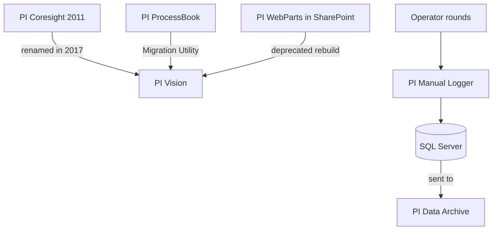

## Plain English

Before PI Vision there were three other ways to put PI data in front of people on the web or the
plant floor:

- **PI Coresight**, OSIsoft's first browser-based tool for ad hoc analysis, released in 2011. It was
  **renamed PI Vision in 2017**.
- **PI WebParts**, components for building PI dashboards inside Microsoft SharePoint.
- **PI Manual Logger**, for operators to enter readings by hand (for example during rounds) so that
  manual values land in PI next to automatic ones.

In 2017 OSIsoft's PI Visualization Suite listed PI Vision, PI ProcessBook, PI DataLink and PI
WebParts, while PI Manual Logger appeared under PI Interfaces and PI Connectors.

## Deep Dive

**PI Coresight.** The 2011 announcement planned a June 2011 beta and a release in the second half of
2011. It was a "New Product – does not replace any existing PI System product", positioned for ad hoc
analysis and collaboration alongside ProcessBook (process monitoring) and WebParts (SharePoint
composite applications). Early clients used Microsoft **Silverlight**, served from the Coresight
server so no internet access was needed. PI Coresight 2016 added a new display editor, mobile support
and event comparison, and ProcessBook displays could be viewed through Coresight. The roadmap then
listed 2016 R2 and a tentative 2017 release, which shipped as **PI Vision 2017**; OSIsoft states "PI
Coresight was renamed PI Vision in 2017". The PI Vision Publisher user type was described as
"equivalent to the traditional PI Coresight user".

**PI WebParts.** OSIsoft web parts for building PI composite applications in Microsoft SharePoint. A
2015 roadmap table showed WebParts and ProcessBook display viewers under "today (2015)" and
"Dashboards" in the "future (2016+)" column. A 2022 feedback-portal post (written by a user) lists PI
ProcessBook and PI WebParts among deprecated products "not being sold anymore".

**PI Manual Logger.** It stores its settings and the entered data in **SQL Server** "before it gets
sent to PI Data Archive". In 2015 the versions were PI Manual Logger Web 2014 / 2014 R2 and PI
Manual Logger Mobile 2012. A 2022 feedback idea asked for 21 CFR Part 11 electronic signatures for
manual data entry in PI Vision and in PI Manual Logger and Manual Logger Web; no AVEVA response was
shown.

## Worked Example

An admin inherits an older PI estate and makes an inventory.

1. A bookmark points at a "Coresight" URL. She knows Coresight is PI Vision's old name, so she plans an
   upgrade to current PI Vision rather than a new product.
2. A SharePoint site has PI dashboards built with WebParts. With WebParts deprecated, she lists each
   dashboard and rebuilds it in PI Vision.
3. Operators enter tank dips through PI Manual Logger. She notes that the entries sit in Manual
   Logger's SQL Server database before they are sent to the Data Archive, so that database must be in
   the backup plan.
4. She checks with AVEVA for the current support status of each product before deciding timelines.

## Diagram

## Common Mistakes

- **Treating Coresight and PI Vision as different products.** PI Vision is Coresight renamed in 2017.
- **Assuming WebParts is still sold.** A 2022 feedback post lists it as deprecated; confirm the status with AVEVA.
- **Leaving Manual Logger's SQL database out of backups.** Entered values live there before they reach PI.
- **Expecting Silverlight clients to work today.** Early Coresight used Silverlight; modern PI Vision runs in a normal browser.

## Real-World Scenario

AVEVA's 2015 user-conference session on PI Manual Logger described operators recording readings on
web and mobile clients (PI ML Web 2014 / 2014 R2 and PI ML Mobile 2012), with data held in SQL
Server and then sent to the Data Archive. Regulated sites later asked for more: a 2022 feedback idea
requested 21 CFR Part 11 electronic signatures for manual entry in PI Vision and Manual Logger,
showing why life-sciences teams review manual-entry tools carefully during validation.
