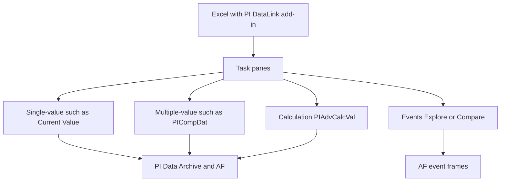

## Plain English

**PI DataLink** is an Excel add-in. It adds functions and task panes that pull PI points, AF
attributes and event frames straight into cells, so you can build reports and calculations in a tool
you already know.

Its functions fall into groups:

| Group | Returns |
|---|---|
| Single-value | Exactly one value per data item (for example Current Value) |
| Multiple-value | Many values per item over a time range (for example Compressed Data) |
| Calculation | Summaries such as totals and averages (Calculated Data) |
| Events | Event frames from AF |
| Search | Data items matching criteria |
| Properties | Attributes and properties of items |

## Deep Dive

**Calculated Data** maps to the Excel function `PIAdvCalcVal`. Its task pane asks for:

- data item(s) and root path
- start time and end time
- time interval
- calculation mode (for example total or average)
- **conversion factor**, for example 1440 to total a per-minute rate over a day
- options to show end time and percent good

**Compressed Data** maps to `PICompDat`. The lab's example is
`PICompDat("cdm158","y","t",1,"","inside")`: point cdm158 from yesterday (`y`) to today (`t`).

**Updating.** "The only PI DataLink function that is volatile by default is Current Value", so it
recalculates whenever Excel does. Resources > Settings has an Automatic Update option ("Full
calculate, 0s Interval"), and the Update button toggles auto-update.

**Performance.** Converting many single-cell formulas into contiguous ranges cut call counts by an
order of magnitude in the lab. With Excel dynamic arrays only the top-left cell of a result is
editable; a blocked spill range shows `#SPILL`, and older Excel shows `#NAME?`.

**Events.** Two methods:

- **Explore Events**: hierarchical, good for events that share a template, with a setting for the
  number of child event levels.
- **Compare Events**: flat, with child attributes on the parent's row.

Search fields include Database, Event Name, Search Start and End, Event Template, Element Template,
Element Name, and More Search Options (attribute values, duration, category). To preview more than
1,000 event frames, raise the Settings limit to 10,000.

**History.** DataLink 2012 added AF integration (attributes and asset-relative use), search and Excel
2010 64-bit support, and dropped Excel 2003. PI DataLink 2019 SP1 is version 5.5.1. DataLink support
for Notifications is read-only from 2016.

> [!NOTE]
> Other DataLink function names and their argument lists were not readable in the research sources,
> so this lesson only names the two that were.

## Worked Example

A shift engineer needs yesterday's total flow, where the tag is a rate per minute.

1. She opens the Calculated Data task pane, picks the flow tag, start `y`, end `t`, interval `1d`.
2. Calculation mode: total. Because the rate is per minute and the total is over a day, she sets the
   conversion factor to **1440** (minutes per day).
3. She ticks show percent good, so she can see if data was missing.
4. DataLink writes a `PIAdvCalcVal` formula into the cell.
5. For the raw values behind it she uses Compressed Data, which writes a formula like
   `PICompDat("cdm158","y","t",1,"","inside")`.
6. The report has 300 tags, so she puts them in one range rather than 300 separate single-cell
   formulas, which cuts the number of calls dramatically.

## Diagram

## Common Mistakes

- **Forgetting the conversion factor** when totalling a rate (1440 for a per-minute rate over a day).
- **Thousands of single-cell formulas.** Use contiguous ranges; the lab saw an order-of-magnitude drop in calls.
- **Surprise recalculation.** Current Value is volatile by default and recalculates with Excel.
- **Blocking a spill range.** Clear the cells below and right of a dynamic-array formula to fix `#SPILL`.
- **Previewing only 1,000 events** when there are more; raise the limit in Settings.

## Real-World Scenario

AVEVA's 2018 Analyzing course uses DataLink's Compare Events on the `\\PISRV01\Fleet Generation`
database: Event Name `*`, Search Start `*-1d`, template "Gas Turbine Temperature Anomaly", and a minimum
duration of 30 minutes. The result is one flat row per anomaly with its child attributes alongside,
ready for a pivot table that shows which turbines had the longest anomalies yesterday.
