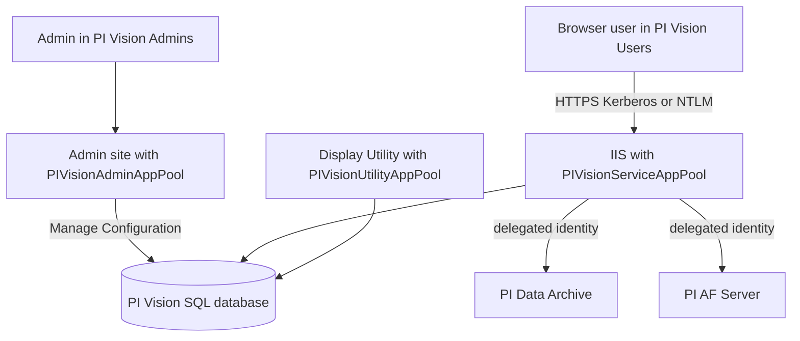

## Plain English

PI Vision is a web application. On the server it is made of:

- **IIS** (Microsoft's web server) hosting the PI Vision websites,
- a **SQL Server database** that stores displays, folders and settings, and
- connections to the **PI Data Archive** and **PI AF** that supply the data.

Administrators use a separate **Admin site** at `https://<WebServer>/PIVision/Admin` to set up the
database, the list of data servers, defaults and usage reports.

Users come in two licence types: **Publishers** create and save displays; **Explorers** view and
interact (change time, switch assets, investigate events, create ad hoc displays) but cannot save.

## Deep Dive

**Three IIS application pools:**

| Pool | Runs |
|---|---|
| PIVisionAdminAppPool | The Admin website |
| PIVisionServiceAppPool | The main PI Vision website |
| PIVisionUtilityAppPool | The PI Vision Display Utility |

**Three local Windows groups:** *PI Vision Admins* (access to the Admin site), *PI Vision Users*
(access to the PI Vision site) and *PI Vision Utility Users* (access to the Display Utility).

**Database.** On the Admin site Overview page, click *Manage Configuration* next to PI Vision Database
and enter the database name. The account doing this needs the **dbcreator** server role and the
**ALTER ANY LOGIN** permission (given by the **securityadmin** role). A PI Square security blog adds:
if SQL Server is on the PI Vision node, set "Allow Triggers to Fire Others" to True. The course
workbook says all SQL Server editions (Express, Standard, Enterprise) from 2014 are supported.

**Data sources.** Data Archive 3.4.380 (the first with Windows Integrated Security) or later and PI
AF 2018 (2.10) or later. The Admin site lists Data Archives from the Known Servers Table on the web
server. Since PI Vision 2020 (3.5.0.0) PI Vision no longer relies on PI Web API.

**Certificates.** From PI Vision 2020 a clean install creates a self-signed certificate and applies it
to the IIS site; an upgrade reuses the existing certificate. The security blog recommends a
third-party or domain certificate for both PI Vision and PI Web API. Basic authentication for mobile
users needs SSL ("Require SSL" in IIS).

**Authentication and delegation.**

- IIS Windows Authentication providers default to Negotiate and NTLM, which the blog calls the
  recommended option; use Negotiate:Kerberos only if you do not want a silent fallback to NTLM.
- If the pools run under a domain account instead of Network Service, set `useAppPoolCredentials` to
  True.
- Built-in Network Service cannot delegate to multiple AF servers: run the Admin, Service and Utility
  pools under a domain account or gMSA. The 2025 architecture course switches the pools to a gMSA with
  IIS Manager or PowerShell.
- The PI Vision account needs a PI identity with Read on the PIDBSEC, PIMAPPING, PIPOINT and PIUSER
  tables and on the points it uses.
- List the real host and domain URLs in CorsOrigins, "not just the asterisk".

**Permissions and admin features.** Administrators control read and write access to display folders
and can see private displays. PI Vision 2024 lets users edit folder permissions, makes child folders
inherit from a parent, moves a folder with all its displays, and shows connected users and data
access times for open displays. Earlier releases added usage reports (display usage, user access in a
time range, user count by licence type), offline display promotion with the Display Utility, and
admin defaults for trace colours, multi-state palettes, time-bar durations and backgrounds (2022).

## Worked Example

An admin finishes a new PI Vision install on `pivis01.corp.example` (an illustrative name).

1. She browses to `https://pivis01.corp.example/PIVision/Admin`; access works because she is in PI
   Vision Admins.
2. On Overview she clicks Manage Configuration next to PI Vision Database and enters the SQL instance
   and a database name. Her account has dbcreator and securityadmin.
3. She switches PIVisionAdminAppPool, PIVisionServiceAppPool and PIVisionUtilityAppPool to a gMSA,
   sets `useAppPoolCredentials` to True, and configures Kerberos constrained delegation so the pools
   can pass user identities to the Data Archive and both AF servers.
4. She maps the gMSA to a PI identity with Read on PIDBSEC, PIMAPPING, PIPOINT and PIUSER.
5. She replaces the self-signed certificate with a domain certificate.
6. She adds the operators' AD group to PI Vision Users and gives most staff Explorer licences.

## Diagram

## Common Mistakes

- **App pools left as Network Service.** It cannot delegate to multiple AF servers; use a domain account or gMSA.
- **500.19 "Cannot add duplicate collection entry".** A PI Vision Users authorisation rule defined at both site and application level. Remove the duplicate from `web.config` and recycle PIVisionServiceAppPool.
- **404.6 after an upgrade.** IIS Request Filtering with "Allow unlisted verbs" unchecked blocks HTTP verbs; a default install denies none.
- **Wildcard CORS.** Using only `*` in CorsOrigins.
- **Creating the database without ALTER ANY LOGIN.** dbcreator alone is not enough.
- **Expecting Explorers to save.** Explorer licences cannot save new or changed displays.

## Real-World Scenario

A PI Square thread describes a PI Vision 2017 to 2017 R2 upgrade after which displays returned 404
errors. The cause was IIS Request Filtering: "Allow unlisted verbs" had been unchecked by a hardening
policy, which blocked the HTTP verbs PI Vision needs (a 404.6). Another thread traced a 500.19 error
to the PI Vision Users rule appearing twice. Both show why PI Vision problems are often IIS problems,
and why admins should compare server-level IIS settings against a default install.
