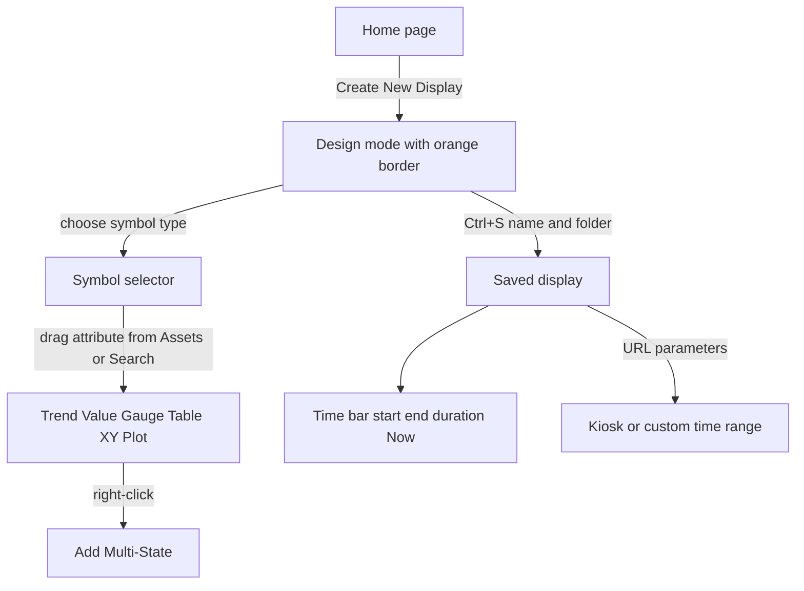

## Plain English

**PI Vision** is the PI System's browser-based display tool. You open it in a web browser, find a
display, and see live values, trends and gauges. If you have the right to, you can also build your
own displays by dragging data onto a blank canvas.

A display is made of **symbols**. Each dynamic symbol is tied to one or more data items, such as an
AF attribute or a PI point. Static items (shapes, text and images) add context.

Every display has a **time bar** at the bottom. It sets the time range for the whole display, and
by default shows the last 8 hours.

## Deep Dive

**Home page.** Displays are grouped into All Displays, Favorites, My Displays and Recent (the last
seven days), and into folders you create. You can filter by keyword, switch between table and
thumbnail view, sort by Accessed, Modified, Name or Owner, and mark favourites. Deleting a folder
moves its contents to Home. From version 2024 folders can be shared by URL and inherit permissions
from their parent folder.

**Design mode.** An **orange border** means you are editing. The toolbar holds the display name (an
`*` marks unsaved changes), Save, Undo/Redo, Cut, Copy, Paste, Delete, Arrange (align, bring
forward, send back, distribute), grid on/off, Select, shapes, Text and Images. Right-click for Format
Display, Format Shape, Format Line and Format Symbols. The first save asks for a name and folder and
leaves design mode.

**Core dynamic symbols** (the course lists ten): Trend, Value, Vertical Gauge, Horizontal Gauge,
Radial Gauge, Table, Asset Comparison Table, Time Series Table, Bar Chart and XY Plot. (The same
workbook also says "nine" in one place.) Choose the symbol type first (upper left), then drag data
in. Dragging an attribute onto a blank display creates the default symbol; dragging another onto a
trend adds a trace. Double-click a trend to expand it.

**Configuring symbols.**

- *Trend*: value scales (for example single scale, autorange), trace colour and style, title, grid,
  and a time range that can follow the display or use its own duration and offset or a custom range.
- *Table*: show or hide columns such as Description, Trend, Minimum and Maximum.
- *XY Plot*: regression line and correlation coefficient.
- *Time Series Table* (2024): sequential values with timestamps, default update interval 5 seconds.
- From 2022, units of measure can be set per data item and per symbol.

**Multi-state.** Right-click a Value or Gauge and choose Add Multi-State. You get five coloured
states, a Bad data state and a Blink option. If the AF attribute has Limits, multi-state uses them
and only the colours can change. Only a PI administrator can configure the Bad data state.

**PI time.** Reference times include `*` (now), `t` (today), `y` (yesterday), weekday and month
names. Offsets use `s`, `m`, `h`, `d`, `w`, `mo` and `y`. Only **one offset** is allowed per
expression, and fractions only with s, m and h.

**Search.** The Assets pane browses the AF hierarchy; the Search pane finds PI points, elements,
attributes, descriptions and displays. `*` is assumed at the end of every query; `?` matches one
character.

**Navigation links and URLs.** Right-click a symbol, shape or image and choose Add Navigation Link
to open another display (optionally passing time and asset context) or a web page. URL parameters
include `StartTime` and `EndTime` (any PI time), `Mode=Kiosk` (limited interactivity), `HideToolbar`
and `HideTimebar`.

**Keyboard shortcuts.** Ctrl+S save, Ctrl+Z / Ctrl+Y undo / redo, Ctrl+A select all, Ctrl+click
multi-select, Shift+drag resize proportionally, Shift while drawing a line snaps it to 45 degrees.

## Worked Example

An analyst builds a tank overview.

1. She clicks Create New Display; the orange border shows design mode.
2. With Trend selected as the symbol type, she drags Tank1 Level from the Assets pane, then drags
   Inlet Flow onto the same trend to add a second trace.
3. She switches the symbol type to Value, drags Tank1 Temperature, right-clicks it and adds
   multi-state. The attribute has AF Limits, so she can only change the colours.
4. She adds a tank shape from the graphics library and a text label sized 18.
5. She presses Ctrl+S, names the display and picks a folder.
6. In the time bar she types start `t+8h` and end `*` to see today's day shift so far.
7. For the control-room wall screen she shares a URL ending
   `?StartTime=*-1h&EndTime=*&Mode=Kiosk`.

## Diagram

## Common Mistakes

- **Two offsets in one time expression,** such as `*-1d+2h`. Only one offset is allowed.
- **Fractions with d, mo or y,** such as `*-1.5d`. Fractions work only with s, m and h.
- **Trying to edit multi-state ranges** on an attribute with AF Limits. Only colours can change.
- **Dragging data before picking the symbol type.** You get the default symbol instead.
- **Forgetting the `*` marker.** It means the display has unsaved changes.

## Real-World Scenario

AVEVA's Visualizing PI System Data course (2024) walks through exactly this flow on a fleet of
tanks. Learners build a trend and value display, add multi-state from AF Limits, use PI time
expressions such as `y-8h` and `mon+14.5h`, and share a kiosk URL for a wall screen. Since PI Vision
2017 R2, attribute values that contain URLs also act as hyperlinks on a display, so a team can store
a link to a work instruction in AF and have it appear as a clickable value.
