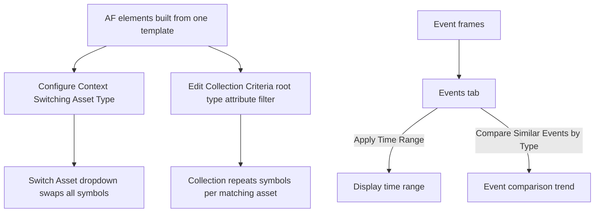

## Plain English

A plant may have 40 identical pumps. Building 40 displays is slow and hard to maintain. PI Vision
gives you two tools that use the AF hierarchy so one display works for all of them:

- **Asset context switching**: build a display for Pump 1, then pick Pump 2 from a dropdown and every
  symbol swaps to Pump 2's attributes, because both pumps use the same AF template.
- **Collections**: build the symbols for one pump, convert them to a collection, and PI Vision
  repeats them for every pump that matches a search. When a pump is added to AF, it appears
  automatically.

PI Vision also shows **event frames** (for example downtime, batches or alarms) so you can see what
happened and compare one event with similar ones.

## Deep Dive

**Asset switching.** The Switch Asset dropdown changes the asset context. The gear icon opens
*Configure Context Switching*, with options: Show search results, Show Assets paths, Search Root,
Return All Descendants and **Asset Type** (an AF template such as "Generic Tank Template"). Since 2017
R2 (Related Assets), authors can swap a single asset or an entire asset path, or disable switching,
and users can filter related assets by name. URL parameters can also swap a display to another asset
that shares the same template.

**Collections.** Select symbols and use *Convert to Collection...*, then *Edit Collection Criteria...*:

- Search Root and Return All Descendants
- Asset Type (template)
- Asset Attribute conditions with operators, for example `> 50`

A collection "automatically reflects when equipment is added or removed from the system" and updates
as attribute values change, so a filter like "Level > 50" changes membership live.

**Per-trend time.** Each trend can follow the display time range, use its own Duration and Offset,
or a custom range such as `*-48h` to `*`. Navigation links can carry asset and time context to the
target display.

**Events.** Events appear in an Events tab on the left, with a colour showing severity. Right-click
an event for:

- **Apply Time Range**: set the display to the event's start and end.
- **Compare Similar Events by Type**: trend the event's trigger attributes for this and recent
  similar events. *Edit Search Criteria* widens the comparison, for example to 100 Inactivity events
  across all turbines.

PI Vision 2022 added overlaying attributes in Event Comparison trends and zoom and pan in event
trends.

**Events Table and pinned events.** The Events Table (2017) filters events by asset type, severity,
hierarchy and more. **Pinned events** are reference events saved with the display, used to spot batch
deviations against a known good batch.

**XY Plot.** Use it to find correlations between attributes, compare assets, or compare time ranges.

**History.** PI Vision 2017 introduced Collections, Drill-in Navigation, the Graphics Library, the
Asset Comparison Table and User Types; 2017 R2 added display folders, Related Assets enhancements,
the XY Plot and the Events Table. Event Comparison dates back to PI Coresight 2016.

## Worked Example

A reliability engineer monitors 12 gas turbines in the `Fleet Generation` AF database.

1. She builds a display for Turbine 01 with a trend of exhaust temperature and a value for load.
2. In Configure Context Switching she sets Asset Type to the turbine template, so the Switch Asset
   dropdown lists all 12 turbines.
3. For an overview, she builds a small group of symbols (name, load, multi-state status), selects
   them and chooses Convert to Collection. Criteria: Search Root `Fleet Generation`, Asset Type turbine
   template, Return All Descendants. Twelve tiles appear.
4. She adds the condition `Load > 50` so only running turbines show. As turbines start and stop, the
   collection updates on its own.
5. In the Events tab she right-clicks an Inactivity event and picks Compare Similar Events by Type,
   then edits the search criteria to include 100 Inactivity events across all turbines.

## Diagram

## Common Mistakes

- **Assets built without a common template.** Switching and collections rely on Asset Type; ad hoc elements will not swap cleanly.
- **Forgetting Return All Descendants** when the matching assets sit below the search root.
- **Expecting a collection to be a static list.** It changes as assets and values change; that is the point.
- **Comparing events of different types.** Compare Similar Events by Type uses the event's own template and trigger attributes.
- **Assuming every trend follows the time bar.** A trend with its own custom range will not move with the display.

## Real-World Scenario

In AVEVA's Analyzing PI System Data course, learners open an Inactivity event on one gas turbine,
choose Compare Similar Events by Type, and then widen the search to 100 Inactivity events across the
whole fleet. Seeing all the events overlaid makes it obvious which turbine behaves differently. OSIsoft's
2017 PI Vision sessions described the same idea for batches: pin a known good batch to the display as
a reference event, and each new batch is compared with it as it runs.
