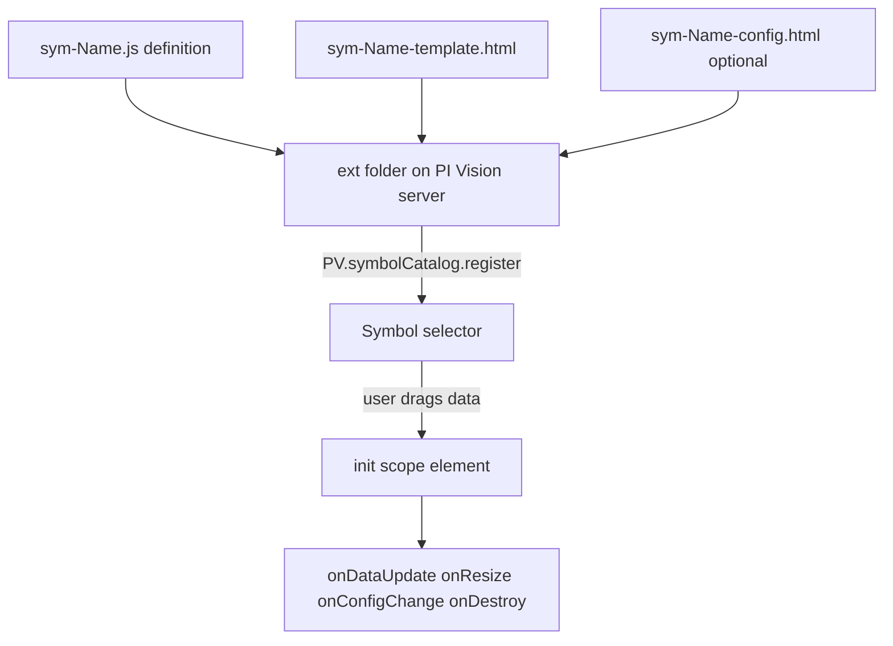

## Plain English

PI Vision ships with a fixed set of symbols. If you need something else, such as a special gauge or a
chart from a JavaScript library, you can build a **custom symbol** from HTML and JavaScript and drop
it into a folder on the PI Vision server. It then appears in the symbol selector like any built-in
symbol.

OSIsoft announced official extensibility around PI Vision 4 (2018). AVEVA's extensibility guide says
the framework has been "fully supported" since PI Vision 2019, and the course README says version 3.0
and later supports extensions.

## Deep Dive

**Folders** (under the PI Vision installation folder):

| What | Where |
|---|---|
| Symbol files | `Scripts\app\editor\symbols\ext` |
| Symbol icons | `Scripts\app\editor\symbols\ext\icons` |
| External libraries | `Scripts\app\editor\symbols\ext\libraries` |
| Tool panes | `Scripts\app\editor\tools\ext` |

A typical full path is `C:\Program Files\PIPC\PIVision\Scripts\app\editor\symbols\ext`.

**File names** for a symbol called *Name*:

- required: `sym-<Name>.js` (implementation) and `sym-<Name>-template.html` (presentation)
- optional: `sym-<Name>-config.html` (configuration pane) and `sym-<Name>.css`

**Registering.** A symbol registers with `PV.symbolCatalog.register(definition)`; a tool pane with
`PV.toolCatalog.register(definition)`.

**The definition object:**

| Property | Purpose |
|---|---|
| `typeName` | Required unique name |
| `displayName` | Name shown to users |
| `datasourceBehavior` | None (0), Single (1) or Multiple (2); None means a static symbol not shown in the selector |
| `iconUrl` | Icon for the selector |
| `getDefaultConfig` | Default settings, property names starting uppercase, available as `scope.config` |
| `configOptions` | Context-menu configuration options |
| `inject` | Services to inject |
| `visObjectType` | Required: the visualisation constructor |
| `supportsCollections` | Default false |

The `DataShape` in the default config tells PI Vision what data to supply: `Value`, `Gauge`,
`Trend`, `Table` or `TimeSeries`.

**Init and callbacks.** `symbolVis.prototype.init = function (scope, element)` runs when the symbol is
created. It can set `onDataUpdate(data)`, `onResize(width, height)`,
`onConfigChange(newConfig, oldConfig)` and `onDestroy`.

**Debugging and minification.**

- Set `<compilation debug="true">` in `web.config` to disable bundling while you debug.
- JavaScript in `ext` is always minified. To stop that, add the appSetting
  `DisableExtensibilityJSMinification` = `true`.
- Your own `*.min.js` is used only when debug is off.
- In PI Vision 2025, the older array-returning pattern for `configOptions` is not supported.

## Worked Example

A minimal value symbol, assembled from the properties in AVEVA's guide and the 2019 developer deck:

```js
(function (PV) {
  function symbolVis() { }
  PV.deriveVisualizationFromBase(symbolVis);
  var definition = {
    typeName: 'simplevalue',
    datasourceBehavior: PV.Extensibility.Enums.DatasourceBehaviors.Single,
    visObjectType: symbolVis,
    getDefaultConfig: function () { return { DataShape: 'Value', Height: 150, Width: 150 }; }
  };
  symbolVis.prototype.init = function (scope, element) {
    this.onDataUpdate = function (data) { if (data) { scope.value = data.Value; } };
  };
  PV.symbolCatalog.register(definition);
})(window.PIVisualization);
```

> [!VERIFY]
> This listing is assembled from documented properties, not copied verbatim from AVEVA. The
> `window.PIVisualization` wrapper is the common pattern but was not read word for word. Compare with
> the PI Vision Extensibility Guide on GitHub before use.

Save it as `sym-simplevalue.js` with a `sym-simplevalue-template.html` that shows `{{value}}`, put
both in the `ext` folder, and reload PI Vision.

## Diagram



## Common Mistakes

- **Modern JavaScript syntax broken by the built-in minifier** in production. Test with minification on, or disable it with `DisableExtensibilityJSMinification`.
- **Loading libraries by editing `Views\Home\index.cshtml`.** That is "unrecommended"; use `ext\libraries`.
- **Credential prompts from a symbol that calls PI Web API.** This usually means Kerberos delegation (SPN, delegation or service account settings) is wrong.
- **Missing `typeName` or `visObjectType`.** Both are required.
- **Using the old array form of `configOptions`** on PI Vision 2025.

## Real-World Scenario

A PI Square thread describes a custom symbol that called PI Web API (through
`PV.ClientSettings.PIWebAPIUrl`, as in the 2019 developer deck) and made every user type their
password. The symbol code was fine; the cause was Kerberos: the delegation and SPN settings for the
service account did not let PI Vision pass the user's identity on. Fixing delegation removed the
prompts. AVEVA's guide does not say whether `ext` contents survive upgrades, so teams keep their
symbols in source control and redeploy after each upgrade.
