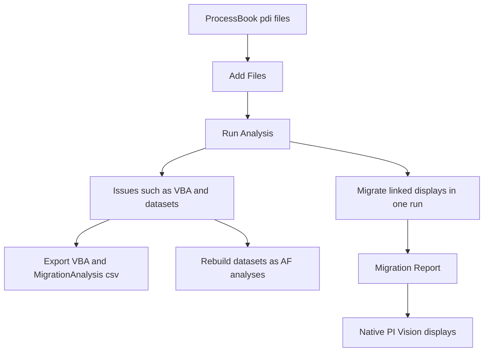

## Plain English

**PI ProcessBook** was OSIsoft's Windows desktop display tool. Operators and engineers built process
graphics in it, saved as **.pdi** files. By 2020 OSIsoft's own lab called it "a 25-year-old product
that has begun to show its age".

On 20 October 2021 AVEVA wrote: "we are officially retiring PI ProcessBook as we transition to AVEVA
PI Vision", because "the existing code base is outdated". A third-party article says security
updates were scheduled to end in 2022 and support in December 2024, and an AVEVA World 2024 session
said "PI ProcessBook support is coming to an end in December".

To move, AVEVA provides the **PI ProcessBook to PI Vision Migration Utility**, a separate install that
converts ProcessBook displays into native PI Vision displays.

## Deep Dive

**Background.** In 2016, ProcessBook displays could still be viewed through PI Coresight. PI Vision's
2017 strategy was to "provide PI ProcessBook customers a path forward" through process graphics, and
its graphics library offered the same symbols as ProcessBook. A 2018 timeline listed a "PI ProcessBook
Migration Tool" with PI Vision 2019.

**The workflow** (2020 lab):

1. **Add Files** and select folders of .pdi files.
2. **Run Analysis**, then review the result categories and issues.
3. **Export VBA**, which writes a .vba file and `MigrationAnalysis.csv` to a reports folder.
4. **Migrate.**
5. Review the **Migration Report**.

The 2022 slide sums this up as "Select, Analyze, Migrate".

**Migration settings:** PI Vision server URL, destination folder, Target Display Owner, Display
Sharing Access (for example World) and "Persist folder structure from migrated items".

**What does not carry over.**

- **VBA** "is not supported in PI Vision". Export it so you know what logic you are losing.
- **ProcessBook datasets** (calculations) are not carried over. The lab rebuilds them as AF analyses.

**Links between displays.** "In order to preserve links between PI ProcessBook displays, they must be
migrated in the same operation."

## Worked Example

A power plant has a ProcessBook home display `PG_Flynn_Home.pdi` that links to `PowerGeneration.pdi`.

1. The admin adds both files in one batch.
2. Run Analysis flags `PowerGeneration.pdi` as containing VBA and a dataset that totals hourly output.
3. She exports the VBA and reads it: the macro only changes a colour, which multi-state can do.
4. She rebuilds the dataset as an AF analysis so the total is available everywhere.
5. She sets the PI Vision URL, a destination folder, Target Display Owner, Display Sharing Access
   World and Persist folder structure, then migrates both displays together so the link still works.
6. She reviews the Migration Report and fixes the remaining items in PI Vision design mode.

## Diagram

## Common Mistakes

- **Migrating linked displays in separate runs,** which breaks the links between them.
- **Expecting VBA to work in PI Vision.** It does not; plan replacements.
- **Forgetting datasets.** They are not carried over; rebuild them as AF analyses.
- **Skipping the analysis step.** Analysis results show the problems before you migrate.

## Real-World Scenario

AVEVA's 2020 migration lab works through a power-generation example with displays such as
`PG_Flynn_Home.pdi` and `PowerGeneration.pdi`. Learners analyse the files, export the VBA, migrate the
displays into PI Vision with World sharing access, and then rebuild the ProcessBook datasets as AF
analyses. AVEVA World 2024 ran a session on the same topic with the warning that support was ending
in December, which is why many sites ran migration projects in 2024.
